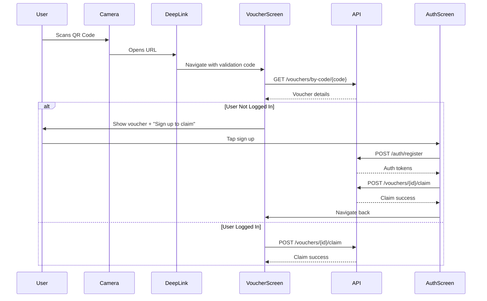

# Flutter QR Scan Implementation Plan

## Executive Summary

This document outlines the implementation plan for two critical features:

1. **Flutter Voucher Screen with Validation Codes** - Enable users to view vouchers from QR codes without authentication
2. **Account Creation Flow with Voucher Context** - Allow users to sign up while preserving voucher context for auto-claiming

## System Architecture Analysis

### Current State

✅ **What's Working:**

- Backend validation endpoints (`/vouchers/by-code/{code}`) work without authentication
- Deep link service extracts validation codes from URLs
- Voucher service has proper error handling
- Navigation structure supports voucher detail screens

❌ **What's Missing:**

- Voucher screen doesn't use validation codes
- No fallback for expired/invalid codes
- Account creation doesn't preserve voucher context
- No auto-claim after signup

### Data Flow Architecture



## Implementation Plan

### Part 1: Flutter Voucher Screen with Validation Codes

#### 1.1 Add Validation Code Support to VoucherService

**File:** `/lib/core/services/voucher/voucher_service.dart`

```dart
/// Get voucher by validation code (no auth required)
Future<VoucherResponse> getVoucherByCode(String validationCode) async {
  try {
    final response = await _apiClient.get(
      '/vouchers/by-code/$validationCode',
      // No auth header needed - public endpoint
      options: Options(
        headers: {'X-Skip-Auth': 'true'}, // Skip auth interceptor
      ),
    );

    if (response.data == null) {
      throw VoucherNotFoundException('Invalid or expired validation code');
    }

    return VoucherResponse.fromJson(response.data);
  } on DioException catch (e) {
    if (e.response?.statusCode == 404) {
      throw VoucherExpiredException('This voucher link has expired. Please request a new one.');
    }
    throw VoucherServiceException('Failed to fetch voucher: ${e.message}');
  }
}
```

#### 1.2 Create Validation Code Provider

**File:** `/lib/features/voucher/presentation/providers/voucher_validation_provider.dart`

```dart
import 'package:flutter_riverpod/flutter_riverpod.dart';
import '../../../../generated/api/voucher_voucher.dart';
import '../../../../core/services/voucher/voucher_service.dart';

// Provider for fetching voucher by validation code
final voucherByCodeProvider = FutureProvider.family<VoucherResponse, String>(
  (ref, validationCode) async {
    final service = ref.watch(voucherServiceProvider);
    return service.getVoucherByCode(validationCode);
  },
);

// State provider for tracking voucher context during signup
final pendingVoucherProvider = StateProvider<PendingVoucher?>((ref) => null);

class PendingVoucher {
  final String voucherId;
  final String? validationCode;
  final VoucherResponse voucher;

  PendingVoucher({
    required this.voucherId,
    this.validationCode,
    required this.voucher,
  });
}
```

#### 1.3 Update VoucherDetailScreen

**File:** `/lib/features/voucher/presentation/screens/voucher_detail_screen.dart`

```dart
class VoucherDetailScreen extends ConsumerWidget {
  final String voucherId;
  final String? validationCode; // NEW: Accept validation code

  const VoucherDetailScreen({
    super.key,
    required this.voucherId,
    this.validationCode, // NEW
  });

  @override
  Widget build(BuildContext context, WidgetRef ref) {
    // Try validation code first, fall back to voucher ID
    final voucherAsync = validationCode != null
        ? ref.watch(voucherByCodeProvider(validationCode!))
        : ref.watch(voucherDetailProvider(voucherId));

    return Scaffold(
      body: voucherAsync.when(
        loading: () => _buildLoadingState(),
        error: (error, stack) => _buildErrorState(error, ref),
        data: (voucher) => _buildVoucherContent(voucher, ref, context),
      ),
    );
  }

  Widget _buildErrorState(Object error, WidgetRef ref) {
    if (error is VoucherExpiredException) {
      return ExpiredVoucherView(
        message: error.message,
        onRetry: () => ref.invalidate(voucherByCodeProvider),
      );
    }
    // ... existing error handling
  }

  Widget _buildVoucherContent(VoucherResponse voucher, WidgetRef ref, BuildContext context) {
    final authState = ref.watch(authStateProvider);
    final isAuthenticated = authState is AuthAuthenticated;

    return Stack(
      children: [
        // ... existing voucher content

        // Bottom CTA based on auth state
        if (!isAuthenticated)
          _buildGuestCTA(voucher, ref, context)
        else
          _buildAuthenticatedCTA(voucher, ref, context),
      ],
    );
  }

  Widget _buildGuestCTA(VoucherResponse voucher, WidgetRef ref, BuildContext context) {
    return Container(
      padding: EdgeInsets.all(20.w),
      child: Column(
        mainAxisSize: MainAxisSize.min,
        children: [
          ElevatedButton(
            onPressed: () {
              // Store voucher context for after signup
              ref.read(pendingVoucherProvider.notifier).state = PendingVoucher(
                voucherId: voucher.id,
                validationCode: validationCode,
                voucher: voucher,
              );

              // Navigate to signup
              context.push('/register?returnTo=/voucher/${voucher.id}');
            },
            child: Text('Sign Up to Claim This Voucher'),
          ),
          TextButton(
            onPressed: () {
              ref.read(pendingVoucherProvider.notifier).state = PendingVoucher(
                voucherId: voucher.id,
                validationCode: validationCode,
                voucher: voucher,
              );
              context.push('/login?returnTo=/voucher/${voucher.id}');
            },
            child: Text('Already have an account? Log in'),
          ),
        ],
      ),
    );
  }
}
```

#### 1.4 Update Router to Accept Validation Code

**File:** `/lib/core/routing/app_router.dart`

```dart
GoRoute(
  path: '/voucher/:id',
  builder: (context, state) {
    final voucherId = state.pathParameters['id']!;
    final extras = state.extra as Map<String, dynamic>?;
    final validationCode = extras?['validationCode'] as String?;

    return VoucherDetailScreen(
      voucherId: voucherId,
      validationCode: validationCode,
    );
  },
),
```

### Part 2: Account Creation Flow with Voucher Context

#### 2.1 Update Registration Screen

**File:** `/lib/features/auth/presentation/screens/register_screen.dart`

```dart
class RegisterScreen extends ConsumerStatefulWidget {
  final String? returnTo; // Optional return path after registration

  const RegisterScreen({
    super.key,
    this.returnTo,
  });

  @override
  ConsumerState<RegisterScreen> createState() => _RegisterScreenState();
}

class _RegisterScreenState extends ConsumerState<RegisterScreen> {
  // ... existing fields

  Future<void> _handleRegister() async {
    // ... existing validation

    try {
      await authNotifier.register(
        email: _emailController.text.trim(),
        password: _passwordController.text,
        firstName: _firstNameController.text.trim(),
        lastName: _lastNameController.text.trim(),
        role: _selectedRole,
        phoneNumber: _phoneController.text.trim(),
      );

      final authState = ref.read(authStateProvider);

      if (authState is AuthAuthenticated) {
        // Check for pending voucher to claim
        final pendingVoucher = ref.read(pendingVoucherProvider);

        if (pendingVoucher != null) {
          try {
            // Auto-claim the voucher
            final voucherService = ref.read(voucherServiceProvider);
            await voucherService.claimVoucher(pendingVoucher.voucherId);

            // Clear pending voucher
            ref.read(pendingVoucherProvider.notifier).state = null;

            // Show success message
            if (mounted) {
              ScaffoldMessenger.of(context).showSnackBar(
                SnackBar(
                  content: Text('Welcome! Voucher "${pendingVoucher.voucher.title}" has been added to your account'),
                  backgroundColor: Colors.green,
                ),
              );
            }
          } catch (e) {
            // Log error but don't block registration flow
            print('Failed to auto-claim voucher: $e');
          }
        }

        // Navigate to return path or home
        if (mounted) {
          if (widget.returnTo != null) {
            context.go(widget.returnTo!);
          } else {
            context.go(AppRoutes.home);
          }
        }
      }
    } catch (error) {
      _handleRegistrationError(error);
    }
  }

  @override
  Widget build(BuildContext context) {
    final pendingVoucher = ref.watch(pendingVoucherProvider);

    return Scaffold(
      body: SafeArea(
        child: SingleChildScrollView(
          child: Column(
            children: [
              // Show pending voucher banner if exists
              if (pendingVoucher != null)
                _buildPendingVoucherBanner(pendingVoucher),

              // ... existing form fields
            ],
          ),
        ),
      ),
    );
  }

  Widget _buildPendingVoucherBanner(PendingVoucher voucher) {
    return Container(
      padding: EdgeInsets.all(16.w),
      color: Colors.blue.withOpacity(0.1),
      child: Row(
        children: [
          Icon(Icons.card_giftcard, color: Colors.blue),
          SizedBox(width: 12.w),
          Expanded(
            child: Column(
              crossAxisAlignment: CrossAxisAlignment.start,
              children: [
                Text(
                  'Sign up to claim:',
                  style: TextStyle(fontSize: 12.sp, color: Colors.grey),
                ),
                Text(
                  voucher.voucher.title,
                  style: TextStyle(
                    fontSize: 14.sp,
                    fontWeight: FontWeight.bold,
                  ),
                ),
              ],
            ),
          ),
        ],
      ),
    );
  }
}
```

#### 2.2 Create Voucher Claim Handler

**File:** `/lib/features/auth/domain/usecases/claim_pending_voucher_usecase.dart`

```dart
import 'package:flutter_riverpod/flutter_riverpod.dart';
import '../../../../core/services/voucher/voucher_service.dart';
import '../../../voucher/presentation/providers/voucher_validation_provider.dart';

class ClaimPendingVoucherUseCase {
  final VoucherService _voucherService;
  final Ref _ref;

  ClaimPendingVoucherUseCase(this._voucherService, this._ref);

  Future<bool> execute() async {
    final pendingVoucher = _ref.read(pendingVoucherProvider);

    if (pendingVoucher == null) {
      return false;
    }

    try {
      await _voucherService.claimVoucher(pendingVoucher.voucherId);

      // Clear pending voucher after successful claim
      _ref.read(pendingVoucherProvider.notifier).state = null;

      return true;
    } catch (e) {
      print('Failed to claim pending voucher: $e');
      return false;
    }
  }
}
```

### Part 3: Error Handling & Edge Cases

#### 3.1 Expired Validation Code Handler

**File:** `/lib/features/voucher/presentation/widgets/expired_voucher_view.dart`

```dart
class ExpiredVoucherView extends StatelessWidget {
  final String message;
  final VoidCallback? onRetry;
  final VoidCallback? onRequestNew;

  const ExpiredVoucherView({
    super.key,
    required this.message,
    this.onRetry,
    this.onRequestNew,
  });

  @override
  Widget build(BuildContext context) {
    return Center(
      child: Padding(
        padding: EdgeInsets.all(24.w),
        child: Column(
          mainAxisAlignment: MainAxisAlignment.center,
          children: [
            Icon(
              Icons.timer_off,
              size: 80.sp,
              color: Colors.orange,
            ),
            SizedBox(height: 24.h),
            Text(
              'Voucher Link Expired',
              style: TextStyle(
                fontSize: 24.sp,
                fontWeight: FontWeight.bold,
              ),
            ),
            SizedBox(height: 16.h),
            Text(
              message,
              textAlign: TextAlign.center,
              style: TextStyle(
                fontSize: 16.sp,
                color: Colors.grey,
              ),
            ),
            SizedBox(height: 32.h),
            if (onRetry != null)
              ElevatedButton(
                onPressed: onRetry,
                child: Text('Try Again'),
              ),
            if (onRequestNew != null) ...[
              SizedBox(height: 12.h),
              OutlinedButton(
                onPressed: onRequestNew,
                child: Text('Request New Link'),
              ),
            ],
            SizedBox(height: 12.h),
            TextButton(
              onPressed: () => context.go('/vouchers'),
              child: Text('Browse All Vouchers'),
            ),
          ],
        ),
      ),
    );
  }
}
```

#### 3.2 Network Resilience

**File:** `/lib/core/services/api/resilient_api_client.dart`

```dart
import 'package:dio/dio.dart';
import 'package:dio_smart_retry/dio_smart_retry.dart';

class ResilientApiClient {
  late final Dio _dio;

  ResilientApiClient({required String baseUrl}) {
    _dio = Dio(BaseOptions(
      baseURL: baseUrl,
      connectTimeout: const Duration(seconds: 10),
      receiveTimeout: const Duration(seconds: 10),
    ));

    // Add retry interceptor
    _dio.interceptors.add(
      RetryInterceptor(
        dio: _dio,
        retries: 3,
        retryDelays: const [
          Duration(seconds: 1),
          Duration(seconds: 2),
          Duration(seconds: 3),
        ],
        retryableExtraStatuses: {503, 504},
      ),
    );

    // Add offline cache interceptor
    _dio.interceptors.add(OfflineCacheInterceptor());
  }

  Future<Response> getVoucherByCode(String code) async {
    return _dio.get(
      '/vouchers/by-code/$code',
      options: Options(
        extra: {
          'cache': true,
          'cacheMaxAge': const Duration(minutes: 5),
        },
      ),
    );
  }
}
```

### Part 4: Testing Strategy

#### 4.1 Unit Tests

```dart
// test/voucher/validation_code_test.dart
void main() {
  group('Validation Code Flow', () {
    test('should fetch voucher by validation code without auth', () async {
      final service = MockVoucherService();
      when(service.getVoucherByCode('XXXX-XXXX'))
          .thenAnswer((_) async => mockVoucher);

      final result = await service.getVoucherByCode('XXXX-XXXX');

      expect(result.id, equals(mockVoucher.id));
      verify(service.getVoucherByCode('XXXX-XXXX')).called(1);
    });

    test('should handle expired validation codes', () async {
      final service = MockVoucherService();
      when(service.getVoucherByCode('EXPIRED'))
          .thenThrow(VoucherExpiredException('Code expired'));

      expect(
        () => service.getVoucherByCode('EXPIRED'),
        throwsA(isA<VoucherExpiredException>()),
      );
    });
  });
}
```

#### 4.2 Integration Tests

```dart
// integration_test/qr_scan_flow_test.dart
void main() {
  testWidgets('Complete QR scan to claim flow', (tester) async {
    // 1. Simulate deep link with validation code
    await tester.pumpWidget(
      ProviderScope(
        child: MyApp(
          initialRoute: '/voucher/123?c=XXXX-XXXX',
        ),
      ),
    );

    // 2. Wait for voucher to load
    await tester.pumpAndSettle();

    // 3. Verify voucher is displayed
    expect(find.text('Special Offer'), findsOneWidget);

    // 4. Tap sign up button
    await tester.tap(find.text('Sign Up to Claim'));
    await tester.pumpAndSettle();

    // 5. Fill registration form
    await tester.enterText(find.byKey(Key('email')), 'test@example.com');
    await tester.enterText(find.byKey(Key('password')), 'Test123!');
    await tester.enterText(find.byKey(Key('firstName')), 'John');
    await tester.enterText(find.byKey(Key('lastName')), 'Doe');

    // 6. Submit registration
    await tester.tap(find.text('Create Account'));
    await tester.pumpAndSettle();

    // 7. Verify voucher is claimed
    expect(find.text('Voucher added to your account'), findsOneWidget);
  });
}
```

### Part 5: Implementation Timeline

#### Phase 1: Core Validation Code Support (2 hours)

1. Update VoucherService with getVoucherByCode method
2. Create validation code provider
3. Add error handling for expired codes

#### Phase 2: Update Voucher Screen (3 hours)

1. Modify VoucherDetailScreen to accept validation code
2. Implement guest vs authenticated CTAs
3. Add expired voucher view
4. Update router configuration

#### Phase 3: Account Creation Flow (3 hours)

1. Add pending voucher provider
2. Update RegisterScreen with voucher context
3. Implement auto-claim after signup
4. Add voucher banner in registration

#### Phase 4: Testing & Polish (2 hours)

1. Write unit tests for validation code flow
2. Create integration tests
3. Test edge cases (expired codes, network errors)
4. Add loading states and animations

## Success Criteria

✅ **Functional Requirements:**

- Users can view vouchers via QR scan without authentication
- Validation codes work and handle expiration gracefully
- Account creation preserves voucher context
- Vouchers are auto-claimed after successful signup
- Proper error messages for expired/invalid codes

✅ **Non-Functional Requirements:**

- Response time < 2 seconds for voucher fetch
- Graceful degradation for network errors
- Smooth animations and transitions
- Accessibility compliant UI
- Proper analytics tracking

## Risk Mitigation

| Risk                                  | Impact | Mitigation                                            |
| ------------------------------------- | ------ | ----------------------------------------------------- |
| Validation codes expire during signup | High   | Store voucher details locally, refresh code if needed |
| Network failure during claim          | Medium | Implement retry logic, queue claims for later         |
| User abandons signup                  | Low    | Save draft registration, send reminder email          |
| Duplicate claims                      | Medium | Backend validation prevents duplicates                |

## Dependencies

- Backend validation endpoints (✅ Already implemented)
- Deep link configuration (✅ Already configured)
- API client with proper error handling (🔧 Needs enhancement)
- State management setup (✅ Riverpod configured)

## Monitoring & Analytics

Track the following metrics:

- QR scan to view conversion rate
- View to signup conversion rate
- Signup to claim success rate
- Validation code expiration rate
- Error rates by type

## Rollback Strategy

If issues occur:

1. Feature flag to disable validation code flow
2. Fall back to authenticated-only voucher viewing
3. Manual voucher claiming through support
4. Clear error messaging to users

## Next Steps

After implementation:

1. A/B test different CTA messages
2. Optimize validation code TTLs
3. Add social sharing after claim
4. Implement voucher gifting feature
5. Create business dashboard for QR analytics
