# VoucherBook Platform - Visual Flow Guide

## 📱 Overview

VoucherBook is a digital platform that connects businesses with customers through discount vouchers. Think of it as a digital coupon book that works on smartphones and can also be printed.

---

## 🎯 Main Actors in the System

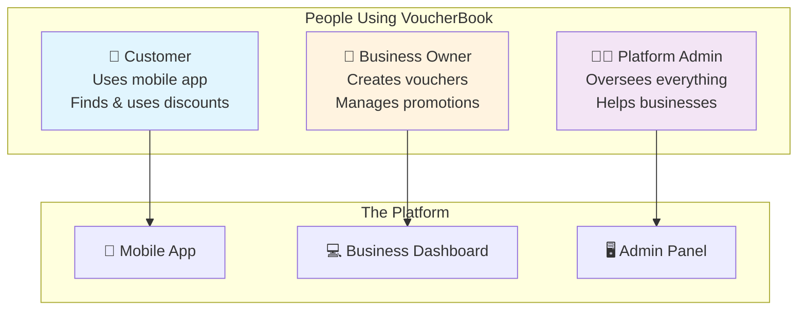

---

## 1️⃣ How Businesses Create Vouchers

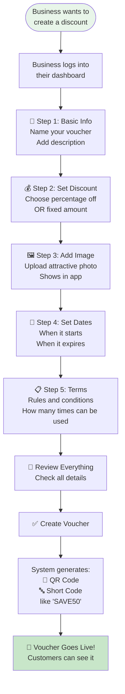

---

## 2️⃣ How Customers Find and Save Vouchers

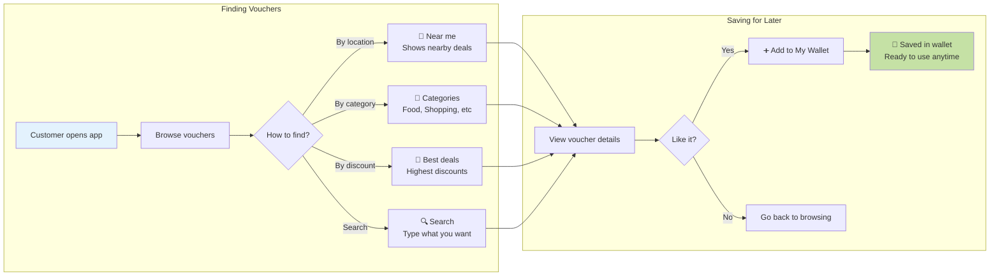

---

## 3️⃣ Using a Voucher at the Store

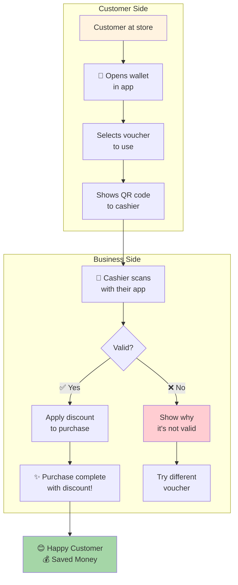

---

## 4️⃣ Voucher Lifecycle - From Creation to Expiry

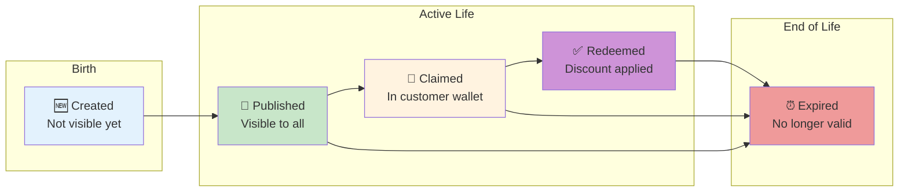

---

## 5️⃣ Physical Voucher Books (Printed Version)

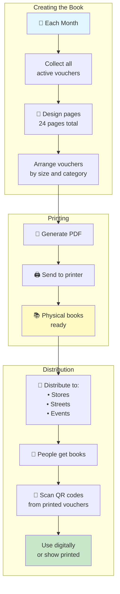

---

## 6️⃣ Different Ways to Discover Vouchers

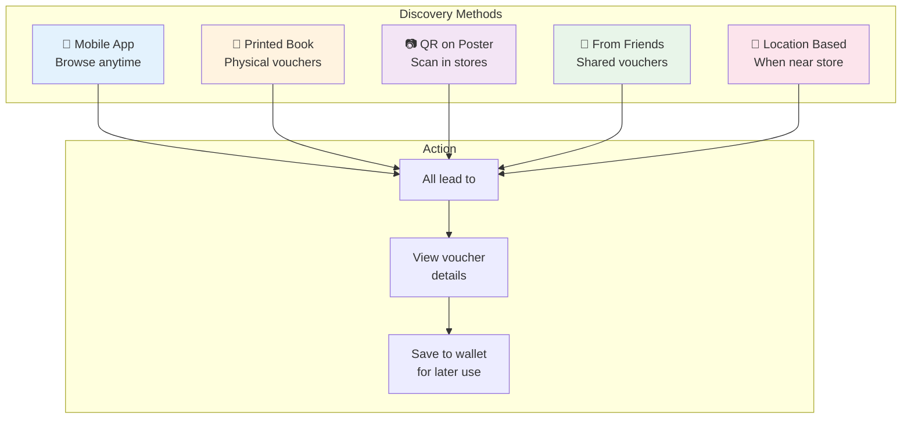

---

## 7️⃣ Security Features (Simple View)

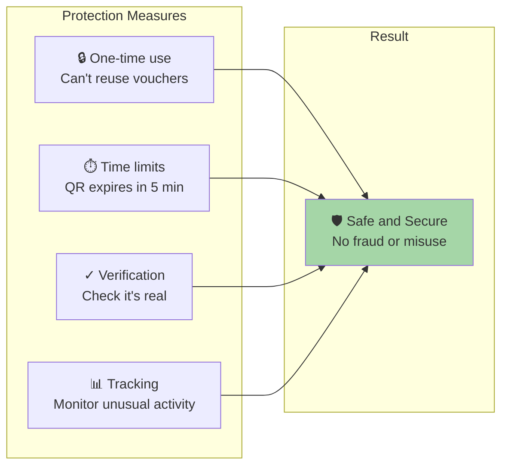

---

## 8️⃣ Business Benefits Dashboard

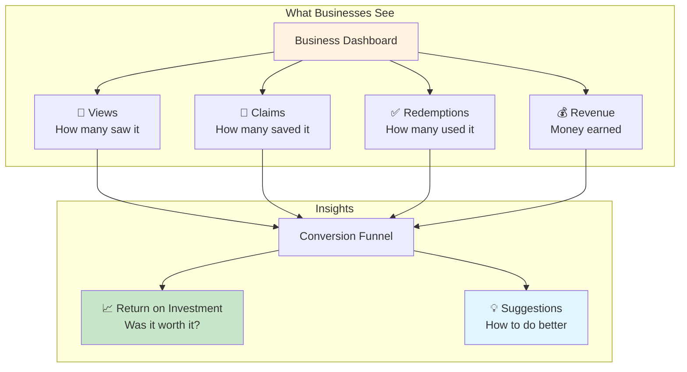

---

## 9️⃣ Complete Customer Journey

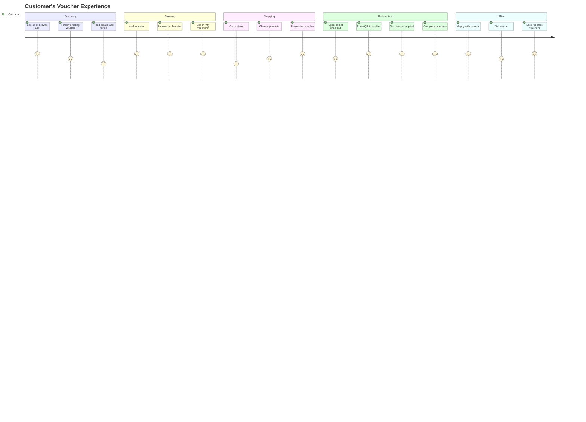

---

## 🔄 Quick Reference: Common Flows

### For Customers:

1. **Find** → Browse or search for vouchers
2. **Save** → Add to wallet for later
3. **Use** → Show QR at checkout
4. **Save Money** → Enjoy your discount!

### For Businesses:

1. **Create** → Make attractive vouchers
2. **Publish** → Make them available
3. **Track** → Watch performance
4. **Improve** → Make better vouchers

### For Admins:

1. **Oversee** → Monitor all activity
2. **Support** → Help businesses succeed
3. **Analyze** → Platform-wide insights
4. **Optimize** → Improve the system

---

## 📊 Key Metrics Explained Simply

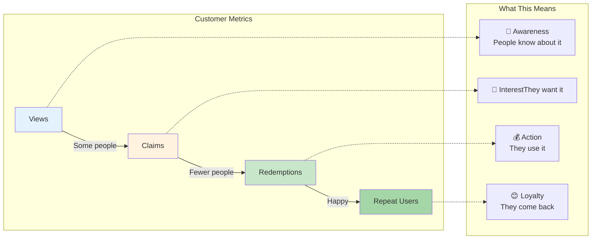

---

## 🌟 Success Story Flow

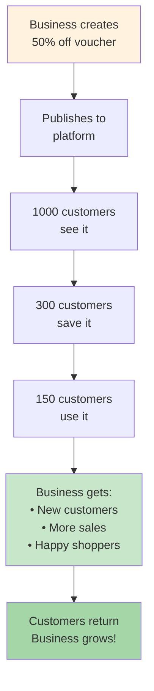

---

## 📱 Technology (Simplified)

Without getting technical, here's what makes it work:

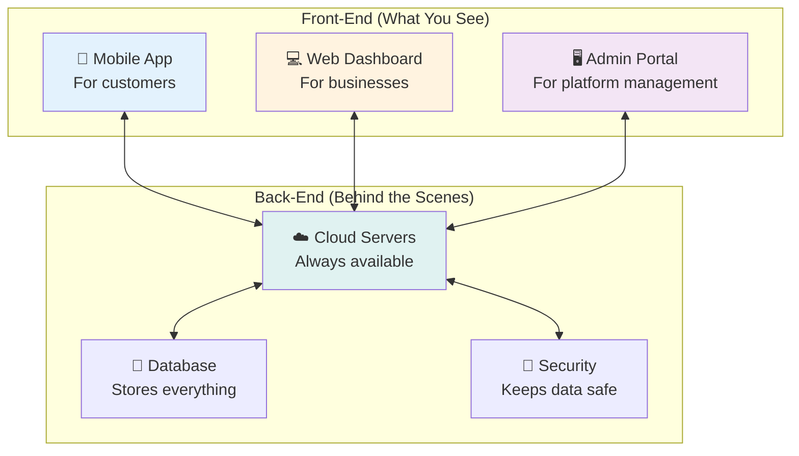

---

## 💡 Key Takeaways

### For Business Owners:

- ✅ Easy to create vouchers
- ✅ Track performance in real-time
- ✅ Reach more customers
- ✅ Increase sales

### For Customers:

- ✅ Find great deals easily
- ✅ Save money on purchases
- ✅ Simple to use
- ✅ Always in your phone

### For the Platform:

- ✅ Connects businesses and customers
- ✅ Supports local economy
- ✅ Modern and secure
- ✅ Works online and offline
