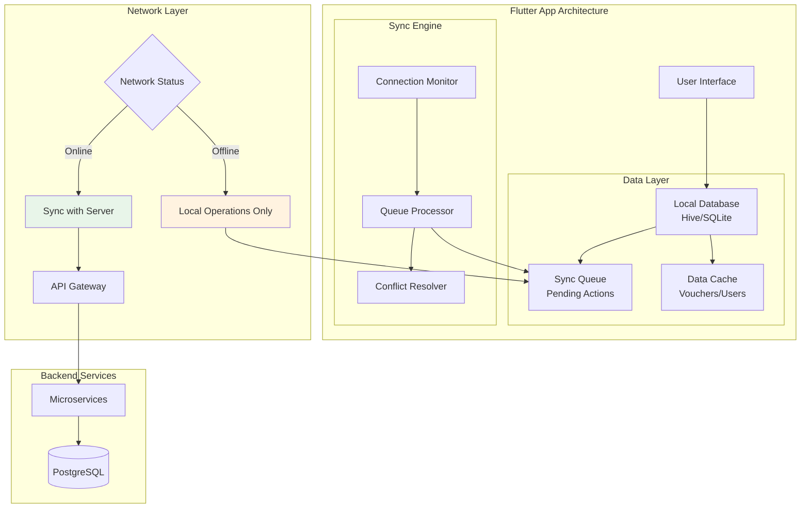
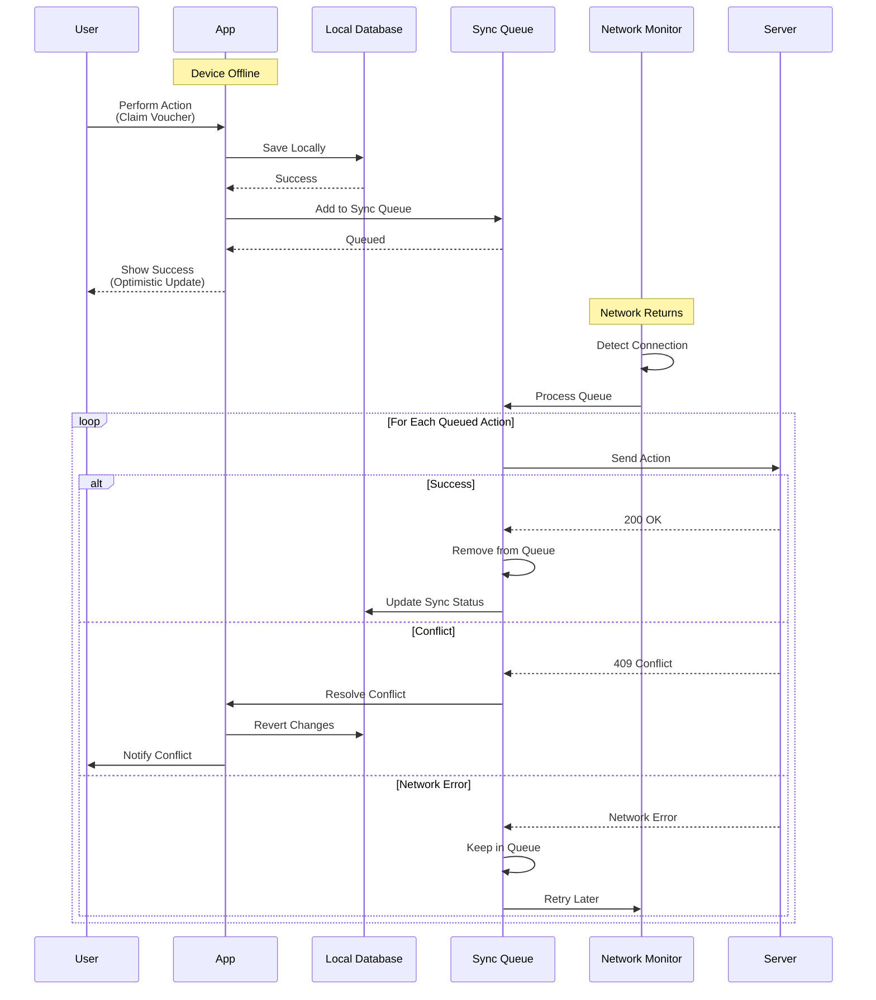
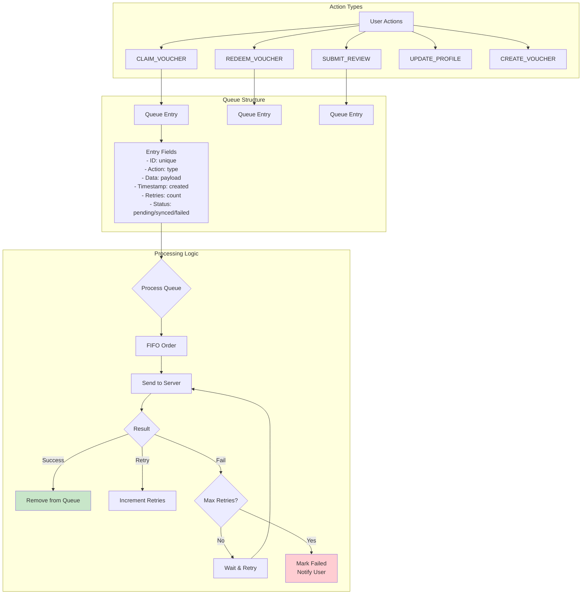
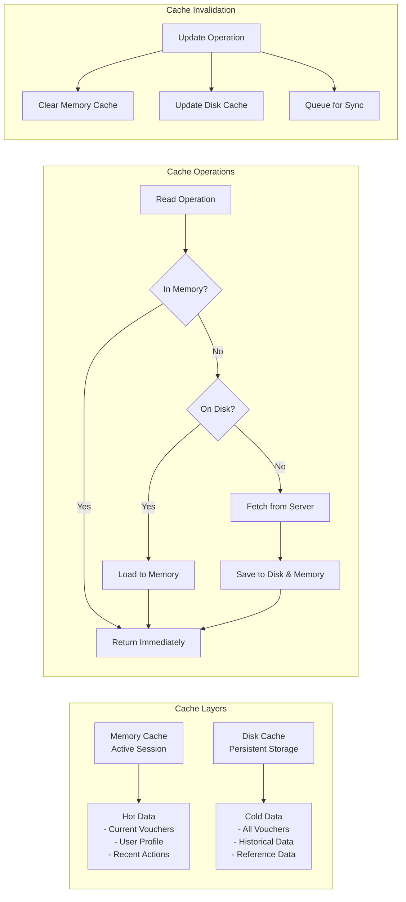
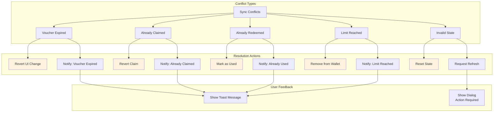
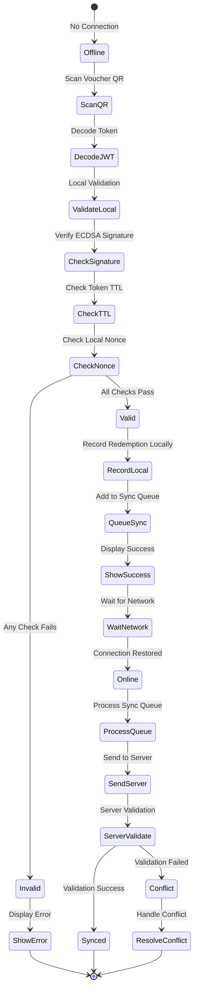
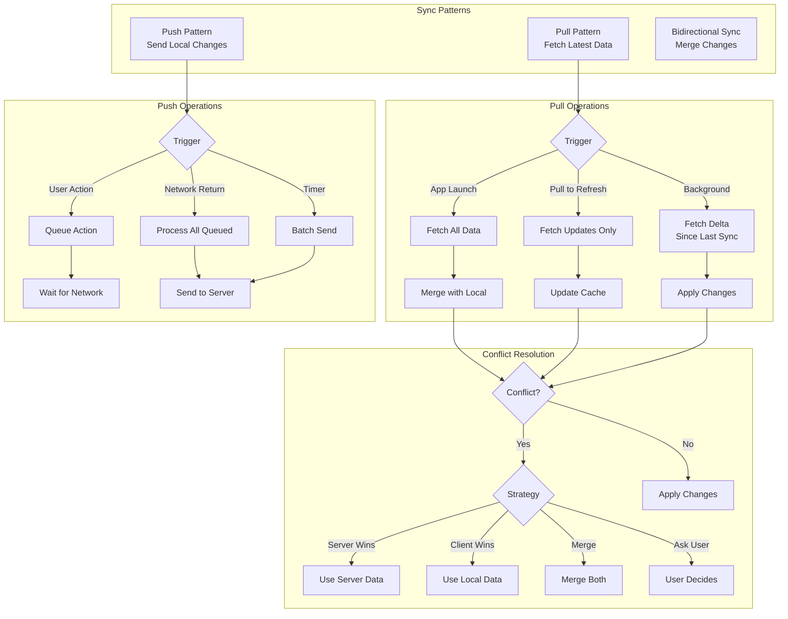
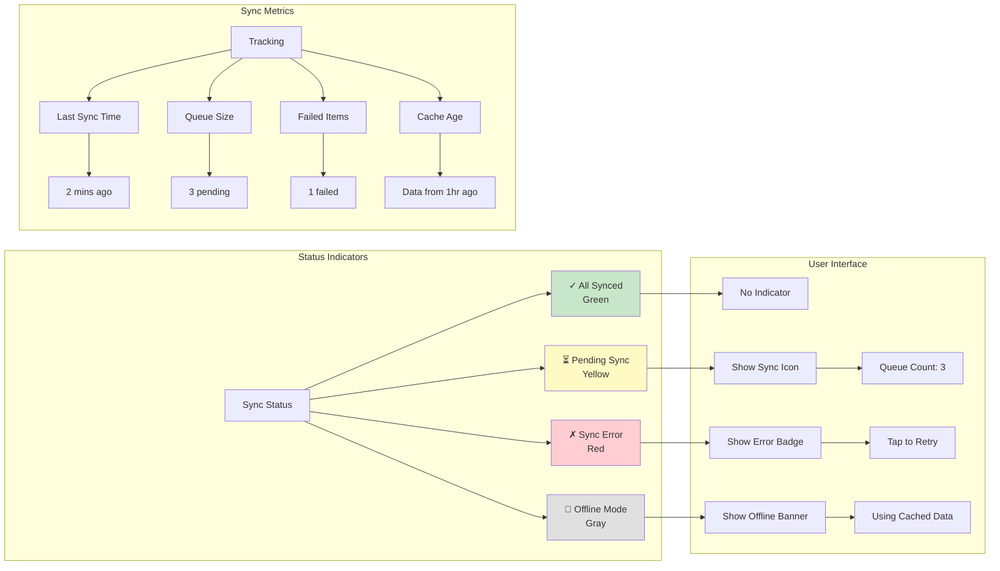
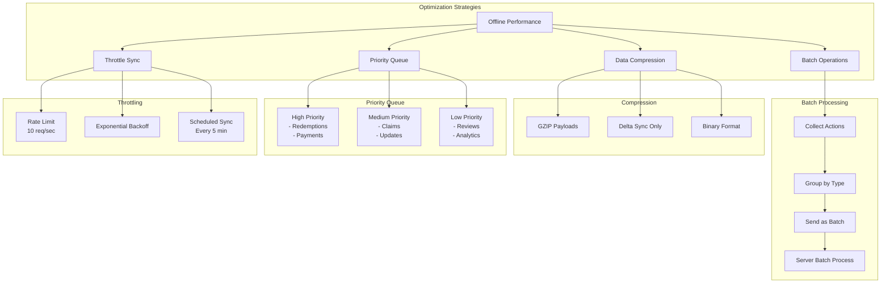

# VoucherBook Platform - Offline Synchronization Architecture

## Offline-First Architecture Overview

## Offline Data Flow

## Sync Queue Management

## Local Data Caching Strategy

## Conflict Resolution Strategies

## Offline Redemption Process

## Data Synchronization Patterns

## Sync Status Monitoring

## Performance Optimization

