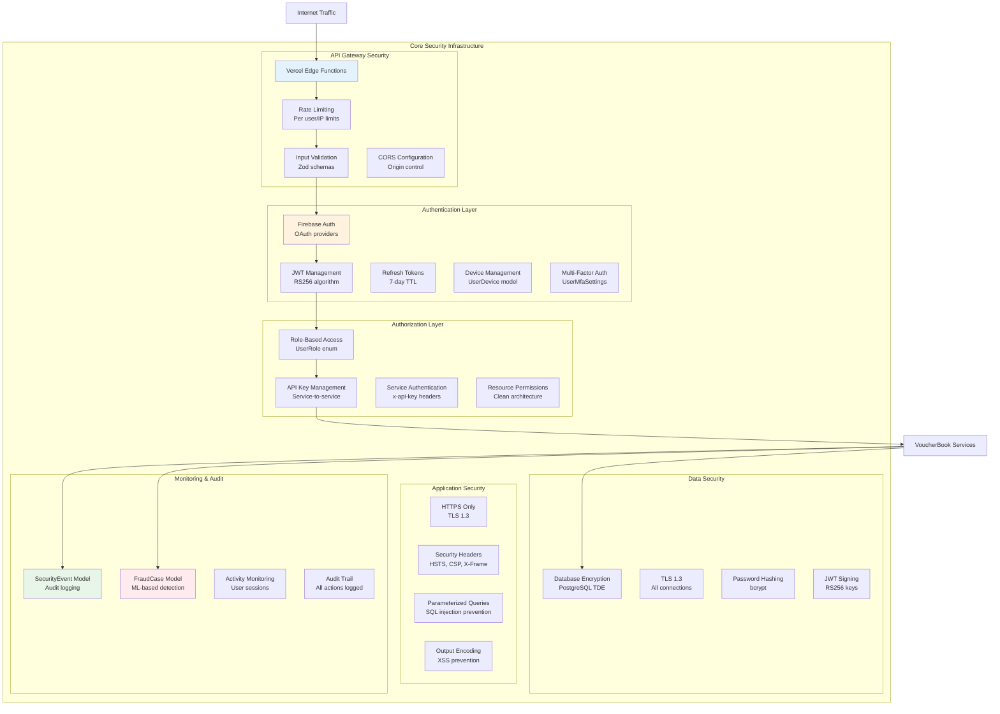
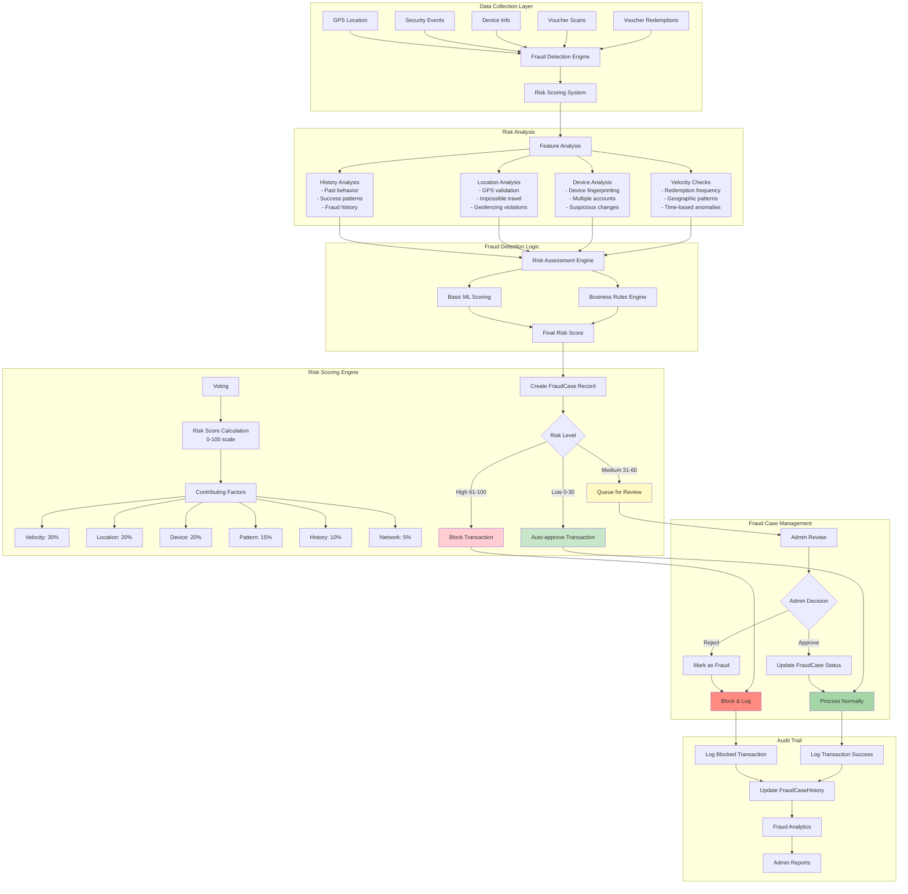
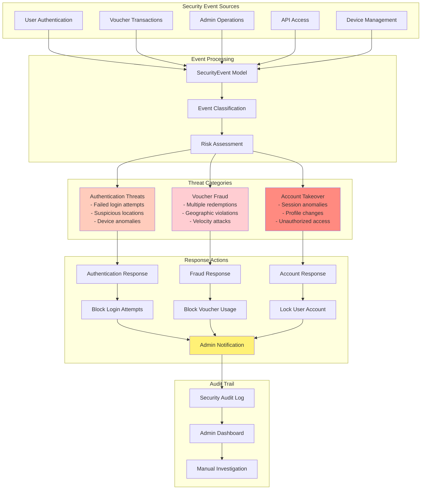
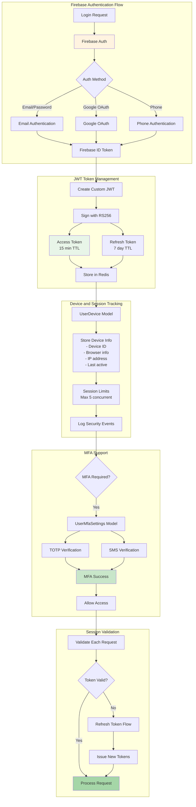
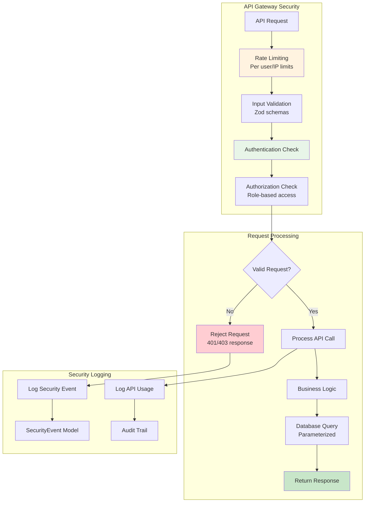

# VoucherBook Platform - Security and Fraud Detection Architecture (Enhanced)

## VoucherBook Security Architecture Overview

## VoucherBook Fraud Detection System

## VoucherBook Security Event Monitoring

## VoucherBook Authentication and Session Management

## VoucherBook API Security Overview

