# VoucherBook Platform - User Journey Flows

## Customer Journey: Discovery to Redemption (Enhanced)

```mermaid
graph TD
    Start([Customer Opens App]) --> CheckLocation{Location Services?}
    CheckLocation -->|Enabled| GetLocation[Get Current Location]
    CheckLocation -->|Disabled| PromptLocation[Prompt Enable Location]

    GetLocation --> CheckNotifications{Push Notifications?}
    PromptLocation --> CheckNotifications

    CheckNotifications -->|Enabled| LoadPersonalized[Load Personalized Feed]
    CheckNotifications -->|Disabled| LoadDefault[Load Default Feed]

    LoadPersonalized --> Browse[Browse Vouchers]
    LoadDefault --> Browse

    Browse --> Filter{Filter Options}

    Filter -->|By Location| NearMe[Near Me Deals<br/>GPS-based radius search]
    Filter -->|By Category| Category[Select Category<br/>Food, Shopping, Services, etc.]
    Filter -->|By Search| Search[Search Keywords<br/>Fuzzy matching & autocomplete]
    Filter -->|By Brand| BrandFilter[Filter by Brand/Store]
    Filter -->|By Discount| DiscountRange[Filter by Discount %]

    NearMe --> SortOptions{Sort By}
    Category --> SortOptions
    Search --> SortOptions
    BrandFilter --> SortOptions
    DiscountRange --> SortOptions

    SortOptions -->|Distance| VoucherList[View Voucher List]
    SortOptions -->|Popularity| VoucherList
    SortOptions -->|Expiry Date| VoucherList
    SortOptions -->|Discount Amount| VoucherList

    VoucherList --> ViewDetails[View Voucher Details<br/>Images, Description, Store Info]
    ViewDetails --> CheckExpiry[Check Expiration Status]

    CheckExpiry --> Valid{Still Valid?}
    Valid -->|No| ShowExpired[Show Expired Message]
    Valid -->|Yes| CheckTerms[Read Terms & Conditions<br/>Usage limits, restrictions]

    ShowExpired --> Browse
    CheckTerms --> CheckStock{Stock Available?}

    CheckStock -->|Limited| ShowLimited[Show Limited Stock Warning]
    CheckStock -->|Available| ShowAvailable[Stock Available]
    CheckStock -->|Out| ShowOutOfStock[Out of Stock]

    ShowLimited --> Decision{Interested?}
    ShowAvailable --> Decision
    ShowOutOfStock --> Browse

    Decision -->|Yes| CheckAuth{Authenticated?}
    Decision -->|No| SaveForLater{Save for Later?}

    SaveForLater -->|Yes| AddToWishlist[Add to Wishlist]
    SaveForLater -->|No| Browse
    AddToWishlist --> Browse

    CheckAuth -->|No| LoginPrompt[Prompt to Login/Register]
    CheckAuth -->|Yes| Claim[Claim to Wallet]

    LoginPrompt --> Login{Login Success?}
    Login -->|Yes| Claim
    Login -->|No| Browse

    Claim --> CheckLimit{Usage Limit?}
    CheckLimit -->|Exceeded| ShowLimitError[Show Limit Exceeded]
    CheckLimit -->|OK| SavedWallet[Saved in Wallet<br/>Generate unique code]

    ShowLimitError --> Browse
    SavedWallet --> NotifySuccess[Show Success Notification]
    NotifySuccess --> ViewWallet{View Wallet?}

    ViewWallet -->|Yes| WalletView[Open Wallet View]
    ViewWallet -->|No| ContinueBrowse[Continue Browsing]

    WalletView --> SelectVoucher[Select Voucher to Use]
    ContinueBrowse --> Browse

    SelectVoucher --> GoToStore[Navigate to Store<br/>Show directions]
    GoToStore --> ArriveStore[Arrive at Store]

    ArriveStore --> OpenVoucher[Open Voucher]
    OpenVoucher --> CheckConnectivity{Internet Available?}

    CheckConnectivity -->|Yes| OnlineRedeem[Online Redemption Mode]
    CheckConnectivity -->|No| OfflineRedeem[Offline Redemption Mode]

    OnlineRedeem --> ShowQR[Display Dynamic QR Code]
    OfflineRedeem --> ShowOfflineQR[Display Offline QR<br/>Cryptographically signed]

    ShowQR --> Scan[Retailer Scans Code]
    ShowOfflineQR --> Scan

    Scan --> Validate{Valid?}
    Validate -->|Yes| CheckUsage{Already Used?}
    Validate -->|No| ShowError[Show Error Details<br/>Invalid/Expired/Wrong Store]

    CheckUsage -->|Yes| ShowUsedError[Show Already Used Error]
    CheckUsage -->|No| ApplyDiscount[Apply Discount<br/>Calculate savings]

    ShowUsedError --> End([End])
    ShowError --> TryAgain{Try Again?}
    TryAgain -->|Yes| ShowQR
    TryAgain -->|Manual| ManualCode[Enter Code Manually]
    TryAgain -->|No| ContactSupport[Contact Support Option]

    ManualCode --> Validate
    ContactSupport --> End

    ApplyDiscount --> ProcessPayment[Process Payment]
    ProcessPayment --> Complete[Purchase Complete<br/>Record transaction]

    Complete --> SaveReceipt[Save Digital Receipt]
    SaveReceipt --> AwardPoints[Award Loyalty Points]
    AwardPoints --> ReviewPrompt[Prompt for Review<br/>Rate experience]

    ReviewPrompt --> WriteReview{Write Review?}
    WriteReview -->|Yes| RateExperience[Rate 1-5 Stars]
    WriteReview -->|No| SkipReview[Skip Review]

    RateExperience --> AddComment{Add Comment?}
    AddComment -->|Yes| WriteComment[Write Text Review]
    AddComment -->|No| SubmitRating[Submit Rating Only]

    WriteComment --> AddPhoto{Add Photo?}
    AddPhoto -->|Yes| UploadPhoto[Upload Photo]
    AddPhoto -->|No| SubmitReview[Submit Full Review]

    UploadPhoto --> SubmitReview
    SubmitRating --> ThankYou[Thank You Message]
    SubmitReview --> ThankYou
    SkipReview --> ThankYou

    ThankYou --> RecommendMore[Recommend Similar Vouchers]
    RecommendMore --> End

    style Start fill:#e8f5e9
    style Complete fill:#c8e6c9
    style End fill:#ffcdd2
    style ShowError fill:#ffcdd2
    style ShowUsedError fill:#ffcdd2
    style ShowLimitError fill:#ffcdd2
```

## Business/Retailer Journey: Voucher Creation to Analytics (Enhanced)

```mermaid
graph TD
    Start([Business Registration]) --> VerifyBusiness{Business Verification}
    VerifyBusiness -->|Pending| SubmitDocs[Submit Business Documents<br/>Tax ID, License, etc.]
    VerifyBusiness -->|Approved| SetupProfile[Setup Business Profile]

    SubmitDocs --> AdminReview[Admin Reviews Documents]
    AdminReview --> ApprovalStatus{Approved?}
    ApprovalStatus -->|No| RequestMore[Request More Info]
    ApprovalStatus -->|Yes| SetupProfile
    RequestMore --> SubmitDocs

    SetupProfile --> AddDetails[Add Business Details<br/>Logo, Description, Hours]
    AddDetails --> AddLocations[Add Store Locations<br/>Multiple branches support]
    AddLocations --> SetPayment[Setup Payment Method<br/>For subscription/fees]

    SetPayment --> ChoosePlan{Choose Subscription Plan}
    ChoosePlan -->|Free| FreeTier[Limited Features<br/>5 vouchers/month]
    ChoosePlan -->|Basic| BasicTier[Basic Features<br/>20 vouchers/month]
    ChoosePlan -->|Premium| PremiumTier[All Features<br/>Unlimited vouchers]

    FreeTier --> Dashboard[Access Dashboard]
    BasicTier --> Dashboard
    PremiumTier --> Dashboard

    Dashboard --> Action{Select Action}
    Action -->|Create| CreateNew[Create New Voucher]
    Action -->|Manage| ManageExisting[Manage Existing]
    Action -->|Analytics| ViewAnalytics[View Analytics]
    Action -->|Settings| BusinessSettings[Business Settings]

    CreateNew --> ChooseType{Voucher Type}
    ChooseType -->|Percentage| PercentageOff[Set % Discount]
    ChooseType -->|Fixed Amount| FixedAmount[Set $ Amount Off]
    ChooseType -->|BOGO| BuyOneGetOne[Configure BOGO Deal]
    ChooseType -->|Free Item| FreeItem[Select Free Product]

    PercentageOff --> FillDetails[Fill Voucher Details]
    FixedAmount --> FillDetails
    BuyOneGetOne --> FillDetails
    FreeItem --> FillDetails

    FillDetails --> AddMedia[Add Images/Videos<br/>Product photos, promo videos]
    AddMedia --> SetCategory[Select Categories<br/>Multiple category tags]
    SetCategory --> SetTerms[Set Terms & Conditions<br/>Restrictions, exclusions]

    SetTerms --> SetSchedule{Schedule Type}
    SetSchedule -->|Always Active| AlwaysOn[No time restrictions]
    SetSchedule -->|Date Range| DateRange[Set Start/End Dates]
    SetSchedule -->|Recurring| Recurring[Set Weekly/Monthly Pattern]
    SetSchedule -->|Happy Hours| TimeSlots[Specific Time Slots]

    AlwaysOn --> SetExpiry[Set Expiration Date]
    DateRange --> SetExpiry
    Recurring --> SetExpiry
    TimeSlots --> SetExpiry

    SetExpiry --> SetLimits[Configure Limits]
    SetLimits --> LimitType{Limit Type}

    LimitType -->|Total Uses| TotalLimit[Set Total Redemption Limit]
    LimitType -->|Per Customer| PerCustomer[Limit Per Customer]
    LimitType -->|Daily Limit| DailyLimit[Daily Redemption Cap]
    LimitType -->|No Limit| NoLimit[Unlimited Redemptions]

    TotalLimit --> SetMinPurchase[Set Minimum Purchase<br/>Optional threshold]
    PerCustomer --> SetMinPurchase
    DailyLimit --> SetMinPurchase
    NoLimit --> SetMinPurchase

    SetMinPurchase --> TargetAudience{Target Audience}
    TargetAudience -->|All Users| AllUsers[Available to Everyone]
    TargetAudience -->|New Customers| NewOnly[First-time Customers]
    TargetAudience -->|Loyal Customers| LoyalOnly[Repeat Customers]
    TargetAudience -->|Premium Members| PremiumOnly[Premium Subscribers]

    AllUsers --> SetPlacement[Choose Placement Options]
    NewOnly --> SetPlacement
    LoyalOnly --> SetPlacement
    PremiumOnly --> SetPlacement

    SetPlacement --> PlacementType{Placement Type}
    PlacementType -->|Digital Only| DigitalOnly[Mobile App Only]
    PlacementType -->|Print Only| PrintOnly[Physical Book Only]
    PlacementType -->|Both| BothPlacements[App + Physical Book]

    DigitalOnly --> Preview[Preview Voucher<br/>See customer view]
    PrintOnly --> SelectBookSlot[Select Book Ad Slot<br/>Premium/Standard placement]
    BothPlacements --> SelectBookSlot

    SelectBookSlot --> Preview
    Preview --> ReviewCost[Review Costs<br/>Placement fees, commissions]

    ReviewCost --> Approve{Approve & Publish?}
    Approve -->|Edit| FillDetails
    Approve -->|Save Draft| SaveDraft[Save as Draft]
    Approve -->|Publish| PayFees{Payment Required?}

    SaveDraft --> Dashboard
    PayFees -->|No| Publish[Publish Voucher]
    PayFees -->|Yes| ProcessPayment[Process Payment]

    ProcessPayment --> PaymentSuccess{Payment Success?}
    PaymentSuccess -->|No| PaymentError[Show Payment Error]
    PaymentSuccess -->|Yes| Publish
    PaymentError --> Dashboard

    Publish --> Live[Voucher Goes Live<br/>Start notifications]
    Live --> Monitor[Real-time Monitoring]

    Monitor --> CustomerFlow[Customer Redemption Flow]
    CustomerFlow --> CustomerArrives[Customer Arrives at Store]
    CustomerArrives --> StaffAction{Staff Action}

    StaffAction -->|Scan QR| ScanApp[Open Scanner in App]
    StaffAction -->|Manual Entry| ManualCode[Enter Code Manually]

    ScanApp --> ScanQR[Scan Customer QR Code]
    ManualCode --> EnterCode[Type Voucher Code]

    ScanQR --> ValidateCode{Valid Code?}
    EnterCode --> ValidateCode

    ValidateCode -->|Invalid| ShowInvalid[Show Invalid Reason<br/>Expired/Used/Wrong Location]
    ValidateCode -->|Valid| CheckConditions{Conditions Met?}

    ShowInvalid --> OverrideOption{Manager Override?}
    OverrideOption -->|Yes| ManagerAuth[Manager Authorization]
    OverrideOption -->|No| RejectRedeem[Reject Redemption]

    ManagerAuth --> OverrideReason[Log Override Reason]
    OverrideReason --> ProcessRedeem

    CheckConditions -->|Min Purchase Not Met| ShowMinPurchase[Show Min Purchase Required]
    CheckConditions -->|Wrong Time| ShowTimeRestriction[Show Time Restriction]
    CheckConditions -->|All Met| ProcessRedeem[Process Redemption]

    ShowMinPurchase --> RejectRedeem
    ShowTimeRestriction --> RejectRedeem

    ProcessRedeem --> ApplyDiscount[Apply Discount<br/>Calculate final price]
    ApplyDiscount --> CompleteTransaction[Complete Transaction]
    CompleteTransaction --> RecordSale[Record Sale Details<br/>Amount, items, timestamp]

    RecordSale --> UpdateInventory[Update Inventory<br/>If applicable]
    UpdateInventory --> SendReceipt[Send Digital Receipt<br/>Email/SMS to customer]
    SendReceipt --> UpdateAnalytics[Update Analytics<br/>Real-time metrics]

    UpdateAnalytics --> Monitor
    RejectRedeem --> Monitor

    ManageExisting --> VoucherList[View Active Vouchers]
    VoucherList --> SelectVoucher[Select Voucher]
    SelectVoucher --> VoucherAction{Action}

    VoucherAction -->|Edit| EditVoucher[Edit Details]
    VoucherAction -->|Pause| PauseVoucher[Temporarily Disable]
    VoucherAction -->|Delete| DeleteVoucher[Remove Voucher]
    VoucherAction -->|Duplicate| DuplicateVoucher[Create Copy]
    VoucherAction -->|Boost| BoostVoucher[Promote Voucher]

    EditVoucher --> SaveChanges[Save Changes]
    PauseVoucher --> Dashboard
    DeleteVoucher --> ConfirmDelete{Confirm?}
    DuplicateVoucher --> FillDetails
    BoostVoucher --> BoostOptions[Select Boost Package<br/>Featured, Top placement]

    ConfirmDelete -->|Yes| Dashboard
    ConfirmDelete -->|No| VoucherList
    SaveChanges --> Dashboard
    BoostOptions --> ProcessPayment

    ViewAnalytics --> SelectPeriod[Select Time Period<br/>Day/Week/Month/Custom]
    SelectPeriod --> LoadMetrics[Load Performance Metrics]

    LoadMetrics --> ShowDashboard[Analytics Dashboard]
    ShowDashboard --> Metrics[Key Metrics<br/>Views, Claims, Redemptions]

    Metrics --> Demographics[Customer Demographics<br/>Age, Location, Preferences]
    Demographics --> RevenueImpact[Revenue Impact<br/>Sales lift, Average basket]
    RevenueImpact --> ROI[Calculate ROI<br/>Cost vs Revenue]

    ROI --> ComparePerformance[Compare Vouchers<br/>A/B testing results]
    ComparePerformance --> ExportData{Export Data?}

    ExportData -->|Yes| GenerateReport[Generate Report<br/>PDF/Excel/CSV]
    ExportData -->|No| Decision{Campaign Decision}

    GenerateReport --> DownloadReport[Download Report]
    DownloadReport --> Decision

    Decision -->|Optimize| OptimizeVoucher[Adjust Parameters]
    Decision -->|Continue| Monitor
    Decision -->|End| EndCampaign[End Campaign]

    OptimizeVoucher --> EditVoucher
    EndCampaign --> ArchiveData[Archive Campaign Data]
    ArchiveData --> End([End])

    BusinessSettings --> SettingType{Setting Type}
    SettingType -->|Profile| UpdateProfile[Update Business Info]
    SettingType -->|Staff| ManageStaff[Add/Remove Staff<br/>Set permissions]
    SettingType -->|Billing| BillingSettings[Payment Methods<br/>Invoices, Subscription]
    SettingType -->|Notifications| NotifySettings[Alert Preferences<br/>Email, SMS, Push]
    SettingType -->|Integration| APISettings[API Keys<br/>Webhook configuration]

    UpdateProfile --> Dashboard
    ManageStaff --> Dashboard
    BillingSettings --> Dashboard
    NotifySettings --> Dashboard
    APISettings --> Dashboard

    style Start fill:#e3f2fd
    style Live fill:#bbdefb
    style ProcessRedeem fill:#c8e6c9
    style RejectRedeem fill:#ffcdd2
    style End fill:#ffcdd2
```

## Offline Redemption Flow

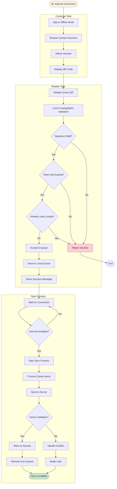

## Authentication & Registration Flows

### Customer Registration Flow

```mermaid
graph TD
    Start([New User Opens App]) --> WelcomeScreen[Welcome Screen<br/>App features overview]
    WelcomeScreen --> RegChoice{Registration Method}

    RegChoice -->|Email| EmailReg[Enter Email Address]
    RegChoice -->|Phone| PhoneReg[Enter Phone Number]
    RegChoice -->|Social| SocialChoice{Select Provider}
    RegChoice -->|Skip| BrowseGuest[Browse as Guest<br/>Limited features]

    SocialChoice -->|Google| GoogleAuth[Google OAuth Flow]
    SocialChoice -->|Facebook| FacebookAuth[Facebook OAuth Flow]
    SocialChoice -->|Apple| AppleAuth[Apple Sign In]

    EmailReg --> ValidateEmail{Valid Format?}
    ValidateEmail -->|No| EmailError[Show Email Error]
    ValidateEmail -->|Yes| CheckDuplicate{Email Exists?}

    EmailError --> EmailReg
    CheckDuplicate -->|Yes| ExistingAccount[Account Exists<br/>Suggest login]
    CheckDuplicate -->|No| SendVerification[Send Verification Code]

    PhoneReg --> ValidatePhone{Valid Format?}
    ValidatePhone -->|No| PhoneError[Show Phone Error]
    ValidatePhone -->|Yes| CheckPhoneDupe{Phone Exists?}

    PhoneError --> PhoneReg
    CheckPhoneDupe -->|Yes| ExistingAccount
    CheckPhoneDupe -->|No| SendSMS[Send SMS Code]

    ExistingAccount --> LoginRedirect[Redirect to Login]
    LoginRedirect --> End([End])

    SendVerification --> EnterCode[Enter Verification Code]
    SendSMS --> EnterCode

    EnterCode --> VerifyCode{Code Valid?}
    VerifyCode -->|No| CodeError[Invalid Code<br/>Show retry option]
    VerifyCode -->|Yes| SetPassword[Set Password]

    CodeError --> ResendOption{Resend Code?}
    ResendOption -->|Yes| SendVerification
    ResendOption -->|No| Start

    GoogleAuth --> OAuthCallback[OAuth Callback]
    FacebookAuth --> OAuthCallback
    AppleAuth --> OAuthCallback

    OAuthCallback --> CheckSocialAccount{Account Exists?}
    CheckSocialAccount -->|Yes| LoadProfile[Load Existing Profile]
    CheckSocialAccount -->|No| CreateSocialProfile[Create Profile from Social]

    SetPassword --> PasswordStrength{Strong Password?}
    PasswordStrength -->|No| WeakPassword[Show Requirements<br/>Min 8 chars, etc.]
    PasswordStrength -->|Yes| CreateProfile[Create User Profile]

    WeakPassword --> SetPassword

    CreateProfile --> BasicInfo[Enter Basic Info<br/>Name, DOB]
    CreateSocialProfile --> BasicInfo

    BasicInfo --> LocationPermission{Request Location?}
    LocationPermission -->|Allow| SaveLocation[Save User Location]
    LocationPermission -->|Deny| SkipLocation[Skip Location]

    SaveLocation --> NotificationPermission{Enable Notifications?}
    SkipLocation --> NotificationPermission

    NotificationPermission -->|Allow| ConfigureNotifications[Configure Preferences<br/>Deals, Expiry alerts]
    NotificationPermission -->|Deny| SkipNotifications[Skip Notifications]

    ConfigureNotifications --> InterestSelection[Select Interests<br/>Categories, Brands]
    SkipNotifications --> InterestSelection

    InterestSelection --> LanguageSelection[Select Language<br/>Spanish, English, Guaraní]
    LanguageSelection --> TermsConditions[Show Terms & Conditions]

    TermsConditions --> AcceptTerms{Accept?}
    AcceptTerms -->|No| CantProceed[Cannot Proceed<br/>Terms required]
    AcceptTerms -->|Yes| PrivacyPolicy[Show Privacy Policy]

    CantProceed --> TermsConditions

    PrivacyPolicy --> AcceptPrivacy{Accept?}
    AcceptPrivacy -->|No| CantProceed
    AcceptPrivacy -->|Yes| CompleteReg[Complete Registration]

    CompleteReg --> WelcomeBonus{Eligible for Bonus?}
    WelcomeBonus -->|Yes| AwardBonus[Award Welcome Vouchers]
    WelcomeBonus -->|No| ShowTutorial[Show App Tutorial]

    AwardBonus --> ShowTutorial
    ShowTutorial --> Tutorial{Complete Tutorial?}

    Tutorial -->|Yes| HomePage[Go to Home Page]
    Tutorial -->|Skip| HomePage

    LoadProfile --> HomePage
    HomePage --> End2([Registration Complete])

    BrowseGuest --> GuestLimit[Limited Features<br/>Can't claim vouchers]
    GuestLimit --> PromptRegister[Periodic Registration Prompts]
    PromptRegister --> End

    style Start fill:#e8f5e9
    style HomePage fill:#c8e6c9
    style End fill:#ffcdd2
    style End2 fill:#c8e6c9
    style CantProceed fill:#ffcdd2
```

### Business Registration Flow

```mermaid
graph TD
    Start([Business Owner Starts]) --> LandingPage[Business Landing Page<br/>Benefits overview]
    LandingPage --> RegType{Registration Type}

    RegType -->|Individual| IndividualReg[Single Store Registration]
    RegType -->|Chain| ChainReg[Multi-location Registration]
    RegType -->|Franchise| FranchiseReg[Franchise Registration]

    IndividualReg --> BusinessInfo[Enter Business Info<br/>Name, Type, Industry]
    ChainReg --> HeadquartersInfo[Enter HQ Information]
    FranchiseReg --> FranchiseCode[Enter Franchise Code]

    HeadquartersInfo --> BusinessInfo
    FranchiseCode --> ValidateFranchise{Valid Franchise?}

    ValidateFranchise -->|No| InvalidFranchise[Invalid Code<br/>Contact support]
    ValidateFranchise -->|Yes| BusinessInfo

    InvalidFranchise --> End([End])

    BusinessInfo --> TaxInfo[Tax Information<br/>Tax ID, VAT number]
    TaxInfo --> ValidateTax{Validate Tax ID}

    ValidateTax -->|Invalid| TaxError[Invalid Tax ID<br/>Check format]
    ValidateTax -->|Valid| ContactInfo[Contact Information<br/>Email, Phone]

    TaxError --> TaxInfo

    ContactInfo --> AddressInfo[Business Address<br/>Physical location]
    AddressInfo --> VerifyAddress{Verify Address}

    VerifyAddress -->|Not Found| ManualAddress[Manual Address Entry]
    VerifyAddress -->|Found| ConfirmAddress[Confirm Address]

    ManualAddress --> OperatingHours[Set Operating Hours]
    ConfirmAddress --> OperatingHours

    OperatingHours --> DocumentUpload[Upload Documents]
    DocumentUpload --> DocType{Document Type}

    DocType -->|Business License| UploadLicense[Upload License]
    DocType -->|Registration| UploadRegistration[Upload Registration]
    DocType -->|Bank Details| UploadBank[Upload Bank Info]

    UploadLicense --> CheckDocs{All Required?}
    UploadRegistration --> CheckDocs
    UploadBank --> CheckDocs

    CheckDocs -->|Missing| ShowMissing[Show Missing Docs]
    CheckDocs -->|Complete| OwnerInfo[Owner Information]

    ShowMissing --> DocumentUpload

    OwnerInfo --> VerifyIdentity[Identity Verification<br/>ID upload, selfie]
    VerifyIdentity --> CreateAccount[Create Account Credentials]

    CreateAccount --> SetupAuth{Setup 2FA?}
    SetupAuth -->|Yes| Configure2FA[Configure 2FA<br/>SMS or App]
    SetupAuth -->|No| SkipAuth[Skip 2FA]

    Configure2FA --> SelectPlan[Select Subscription Plan]
    SkipAuth --> SelectPlan

    SelectPlan --> PlanChoice{Plan Selection}
    PlanChoice -->|Free Trial| FreeTrial[30-day Free Trial]
    PlanChoice -->|Starter| StarterPlan[Starter Plan Setup]
    PlanChoice -->|Professional| ProPlan[Professional Plan]
    PlanChoice -->|Enterprise| EnterprisePlan[Enterprise Plan]

    FreeTrial --> TrialLimits[Show Trial Limitations]
    StarterPlan --> PaymentSetup[Setup Payment Method]
    ProPlan --> PaymentSetup
    EnterprisePlan --> ContactSales[Contact Sales Team]

    TrialLimits --> ReviewSubmission[Review Submission]
    PaymentSetup --> PaymentMethod{Payment Method}
    ContactSales --> SalesProcess[Sales Process<br/>Custom pricing]

    PaymentMethod -->|Credit Card| CardDetails[Enter Card Details]
    PaymentMethod -->|Bank Transfer| BankDetails[Bank Transfer Setup]
    PaymentMethod -->|PayPal| PayPalAuth[PayPal Authorization]

    CardDetails --> ValidateCard{Card Valid?}
    BankDetails --> ValidateBank{Bank Valid?}
    PayPalAuth --> ValidatePayPal{PayPal Linked?}

    ValidateCard -->|No| CardError[Card Error<br/>Try again]
    ValidateCard -->|Yes| ReviewSubmission

    ValidateBank -->|No| BankError[Bank Error<br/>Verify details]
    ValidateBank -->|Yes| ReviewSubmission

    ValidatePayPal -->|No| PayPalError[PayPal Error<br/>Re-authorize]
    ValidatePayPal -->|Yes| ReviewSubmission

    CardError --> CardDetails
    BankError --> BankDetails
    PayPalError --> PayPalAuth

    ReviewSubmission --> SubmitApplication[Submit Application]
    SalesProcess --> SubmitApplication

    SubmitApplication --> VerificationQueue[Enter Verification Queue]
    VerificationQueue --> AdminReview[Admin Reviews Application]

    AdminReview --> ReviewStatus{Review Decision}
    ReviewStatus -->|Approved| ApprovalEmail[Send Approval Email]
    ReviewStatus -->|Rejected| RejectionEmail[Send Rejection Email<br/>With reasons]
    ReviewStatus -->|More Info| RequestInfo[Request Additional Info]

    ApprovalEmail --> ActivateAccount[Activate Business Account]
    RejectionEmail --> AppealOption{Appeal?}
    RequestInfo --> ProvideInfo[Business Provides Info]

    AppealOption -->|Yes| AppealProcess[Start Appeal Process]
    AppealOption -->|No| End

    ProvideInfo --> AdminReview
    AppealProcess --> AdminReview

    ActivateAccount --> OnboardingFlow[Start Onboarding]
    OnboardingFlow --> SetupWizard[Setup Wizard<br/>First voucher guide]
    SetupWizard --> DashboardAccess[Access Dashboard]
    DashboardAccess --> End2([Registration Complete])

    style Start fill:#e3f2fd
    style DashboardAccess fill:#c8e6c9
    style End fill:#ffcdd2
    style End2 fill:#c8e6c9
    style RejectionEmail fill:#ffcdd2
```

### Login & Password Recovery Flow

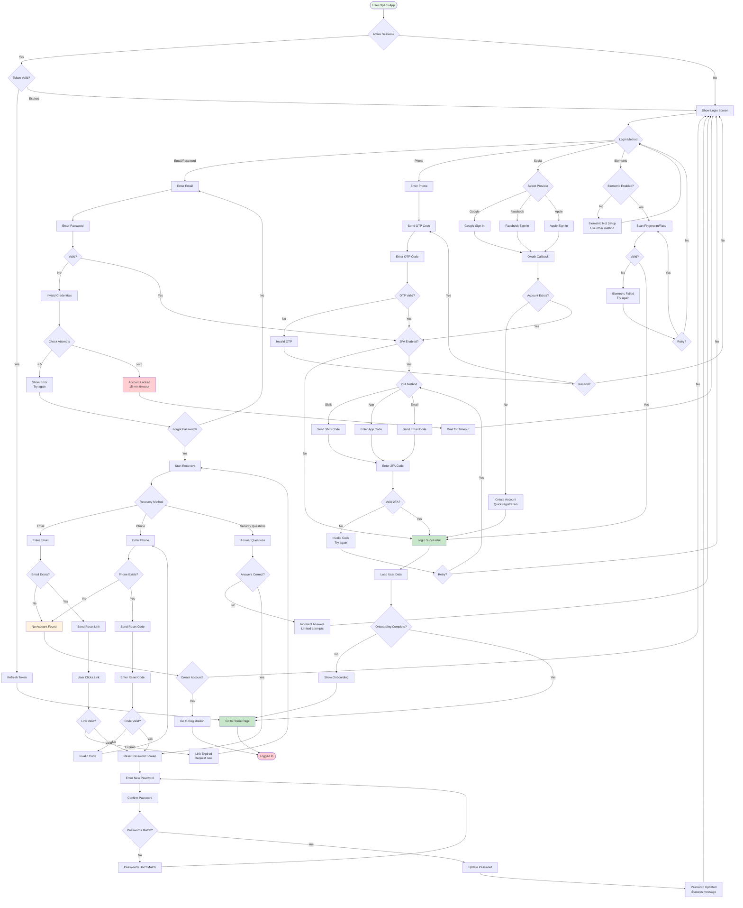

## Physical Voucher Book Flow

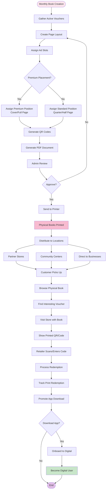

## Admin Platform Management Flow

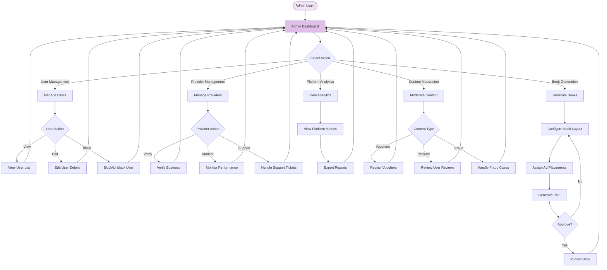

## Multi-Language User Experience Flow

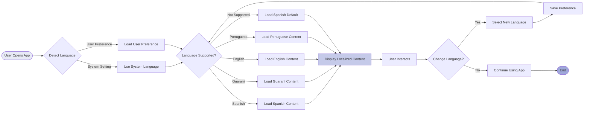

## Notification System Flows

### Push Notification Management

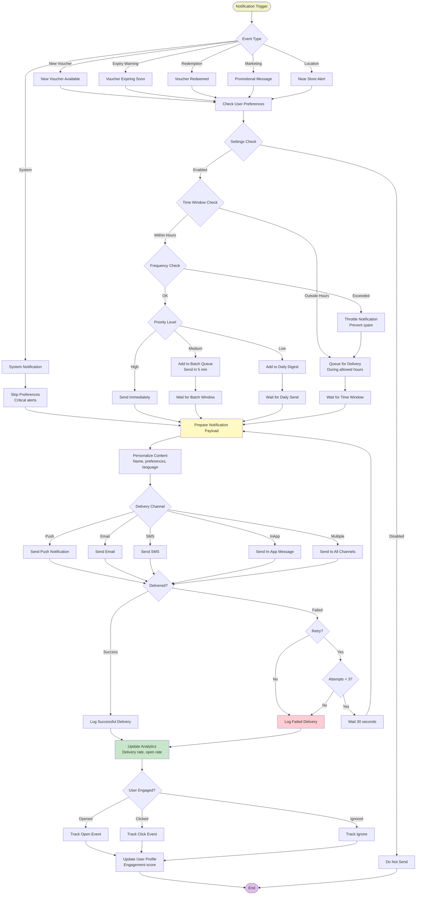

### Email Campaign Flow

```mermaid
graph TD
    Start([Email Campaign Start]) --> CampaignType{Campaign Type}

    CampaignType -->|Welcome| WelcomeSeries[Welcome Email Series]
    CampaignType -->|Weekly Digest| WeeklyDigest[Weekly Voucher Digest]
    CampaignType -->|Abandoned| AbandonedCart[Abandoned Voucher Reminder]
    CampaignType -->|Reactivation| ReactivationCampaign[Win-back Campaign]
    CampaignType -->|Transactional| TransactionalEmail[Transaction Emails]

    WelcomeSeries --> SegmentUsers[Segment User Base]
    WeeklyDigest --> SegmentUsers
    AbandonedCart --> IdentifyAbandoned[Identify Abandoned Vouchers]
    ReactivationCampaign --> IdentifyInactive[Identify Inactive Users]
    TransactionalEmail --> PrepareTransaction[Prepare Transaction Data]

    IdentifyAbandoned --> SegmentUsers
    IdentifyInactive --> SegmentUsers

    SegmentUsers --> SegmentCriteria{Segmentation}
    SegmentCriteria -->|Demographics| DemoSegment[Age, Gender, Location]
    SegmentCriteria -->|Behavior| BehaviorSegment[Purchase history, Engagement]
    SegmentCriteria -->|Preferences| PrefSegment[Categories, Brands]
    SegmentCriteria -->|Value| ValueSegment[High value, Low value]

    DemoSegment --> CreateSegments[Create User Segments]
    BehaviorSegment --> CreateSegments
    PrefSegment --> CreateSegments
    ValueSegment --> CreateSegments

    CreateSegments --> SelectTemplate[Select Email Template]
    PrepareTransaction --> SelectTemplate

    SelectTemplate --> TemplateType{Template Type}
    TemplateType -->|Standard| StandardTemplate[Standard Layout]
    TemplateType -->|Premium| PremiumTemplate[Premium Design]
    TemplateType -->|Minimal| MinimalTemplate[Text-focused]
    TemplateType -->|Seasonal| SeasonalTemplate[Holiday/Event themed]

    StandardTemplate --> PersonalizeEmail[Personalize Content]
    PremiumTemplate --> PersonalizeEmail
    MinimalTemplate --> PersonalizeEmail
    SeasonalTemplate --> PersonalizeEmail

    PersonalizeEmail --> AddDynamicContent[Add Dynamic Content<br/>Recommendations, Vouchers]
    AddDynamicContent --> OptimizeSubject[A/B Test Subject Lines]

    OptimizeSubject --> TestVariants{Test Variants}
    TestVariants -->|A| VariantA[Subject Line A]
    TestVariants -->|B| VariantB[Subject Line B]

    VariantA --> SendTestBatch[Send Test Batch<br/>10% of segment]
    VariantB --> SendTestBatch

    SendTestBatch --> WaitResults[Wait 2 Hours]
    WaitResults --> AnalyzeResults[Analyze Open Rates]

    AnalyzeResults --> SelectWinner{Select Winner}
    SelectWinner --> WinningSubject[Use Winning Subject]

    WinningSubject --> FinalChecks[Final Quality Checks<br/>Spam score, rendering]
    FinalChecks --> ScheduleSend{Schedule Send}

    ScheduleSend -->|Immediate| SendNow[Send Immediately]
    ScheduleSend -->|Scheduled| ScheduleTime[Schedule for Optimal Time]
    ScheduleSend -->|Batch| BatchSend[Send in Batches]

    SendNow --> DeliverEmails[Deliver to Email Servers]
    ScheduleTime --> WaitSchedule[Wait for Scheduled Time]
    BatchSend --> SendBatches[Send Batches Over Time]

    WaitSchedule --> DeliverEmails
    SendBatches --> DeliverEmails

    DeliverEmails --> TrackDelivery[Track Delivery Status]
    TrackDelivery --> DeliveryStatus{Status}

    DeliveryStatus -->|Delivered| LogSuccess[Log Successful Delivery]
    DeliveryStatus -->|Bounced| HandleBounce[Handle Bounce]
    DeliveryStatus -->|Spam| HandleSpam[Handle Spam Report]

    HandleBounce --> BounceType{Bounce Type}
    BounceType -->|Soft| RetrySoft[Retry Later]
    BounceType -->|Hard| MarkInvalid[Mark Email Invalid]

    RetrySoft --> DeliverEmails
    MarkInvalid --> UpdateList[Update Email List]
    HandleSpam --> UpdateList

    LogSuccess --> TrackEngagement[Track Engagement<br/>Opens, Clicks, Conversions]
    UpdateList --> GenerateReport[Generate Campaign Report]

    TrackEngagement --> EngagementMetrics{Engagement Level}
    EngagementMetrics -->|High| HighEngagement[Mark as Engaged]
    EngagementMetrics -->|Medium| MediumEngagement[Normal Cadence]
    EngagementMetrics -->|Low| LowEngagement[Reduce Frequency]

    HighEngagement --> UpdateUserScore[Update Engagement Score]
    MediumEngagement --> UpdateUserScore
    LowEngagement --> UpdateUserScore

    UpdateUserScore --> GenerateReport
    GenerateReport --> End([Campaign Complete])

    style Start fill:#e3f2fd
    style DeliverEmails fill:#bbdefb
    style GenerateReport fill:#c8e6c9
    style HandleSpam fill:#ffcdd2
    style End fill:#90caf9
```

## Payment & Subscription Flows

### Payment Processing Flow

```mermaid
graph TD
    Start([Payment Initiated]) --> PaymentContext{Payment Context}

    PaymentContext -->|Subscription| SubPayment[Subscription Payment]
    PaymentContext -->|One-time| OneTimePayment[One-time Purchase]
    PaymentContext -->|Upgrade| UpgradePayment[Plan Upgrade]
    PaymentContext -->|Ad Placement| AdPayment[Ad Placement Fee]

    SubPayment --> SelectPlan[Select Subscription Plan]
    OneTimePayment --> SelectItem[Select Purchase Item]
    UpgradePayment --> ComparePlans[Compare Current vs New]
    AdPayment --> SelectPlacement[Select Ad Placement]

    SelectPlan --> ShowPricing[Show Pricing Details]
    SelectItem --> ShowPricing
    ComparePlans --> ShowPricing
    SelectPlacement --> ShowPricing

    ShowPricing --> ApplyCoupon{Apply Discount?}
    ApplyCoupon -->|Yes| EnterCoupon[Enter Coupon Code]
    ApplyCoupon -->|No| CalculateTotal[Calculate Total]

    EnterCoupon --> ValidateCoupon{Valid Coupon?}
    ValidateCoupon -->|No| CouponError[Show Error Message]
    ValidateCoupon -->|Yes| ApplyDiscount[Apply Discount]

    CouponError --> ApplyCoupon
    ApplyDiscount --> CalculateTotal

    CalculateTotal --> AddTaxes[Add Applicable Taxes]
    AddTaxes --> ShowTotal[Show Final Total]

    ShowTotal --> SelectMethod{Payment Method}
    SelectMethod -->|Credit Card| CardPayment[Credit Card Entry]
    SelectMethod -->|PayPal| PayPalFlow[PayPal Authorization]
    SelectMethod -->|Bank Transfer| BankTransfer[Bank Transfer Details]
    SelectMethod -->|Crypto| CryptoPayment[Crypto Payment]
    SelectMethod -->|Invoice| InvoicePayment[Generate Invoice]

    CardPayment --> EnterCardDetails[Enter Card Information<br/>Number, CVV, Expiry]
    EnterCardDetails --> ValidateCard{Validate Card}

    ValidateCard -->|Invalid| CardError[Show Card Error]
    ValidateCard -->|Valid| CheckSavedCard{Save Card?}

    CardError --> EnterCardDetails

    CheckSavedCard -->|Yes| TokenizeCard[Tokenize Card<br/>Secure storage]
    CheckSavedCard -->|No| Proceed3DS[Proceed to 3DS]

    TokenizeCard --> Proceed3DS

    Proceed3DS --> Check3DS{3DS Required?}
    Check3DS -->|Yes| Show3DS[3D Secure Challenge]
    Check3DS -->|No| ProcessPayment[Process Payment]

    Show3DS --> Authenticate3DS{3DS Success?}
    Authenticate3DS -->|No| Failed3DS[3DS Failed]
    Authenticate3DS -->|Yes| ProcessPayment

    Failed3DS --> RetryPayment{Retry?}
    RetryPayment -->|Yes| SelectMethod
    RetryPayment -->|No| CancelPayment[Cancel Payment]

    PayPalFlow --> PayPalRedirect[Redirect to PayPal]
    PayPalRedirect --> PayPalAuth[PayPal Authentication]
    PayPalAuth --> PayPalApprove{Approved?}

    PayPalApprove -->|No| PayPalCancel[PayPal Cancelled]
    PayPalApprove -->|Yes| PayPalReturn[Return to App]

    PayPalCancel --> SelectMethod
    PayPalReturn --> ProcessPayment

    BankTransfer --> GenerateReference[Generate Payment Reference]
    GenerateReference --> ShowBankDetails[Show Bank Details<br/>Account, Reference]
    ShowBankDetails --> WaitTransfer[Wait for Transfer<br/>Manual verification]

    WaitTransfer --> VerifyTransfer{Transfer Verified?}
    VerifyTransfer -->|No| PendingTransfer[Mark as Pending]
    VerifyTransfer -->|Yes| ProcessPayment

    CryptoPayment --> SelectCrypto{Select Currency}
    SelectCrypto -->|Bitcoin| BTCPayment[Bitcoin Address]
    SelectCrypto -->|Ethereum| ETHPayment[Ethereum Address]
    SelectCrypto -->|USDT| USDTPayment[USDT Address]

    BTCPayment --> ShowCryptoAddress[Show Wallet Address<br/>QR Code]
    ETHPayment --> ShowCryptoAddress
    USDTPayment --> ShowCryptoAddress

    ShowCryptoAddress --> WaitBlockchain[Wait for Confirmation<br/>Blockchain verification]
    WaitBlockchain --> VerifyBlockchain{Confirmed?}

    VerifyBlockchain -->|No| PendingCrypto[Mark as Pending]
    VerifyBlockchain -->|Yes| ProcessPayment

    InvoicePayment --> GenerateInvoice[Generate Invoice PDF]
    GenerateInvoice --> SendInvoice[Send Invoice Email]
    SendInvoice --> WaitInvoicePayment[Wait for Payment<br/>Net 30 terms]

    WaitInvoicePayment --> InvoicePaid{Paid?}
    InvoicePaid -->|No| SendReminder[Send Payment Reminder]
    InvoicePaid -->|Yes| ProcessPayment

    SendReminder --> WaitInvoicePayment

    ProcessPayment --> ChargeCard[Charge Payment Method]
    ChargeCard --> PaymentResult{Payment Success?}

    PaymentResult -->|Failed| PaymentFailed[Payment Failed]
    PaymentResult -->|Success| PaymentSuccess[Payment Successful]

    PaymentFailed --> FailureReason{Failure Reason}
    FailureReason -->|Insufficient Funds| InsufficientFunds[Insufficient Funds Error]
    FailureReason -->|Card Declined| CardDeclined[Card Declined Error]
    FailureReason -->|Technical| TechnicalError[Technical Error]

    InsufficientFunds --> RetryPayment
    CardDeclined --> RetryPayment
    TechnicalError --> RetryPayment

    PaymentSuccess --> CreateReceipt[Generate Receipt]
    CreateReceipt --> UpdateSubscription[Update Subscription Status]
    UpdateSubscription --> SendConfirmation[Send Confirmation Email]

    SendConfirmation --> ActivateService[Activate Service/Product]
    ActivateService --> LogTransaction[Log Transaction]

    LogTransaction --> UpdateAnalytics[Update Payment Analytics]
    UpdateAnalytics --> End([Payment Complete])

    CancelPayment --> End
    PendingTransfer --> End
    PendingCrypto --> End

    style Start fill:#fff3e0
    style ProcessPayment fill:#fff9c4
    style PaymentSuccess fill:#c8e6c9
    style PaymentFailed fill:#ffcdd2
    style End fill:#e1bee7
```

### Subscription Management Flow

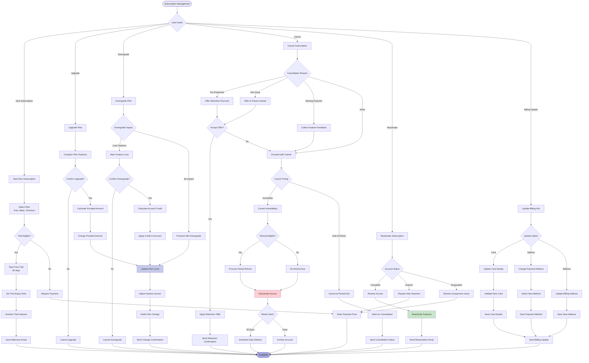

## Customer Support & Dispute Resolution Flows

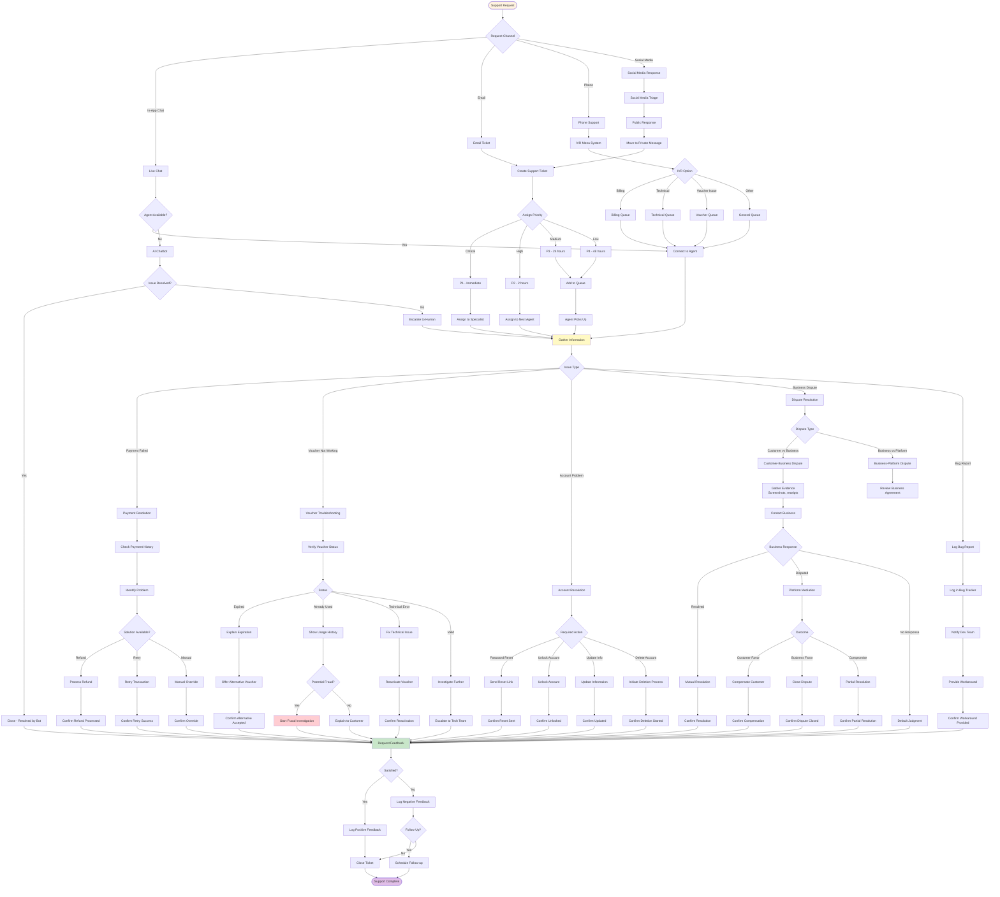

## Mobile App Onboarding Flow

```mermaid
graph TD
    Start([App First Launch]) --> SplashScreen[Splash Screen<br/>App logo animation]
    SplashScreen --> CheckFirstTime{First Time User?}

    CheckFirstTime -->|No| LoginScreen[Go to Login]
    CheckFirstTime -->|Yes| WelcomeSlides[Welcome Slides]

    WelcomeSlides --> Slide1[Slide 1: Save Money<br/>Discover local deals]
    Slide1 --> Slide2[Slide 2: Easy Redemption<br/>Show QR code at store]
    Slide2 --> Slide3[Slide 3: Exclusive Offers<br/>Members-only deals]
    Slide3 --> Slide4[Slide 4: Track Savings<br/>See total saved]

    Slide4 --> GetStarted{Get Started}
    GetStarted -->|Skip| SkipOnboarding[Skip to Browse]
    GetStarted -->|Continue| PermissionsIntro[Permissions Introduction]

    PermissionsIntro --> LocationPermission[Request Location Permission<br/>Find nearby deals]
    LocationPermission --> LocationGranted{Permission Granted?}

    LocationGranted -->|Yes| EnableLocation[Enable Location Services]
    LocationGranted -->|No| LocationSkipped[Skip Location Setup]

    EnableLocation --> NotificationPermission[Request Notification Permission<br/>Deal alerts]
    LocationSkipped --> NotificationPermission

    NotificationPermission --> NotifGranted{Permission Granted?}
    NotifGranted -->|Yes| ConfigureNotifications[Configure Notification Preferences]
    NotifGranted -->|No| NotifSkipped[Skip Notifications]

    ConfigureNotifications --> NotifOptions[Select Notification Types<br/>New deals, Expiry alerts, etc.]
    NotifOptions --> CameraPermission[Request Camera Permission<br/>Scan QR codes]
    NotifSkipped --> CameraPermission

    CameraPermission --> CameraGranted{Permission Granted?}
    CameraGranted -->|Yes| EnableCamera[Enable Camera Access]
    CameraGranted -->|No| CameraSkipped[Skip Camera Setup]

    EnableCamera --> PersonalizationIntro[Personalization Setup]
    CameraSkipped --> PersonalizationIntro

    PersonalizationIntro --> SelectInterests[Select Your Interests]
    SelectInterests --> CategorySelection[Choose Categories<br/>Food, Shopping, Services]

    CategorySelection --> BrandSelection[Follow Favorite Brands<br/>Optional]
    BrandSelection --> BudgetPreference[Set Budget Preferences<br/>Price ranges]

    BudgetPreference --> QuickTutorial{Show Quick Tutorial?}
    QuickTutorial -->|Yes| InteractiveTutorial[Interactive Tutorial]
    QuickTutorial -->|Skip| CreateAccount[Create Account Prompt]

    InteractiveTutorial --> TutorialStep1[Step 1: Browse Vouchers<br/>Swipe and tap demo]
    TutorialStep1 --> TutorialStep2[Step 2: Claim Voucher<br/>Add to wallet demo]
    TutorialStep2 --> TutorialStep3[Step 3: Redeem at Store<br/>Show QR demo]
    TutorialStep3 --> TutorialStep4[Step 4: Track Savings<br/>View history demo]

    TutorialStep4 --> CreateAccount
    SkipOnboarding --> CreateAccount

    CreateAccount --> AccountChoice{Create Account?}
    AccountChoice -->|Yes| RegistrationFlow[Go to Registration]
    AccountChoice -->|Later| BrowseAsGuest[Browse as Guest]

    RegistrationFlow --> AccountCreated[Account Created]
    AccountCreated --> WelcomeBonus{Eligible for Welcome Bonus?}

    WelcomeBonus -->|Yes| ShowBonus[Show Welcome Vouchers<br/>Free credits]
    WelcomeBonus -->|No| GoToHome[Go to Home Screen]

    ShowBonus --> ClaimBonus{Claim Bonus?}
    ClaimBonus -->|Yes| AddToWallet[Add Bonus to Wallet]
    ClaimBonus -->|No| GoToHome

    AddToWallet --> ShowSuccess[Show Success Animation]
    ShowSuccess --> GoToHome

    BrowseAsGuest --> GuestLimitations[Show Guest Limitations<br/>Can't claim vouchers]
    GuestLimitations --> GoToHome

    GoToHome --> FirstTimeTooltips[Show First-Time Tooltips]
    FirstTimeTooltips --> Tooltip1[Highlight Search Feature]
    Tooltip1 --> Tooltip2[Highlight Filter Options]
    Tooltip2 --> Tooltip3[Highlight Wallet Access]
    Tooltip3 --> Tooltip4[Highlight Profile Menu]

    Tooltip4 --> OnboardingComplete[Onboarding Complete]
    OnboardingComplete --> SaveProgress[Save Onboarding Status]
    SaveProgress --> End([Start Using App])

    LoginScreen --> End

    style Start fill:#e8f5e9
    style PersonalizationIntro fill:#c5e1a5
    style AccountCreated fill:#c8e6c9
    style OnboardingComplete fill:#a5d6a7
    style End fill:#81c784
```
