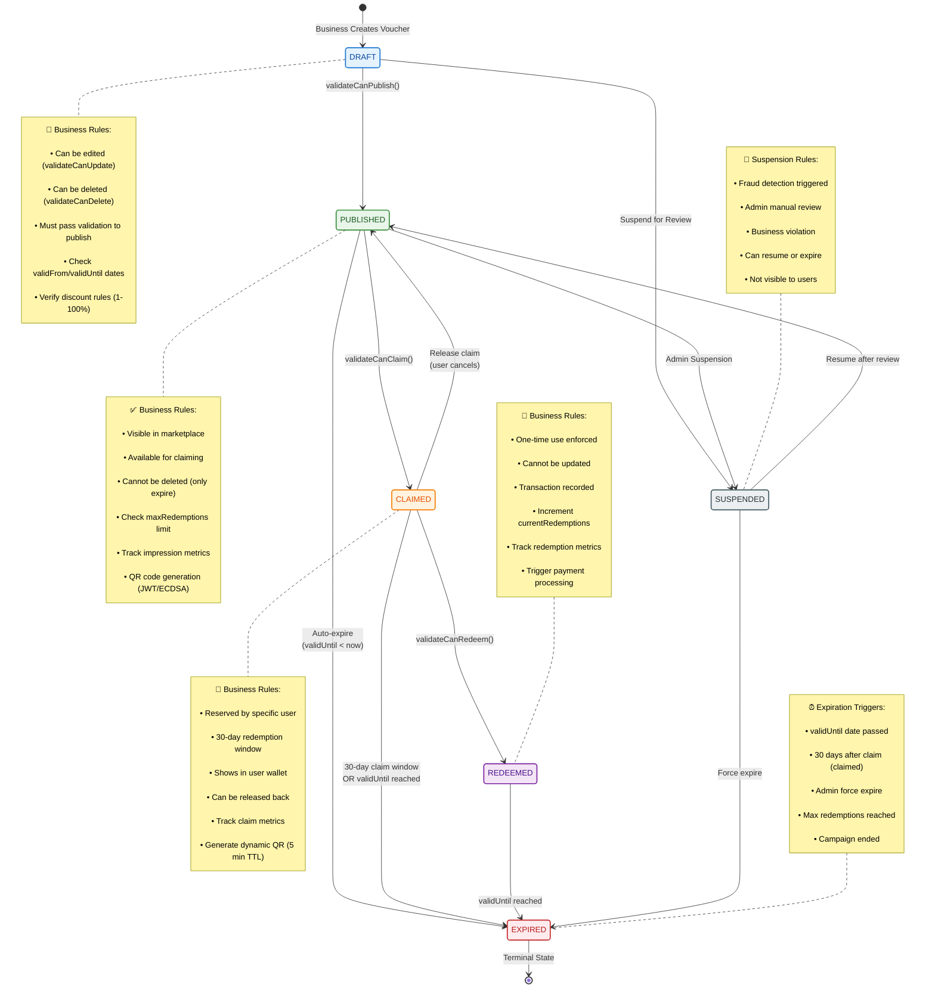
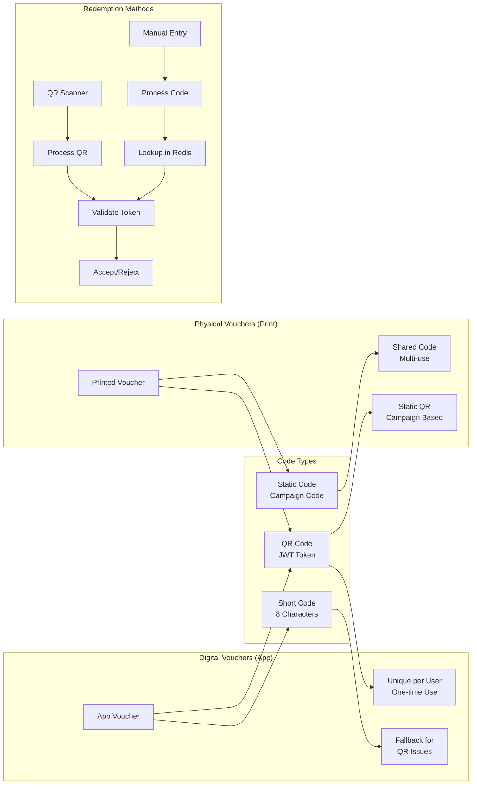
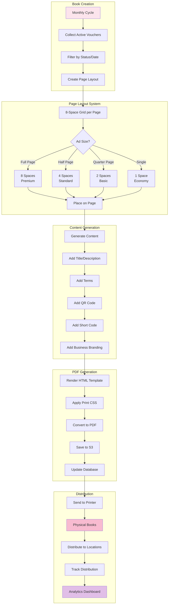
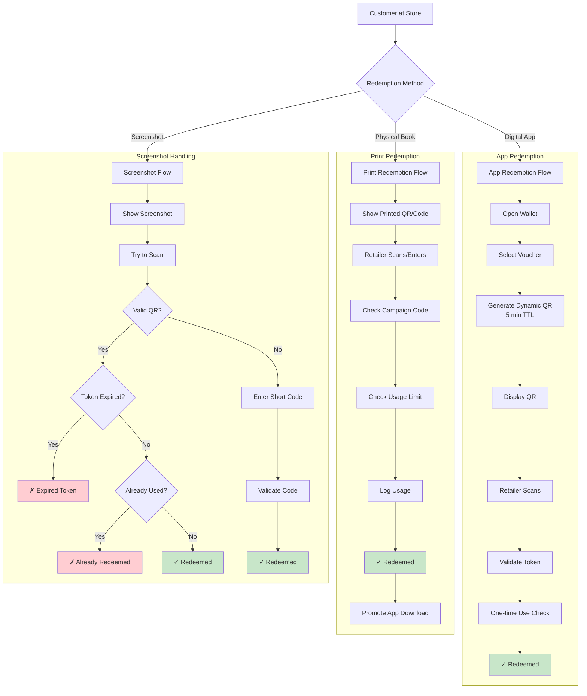
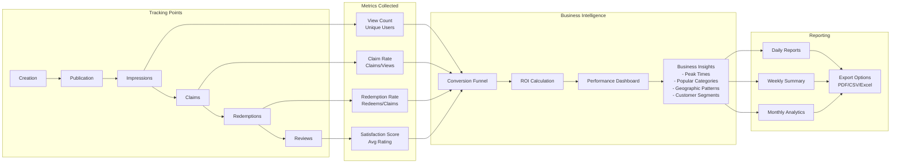

# VoucherBook Platform - Voucher Lifecycle Management

## Voucher State Transitions

## QR Code Generation and Validation Flow

```mermaid
graph TB
    subgraph "QR Code Generation"
        Create[Create Voucher] --> GenPayload[Generate JWT Payload]

        GenPayload --> PayloadType{Voucher Type?}

        PayloadType -->|Digital/App| UserToken[User-Specific Token<br/>5 min TTL]
        PayloadType -->|Physical/Print| PrintToken[Campaign Token<br/>30 day TTL]

        UserToken --> SignToken[Sign with ECDSA]
        PrintToken --> SignToken

        SignToken --> EncodeQR[Encode as QR Code]
        EncodeQR --> GenShortCode[Generate Short Code<br/>SAVE-2K9P]

        GenShortCode --> StoreRedis[Store in Redis<br/>Code Mapping]
        StoreRedis --> ReturnCodes[Return QR + Short Code]
    end

    subgraph "QR Code Validation"
        ScanQR[Scan QR Code] --> DecodeJWT[Decode JWT Token]

        DecodeJWT --> OnlineCheck{Online?}

        OnlineCheck -->|Yes| ServerValidate[Server Validation]
        OnlineCheck -->|No| OfflineValidate[Local Validation]

        ServerValidate --> CheckDB[Check Database<br/>- Voucher Status<br/>- Redemption Count<br/>- User Authorization]

        OfflineValidate --> CheckSig[Verify Signature<br/>with Public Key]
        CheckSig --> CheckTTL[Check TTL<br/>Not Expired]
        CheckTTL --> CheckNonce[Check Nonce<br/>Not Reused]

        CheckDB --> Valid{Valid?}
        CheckNonce --> Valid

        Valid -->|Yes| Accept[Accept Redemption]
        Valid -->|No| Reject[Reject with Reason]

        Accept --> UpdateState[Update Voucher State]
        UpdateState --> RecordRedemption[Record Redemption]
        RecordRedemption --> NotifyUser[Notify User]
    end

    style Create fill:#e8f5e9
    style Accept fill:#c8e6c9
    style Reject fill:#ffcdd2
```

## Voucher Code Types and Usage

## Physical Book Voucher Integration

## Voucher Redemption Scenarios

## Voucher Analytics and Tracking

