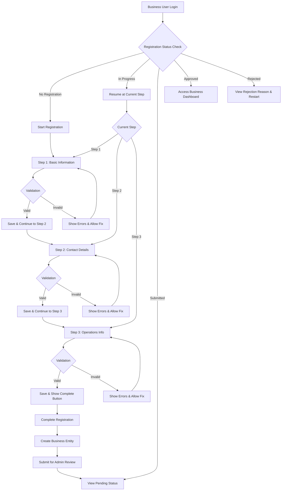
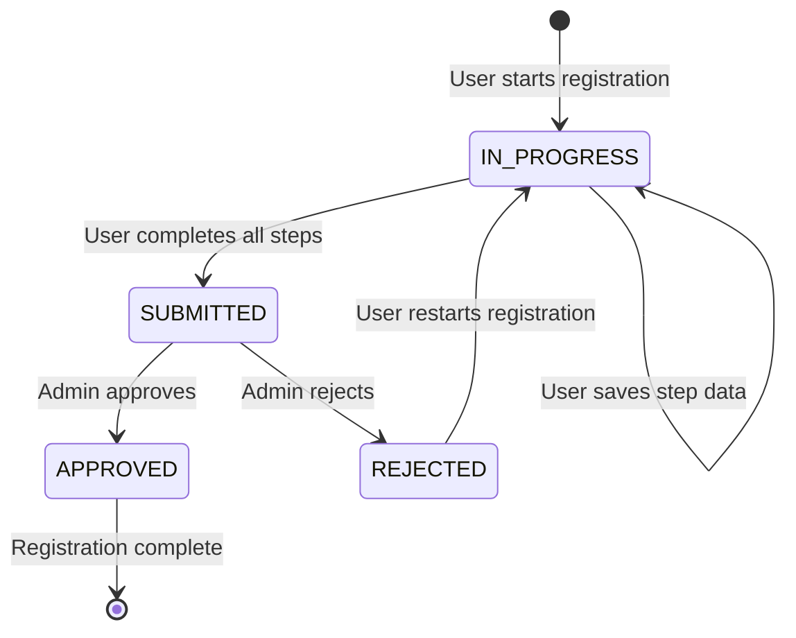
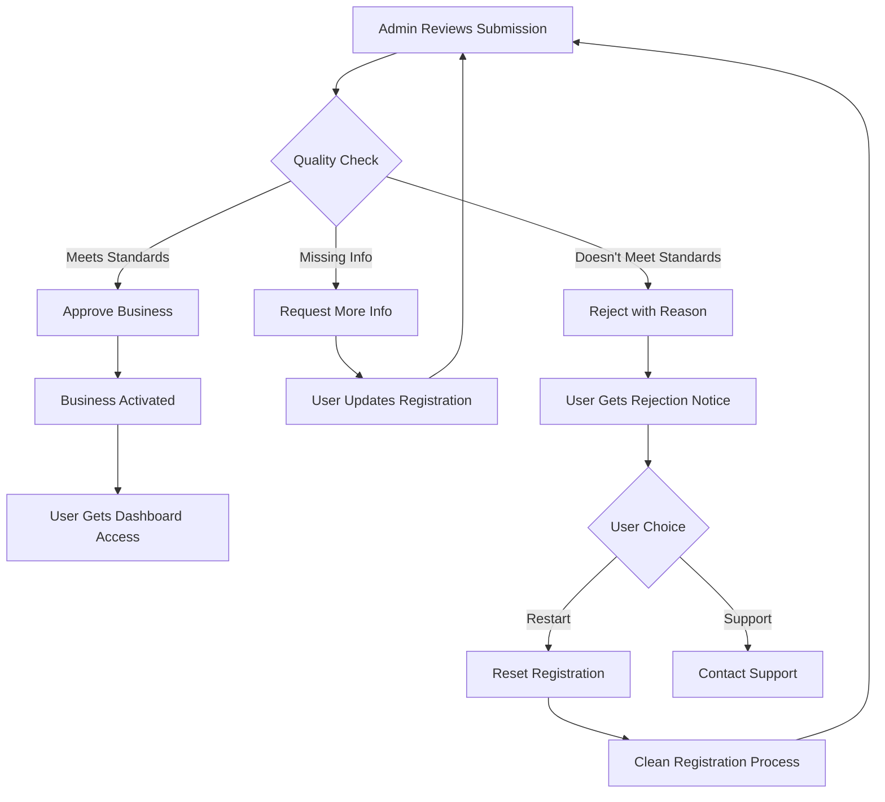

# Business Registration Flow

**VoucherBook Platform Feature Documentation**

---

## Table of Contents

1. [Overview](#overview)
2. [Business Purpose](#business-purpose)
3. [User Experience Flow](#user-experience-flow)
4. [Technical Implementation](#technical-implementation)
5. [Admin Management](#admin-management)
6. [API Reference](#api-reference)
7. [Database Schema](#database-schema)
8. [Security & Validation](#security--validation)
9. [Performance & Caching](#performance--caching)
10. [Testing & Quality Assurance](#testing--quality-assurance)
11. [Troubleshooting](#troubleshooting)

---

## Overview

The Business Registration Flow is a comprehensive multi-step onboarding system that enables business owners to register their companies on the VoucherBook platform. This feature ensures quality control through structured data collection, progressive validation, and admin approval workflows.

### Key Features
- **3-step guided registration** with progressive data collection
- **Real-time validation** and error feedback
- **Admin approval workflow** with review and rejection capabilities
- **Resume capability** - users can continue where they left off
- **Edit functionality** - users can modify previous steps
- **Comprehensive caching** for optimal performance
- **Web-based interface** for business owners (mobile customers use Flutter app)

---

## Business Purpose

### What This Feature Solves

**For Business Owners:**
- Simplified onboarding process to join the VoucherBook marketplace
- Clear requirements and expectations upfront
- Ability to save progress and return later
- Transparent approval status tracking

**For VoucherBook Platform:**
- Quality control over business partners
- Comprehensive business data for marketplace trust
- Reduced support burden through self-service registration
- Structured data collection for business analytics

**For Customers:**
- Verified business information for trusted transactions
- Complete business profiles with contact and operational details
- Quality assurance through admin-reviewed businesses

### Business Value
- **Increased Business Partner Acquisition** through streamlined onboarding
- **Improved Data Quality** via structured collection and validation
- **Reduced Support Costs** through self-service capabilities
- **Enhanced Trust** via admin approval verification
- **Better User Experience** with progressive disclosure and resume functionality

---

## User Experience Flow

### Registration Journey



### Step-by-Step Process

#### Step 1: Basic Business Information
**What users provide:**
- Business name (2-100 characters)
- Business type (Restaurant, Retail, Service, etc.)
- Primary category from taxonomy
- Primary language for communications

**User experience:**
- Clean form with real-time validation
- Category selector with search functionality
- Language dropdown with common options
- "Save & Continue" or "Save as Draft" options

#### Step 2: Contact & Location Details
**What users provide:**
- Business description
- Complete address (street, city, state, postal code, country)
- Primary phone number
- Optional website URL
- Optional contact email

**User experience:**
- Address autocomplete/validation integration
- Phone number formatting assistance
- Website URL validation
- Rich text editor for business description

#### Step 3: Operations & Additional Information
**What users provide:**
- Operating hours for each day of the week
- Social media profiles (optional)
- Additional business information (flexible)

**User experience:**
- Interactive schedule builder
- Social media platform integration
- Expandable sections for optional information
- Preview of complete business profile

#### Final Submission
**What users confirm:**
- Review all entered information
- Confirm data accuracy (required checkbox)
- Agree to terms and conditions (required checkbox)
- Submit for admin review

**User experience:**
- Comprehensive review page with edit links
- Clear explanation of approval process
- Expected review timeline (24-48 hours)
- Confirmation email sent

### Post-Submission Experience

#### Pending Review
- Dashboard shows "Under Review" status
- Estimated review time displayed
- Contact information for support questions
- Ability to view submitted information (read-only)

#### Approved
- Automatic email notification
- Immediate access to business dashboard
- Welcome tour of platform features
- Initial setup guidance for voucher creation

#### Rejected
- Email notification with specific rejection reasons
- Ability to view detailed feedback from admin
- One-click option to restart registration
- Support contact for questions about rejection

---

## Technical Implementation

### Architecture Overview

The business registration system follows **Clean Architecture** principles with clear separation of concerns:

```
┌─────────────────┐    ┌─────────────────┐    ┌─────────────────┐
│   Controllers   │    │    Services     │    │  Repositories   │
│                 │    │                 │    │                 │
│ HTTP Request    │───▶│ Business Logic  │───▶│ Data Access     │
│ Validation      │    │ Validation      │    │ Caching         │
│ Response        │    │ Orchestration   │    │ Database        │
└─────────────────┘    └─────────────────┘    └─────────────────┘
        │                       │                       │
        ▼                       ▼                       ▼
┌─────────────────┐    ┌─────────────────┐    ┌─────────────────┐
│    Mappers      │    │     Cache       │    │    Database     │
│                 │    │                 │    │                 │
│ Data Transform  │    │ Redis Store     │    │ PostgreSQL      │
│ DTO Conversion  │    │ Performance     │    │ Persistence     │
└─────────────────┘    └─────────────────┘    └─────────────────┘
```

### Core Components

#### 1. **BusinessRegistrationController**
**Responsibility:** HTTP request handling and response formatting

**Key Methods:**
- `getRegistrationStatus()` - Check current registration state
- `startRegistration()` - Initialize new registration
- `getProgress()` - Get detailed progress with all step data
- `submitStep1/2/3()` - Handle step submissions
- `completeRegistration()` - Finalize with user consent

**Features:**
- Request validation using Zod schemas
- Response transformation via mappers
- Cookie management for frontend state
- Comprehensive error handling

#### 2. **BusinessRegistrationService**
**Responsibility:** Business logic and workflow orchestration

**Key Methods:**
- `checkRegistrationStatus()` - Determine user's registration state
- `saveStep()` - Validate and save step data
- `completeRegistration()` - Create business and submit for review
- `resetRegistration()` - Admin-only reset functionality

**Business Rules:**
- Users can edit previously completed steps
- Cannot skip ahead to future steps
- All 3 steps required for completion
- Explicit user consent required for submission

#### 3. **BusinessRegistrationRepository**
**Responsibility:** Data access and persistence

**Key Methods:**
- `findByUserId()` - Get registration by user (with caching)
- `findByBusinessId()` - Get registration by business (for admin)
- `updateStep()` - Save step data with progress tracking
- `updateStatus()` - Change registration status (with reason)

**Features:**
- Redis caching for performance
- Cache invalidation on writes
- JSON storage for flexible step data
- Comprehensive error handling

#### 4. **BusinessRegistrationMapper**
**Responsibility:** Data transformation between layers

**Key Methods:**
- `fromDocument()` - Database → Domain conversion
- `toStatusResponse()` - Domain → API status response
- `toProgressResponse()` - Domain → API progress response
- `validateStepData()` - Business rule validation

**Features:**
- Type-safe transformations
- Validation logic encapsulation
- Status determination logic
- DTO standardization

### Status Transitions



**Status Meanings:**
- `IN_PROGRESS`: User actively filling out steps
- `SUBMITTED`: All steps complete, awaiting admin review
- `APPROVED`: Admin approved, business active
- `REJECTED`: Admin rejected with reason, user can restart

### Data Storage Strategy

#### Registration Record
```typescript
interface BusinessRegistration {
  id: string                    // UUID primary key
  userId: string               // User who owns registration (unique)
  businessId?: string          // Created business ID (nullable)
  currentStep: number          // Progress tracking (1-3)
  step1Data?: Json             // Flexible business info
  step2Data?: Json             // Flexible contact details  
  step3Data?: Json             // Flexible operations info
  registrationStatus: Status   // Workflow state
  startedAt: DateTime          // Audit trail
  completedAt?: DateTime       // Completion timestamp
  submittedAt?: DateTime       // Submission timestamp
  rejectionReason?: string     // Admin feedback
  createdAt: DateTime          // Record creation
  updatedAt: DateTime          // Last modification
}
```

**Design Benefits:**
- **JSON storage** provides flexibility for evolving requirements
- **Separate timestamps** enable comprehensive audit trails
- **Nullable business link** allows reset without data loss
- **Unique constraints** prevent duplicate registrations

---

## Admin Management

### Admin Dashboard Integration

#### Business Approval Interface
Admins can view and manage business registrations through dedicated endpoints:

**Review Pending Registrations:**
```http
GET /admin/businesses?approved=false&include=businessRegistration
```
Response includes:
- Business details from all registration steps
- Submission timestamp and user information
- Registration status and current step
- Complete audit trail

#### Approval Actions

**Approve Business:**
```http
POST /admin/businesses/:businessId/approve
{
  "approved": true,
  "reason": "All documents verified and business meets platform standards"
}
```

**Reject Business:**
```http
POST /admin/businesses/:businessId/approve
{
  "approved": false,
  "reason": "Missing required business license documentation"
}
```

**System Behavior on Approval/Rejection:**
1. Updates business approval status
2. Automatically syncs registration status
3. Logs action with admin details and timestamp
4. Triggers notification pipeline (future enhancement)
5. Updates cache for immediate frontend reflection

#### Registration Reset (Admin Only)

When businesses need to restart their registration:

```http
POST /admin/businesses/users/:userId/registration/reset
{
  "reason": "Updated platform requirements, please resubmit with new information",
  "notifyUser": true
}
```

**Reset Process:**
1. Deletes associated business entity
2. Resets registration to step 1
3. Clears all step data
4. Sets status to IN_PROGRESS
5. Optionally notifies user (future enhancement)
6. Logs reset action for audit

### Admin Workflow



### Admin Best Practices

**Review Criteria:**
- Business license verification
- Address validation
- Contact information accuracy
- Business type appropriateness for platform
- Compliance with platform policies

**Rejection Reasons (Common):**
- "Missing business license documentation"
- "Invalid business address provided"
- "Business type not suitable for platform"
- "Incomplete contact information"
- "Duplicate business registration detected"

**Approval Timeline:**
- Target: 24-48 hours for standard applications
- Complex cases: Up to 5 business days
- Priority processing for verified businesses

---

## API Reference

### Public Registration Endpoints

#### Get Registration Status
```http
GET /businesses/registration/status
Authorization: Bearer <jwt_token>
```

**Response:**
```json
{
  "needsRegistration": boolean,
  "currentStep": number,
  "registrationStatus": "in_progress" | "submitted" | "approved" | "rejected",
  "canAccessDashboard": boolean,
  "registrationId": "uuid",
  "businessId": "uuid",
  "createdAt": "2024-01-15T10:30:00Z",
  "updatedAt": "2024-01-15T14:22:00Z"
}
```

#### Start Registration
```http
POST /businesses/registration/start
Authorization: Bearer <jwt_token>
```

**Response:**
```json
{
  "started": boolean,
  "currentStep": number
}
```

#### Get Registration Progress
```http
GET /businesses/registration/progress
Authorization: Bearer <jwt_token>
```

**Response:**
```json
{
  "id": "uuid",
  "userId": "uuid", 
  "currentStep": number,
  "stepsCompleted": [1, 2],
  "step1Data": {
    "businessName": "Example Business",
    "businessType": "restaurant",
    "categoryId": "uuid",
    "primaryLanguage": "en"
  },
  "step2Data": {
    "description": "Great local restaurant",
    "address": {
      "street": "123 Main St",
      "city": "Springfield", 
      "state": "IL",
      "postalCode": "62701",
      "country": "US"
    },
    "phone": "+1234567890",
    "website": "https://example.com"
  },
  "step3Data": {},
  "registrationStatus": "in_progress",
  "businessId": null,
  "createdAt": "2024-01-15T10:30:00Z",
  "updatedAt": "2024-01-15T14:22:00Z"
}
```

#### Submit Step Data
```http
POST /businesses/registration/step1
Authorization: Bearer <jwt_token>
Content-Type: application/json
```

**Step 1 Request:**
```json
{
  "businessName": "Example Restaurant",
  "businessType": "restaurant",
  "categoryId": "uuid",
  "primaryLanguage": "en"
}
```

**Step 2 Request:**
```json
{
  "description": "Authentic Italian cuisine in the heart of downtown",
  "address": {
    "street": "123 Main Street",
    "city": "Springfield",
    "state": "Illinois", 
    "postalCode": "62701",
    "country": "US"
  },
  "phone": "+12345678900",
  "website": "https://example-restaurant.com",
  "email": "contact@example-restaurant.com"
}
```

**Step 3 Request:**
```json
{
  "operatingHours": {
    "monday": { "open": "09:00", "close": "22:00" },
    "tuesday": { "open": "09:00", "close": "22:00" },
    "wednesday": { "open": "09:00", "close": "22:00" },
    "thursday": { "open": "09:00", "close": "22:00" },
    "friday": { "open": "09:00", "close": "23:00" },
    "saturday": { "open": "10:00", "close": "23:00" },
    "sunday": { "closed": true }
  },
  "socialMedia": {
    "facebook": "https://facebook.com/example-restaurant",
    "instagram": "https://instagram.com/example_restaurant"
  },
  "additionalInfo": {
    "specialties": ["pasta", "pizza", "wine"],
    "deliveryAvailable": true,
    "parkingAvailable": true
  }
}
```

**Step Response:**
```json
{
  "success": boolean,
  "nextStep": number | null,
  "savedData": object
}
```

#### Complete Registration
```http
POST /businesses/registration/complete
Authorization: Bearer <jwt_token>
Content-Type: application/json
```

**Request:**
```json
{
  "confirmAllDataAccurate": true,
  "agreedToTerms": true
}
```

**Response:**
```json
{
  "businessId": "uuid",
  "registrationStatus": "submitted",
  "message": "Business registration submitted successfully. Awaiting admin approval.",
  "estimatedReviewTime": "24-48 hours"
}
```

### Admin Management Endpoints

#### Approve/Reject Business
```http
POST /admin/businesses/:businessId/approve
Authorization: Bearer <admin_jwt_token>
Content-Type: application/json
```

**Request:**
```json
{
  "approved": boolean,
  "reason": "Detailed reason for approval or rejection"
}
```

**Response:**
```json
{
  "id": "uuid",
  "userId": "uuid",
  "businessName": "Example Business",
  "approved": boolean,
  "approvedBy": "admin_uuid",
  "approvedAt": "2024-01-16T09:15:00Z",
  "registrationStatus": "approved" | "rejected"
}
```

#### Reset Registration
```http
POST /admin/businesses/users/:userId/registration/reset
Authorization: Bearer <admin_jwt_token>
Content-Type: application/json
```

**Request:**
```json
{
  "reason": "Platform requirements updated, please resubmit",
  "notifyUser": true
}
```

**Response:**
```json
{
  "success": true,
  "message": "Business registration has been reset successfully",
  "registrationId": "uuid",
  "userId": "uuid"
}
```

---

## Database Schema

### Business Registration Table

```sql
CREATE TABLE "business_registrations" (
  "id" UUID PRIMARY KEY DEFAULT uuid_generate_v4(),
  "user_id" UUID NOT NULL UNIQUE,
  "business_id" UUID UNIQUE,
  "current_step" INTEGER NOT NULL DEFAULT 1,
  "step1_data" JSONB,
  "step2_data" JSONB,
  "step3_data" JSONB,
  "registration_status" "BusinessRegistrationStatus" NOT NULL DEFAULT 'IN_PROGRESS',
  "started_at" TIMESTAMP(3) NOT NULL DEFAULT CURRENT_TIMESTAMP,
  "completed_at" TIMESTAMP(3),
  "submitted_at" TIMESTAMP(3),
  "rejection_reason" TEXT,
  "created_at" TIMESTAMP(3) NOT NULL DEFAULT CURRENT_TIMESTAMP,
  "updated_at" TIMESTAMP(3) NOT NULL DEFAULT CURRENT_TIMESTAMP,
  
  CONSTRAINT "business_registrations_user_id_fkey" 
    FOREIGN KEY ("user_id") REFERENCES "users"("id") ON DELETE CASCADE,
  CONSTRAINT "business_registrations_business_id_fkey" 
    FOREIGN KEY ("business_id") REFERENCES "businesses"("id") ON DELETE SET NULL
);

CREATE INDEX "business_registrations_user_id_idx" ON "business_registrations"("user_id");
CREATE INDEX "business_registrations_status_idx" ON "business_registrations"("registration_status");
CREATE INDEX "business_registrations_business_id_idx" ON "business_registrations"("business_id");
```

### Registration Status Enum

```sql
CREATE TYPE "BusinessRegistrationStatus" AS ENUM (
  'IN_PROGRESS',
  'SUBMITTED', 
  'APPROVED',
  'REJECTED'
);
```

### Related Tables

#### Users Table (Foreign Key)
```sql
-- registration.user_id references users.id
-- Cascade delete: if user deleted, registration deleted
-- Ensures data consistency and privacy compliance
```

#### Businesses Table (Foreign Key)
```sql
-- registration.business_id references businesses.id  
-- Set null on delete: if business deleted, registration preserved for audit
-- Allows admin to reset registrations without losing history
```

### JSON Schema for Step Data

#### Step 1 Data Structure
```json
{
  "$schema": "http://json-schema.org/draft-07/schema#",
  "type": "object",
  "properties": {
    "businessName": { "type": "string", "minLength": 2, "maxLength": 100 },
    "businessType": { "type": "string", "enum": ["restaurant", "retail", "service", "health", "automotive"] },
    "categoryId": { "type": "string", "format": "uuid" },
    "primaryLanguage": { "type": "string", "pattern": "^[a-z]{2}(-[A-Z]{2})?$" }
  },
  "required": ["businessName", "businessType", "categoryId", "primaryLanguage"],
  "additionalProperties": false
}
```

#### Step 2 Data Structure
```json
{
  "$schema": "http://json-schema.org/draft-07/schema#",
  "type": "object", 
  "properties": {
    "description": { "type": "string", "minLength": 1, "maxLength": 1000 },
    "address": {
      "type": "object",
      "properties": {
        "street": { "type": "string", "minLength": 1 },
        "city": { "type": "string", "minLength": 1 },
        "state": { "type": "string", "minLength": 1 },
        "postalCode": { "type": "string", "minLength": 1 },
        "country": { "type": "string", "pattern": "^[A-Z]{2}$" }
      },
      "required": ["street", "city", "state", "postalCode", "country"],
      "additionalProperties": false
    },
    "phone": { "type": "string", "pattern": "^\\+[1-9]\\d{1,14}$" },
    "website": { "type": "string", "format": "uri" },
    "email": { "type": "string", "format": "email" }
  },
  "required": ["description", "address", "phone"],
  "additionalProperties": false
}
```

#### Step 3 Data Structure
```json
{
  "$schema": "http://json-schema.org/draft-07/schema#",
  "type": "object",
  "properties": {
    "operatingHours": {
      "type": "object",
      "patternProperties": {
        "^(monday|tuesday|wednesday|thursday|friday|saturday|sunday)$": {
          "type": "object",
          "properties": {
            "open": { "type": "string", "pattern": "^([01]?[0-9]|2[0-3]):[0-5][0-9]$" },
            "close": { "type": "string", "pattern": "^([01]?[0-9]|2[0-3]):[0-5][0-9]$" },
            "closed": { "type": "boolean" }
          },
          "additionalProperties": false
        }
      },
      "additionalProperties": false
    },
    "socialMedia": {
      "type": "object",
      "patternProperties": {
        "^[a-zA-Z]+$": { "type": "string", "format": "uri" }
      },
      "additionalProperties": false
    },
    "additionalInfo": {
      "type": "object",
      "additionalProperties": true
    }
  },
  "additionalProperties": false
}
```

---

## Security & Validation

### Authentication & Authorization

#### Authentication Requirements
- **JWT Token Required:** All endpoints require valid JWT authentication
- **Token Validation:** Tokens verified against user service
- **Session Management:** Stateless design with token-based sessions

#### Authorization Matrix

| Endpoint | User Role | Permission Required |
|----------|-----------|-------------------|
| Registration endpoints | Business | `businesses:write:own` |
| Status/Progress check | Business | `businesses:read:own` |
| Admin approval | Admin | `admin:businesses` |
| Admin reset | Admin | `admin:businesses` |

#### Permission Enforcement
```typescript
// All registration endpoints
requireAuth() && requirePermissions('businesses:write:own')

// Admin endpoints  
requireAuth() && requirePermissions('admin:businesses')

// Cross-user access prevention
if (requestUserId !== tokenUserId && !isAdmin) {
  throw ErrorFactory.forbidden('Cannot access other user data')
}
```

### Input Validation

#### Request Validation Pipeline
1. **Zod Schema Validation:** All requests validated against TypeScript-first schemas
2. **Business Rule Validation:** Step progression and data consistency checks
3. **Data Sanitization:** HTML/script tag removal, SQL injection prevention
4. **Rate Limiting:** Protection against abuse and spam

#### Validation Rules by Step

**Step 1 Validation:**
```typescript
const Step1Schema = z.object({
  businessName: z.string()
    .min(2, "Business name too short")
    .max(100, "Business name too long") 
    .regex(/^[a-zA-Z0-9\s\-&'.,]+$/, "Invalid characters in business name"),
  businessType: z.enum(BusinessTypeEnum),
  categoryId: z.string().uuid("Invalid category ID"),
  primaryLanguage: z.string().regex(/^[a-z]{2}(-[A-Z]{2})?$/, "Invalid language code")
})
```

**Step 2 Validation:**
```typescript
const Step2Schema = z.object({
  description: z.string()
    .min(1, "Description required")
    .max(1000, "Description too long"),
  address: z.object({
    street: z.string().min(1, "Street address required"),
    city: z.string().min(1, "City required"),
    state: z.string().min(1, "State required"),
    postalCode: z.string().min(1, "Postal code required"),
    country: z.string().regex(/^[A-Z]{2}$/, "Invalid country code")
  }),
  phone: z.string().regex(/^\+[1-9]\d{1,14}$/, "Invalid phone format"),
  website: z.string().url().optional(),
  email: z.string().email().optional()
})
```

**Step 3 Validation:**
```typescript  
const Step3Schema = z.object({
  operatingHours: z.record(z.object({
    open: z.string().regex(/^([01]?[0-9]|2[0-3]):[0-5][0-9]$/).optional(),
    close: z.string().regex(/^([01]?[0-9]|2[0-3]):[0-5][0-9]$/).optional(),
    closed: z.boolean().optional()
  })).optional(),
  socialMedia: z.record(z.string().url()).optional(),
  additionalInfo: z.record(z.any()).optional()
})
```

### Data Security

#### Sensitive Data Protection
- **PII Encryption:** Phone numbers and emails encrypted at rest
- **Address Privacy:** Coordinates stored separately from registration
- **Audit Logging:** All changes logged with timestamps and user context
- **Data Retention:** Automatic cleanup of rejected registrations after 90 days

#### SQL Injection Prevention
- **Parameterized Queries:** All database queries use parameter binding
- **ORM Protection:** Prisma ORM provides built-in SQL injection protection
- **Input Sanitization:** User input sanitized before database storage

#### XSS Prevention
- **Output Encoding:** All user data encoded before display
- **Content Security Policy:** Strict CSP headers prevent script injection
- **Input Validation:** HTML/script tags stripped from text inputs

### Business Logic Security

#### Step Progression Security
```typescript
// Prevent step skipping
if (requestedStep > currentStep + 1) {
  throw ErrorFactory.validationError({
    step: ["Cannot skip steps. Complete previous steps first."]
  })
}

// Prevent unauthorized step access
if (requestedStep < 1 || requestedStep > 3) {
  throw ErrorFactory.validationError({
    step: ["Invalid step number"]
  })
}
```

#### Registration State Security
```typescript
// Prevent modification of submitted registrations
if (registrationStatus === 'SUBMITTED' || registrationStatus === 'APPROVED') {
  throw ErrorFactory.businessRuleViolation(
    'REGISTRATION_FINALIZED',
    'Cannot modify submitted registration'
  )
}

// Prevent duplicate registrations
if (existingRegistration && !isReset) {
  throw ErrorFactory.businessRuleViolation(
    'REGISTRATION_EXISTS', 
    'User already has active registration'
  )
}
```

---

## Performance & Caching

### Caching Strategy

#### Two-Tier Cache Architecture

**Tier 1: Service-Level Cache (Redis)**
```typescript
@Cache({
  ttl: 300, // 5 minutes
  prefix: 'business:registration:status',
  keyGenerator: (prefix, methodName, args) => `${prefix}:${args[0]}` // userId
})
async checkRegistrationStatus(userId: string): Promise<StatusResponse>
```

**Tier 2: Repository-Level Cache (Redis)**
```typescript
// Cache registration data for 5 minutes
const cacheKey = `business:registration:user:${userId}`
await cacheService.set(cacheKey, registration, 300)
```

#### Cache Invalidation Strategy

**Write-Through Invalidation:**
```typescript
async updateRegistration(id: string, data: any): Promise<void> {
  // Update database
  const registration = await this.prisma.businessRegistration.update({
    where: { id },
    data
  })
  
  // Invalidate both cache layers
  await Promise.all([
    this.cache.del(`business:registration:status:${registration.userId}`),
    this.cache.del(`business:registration:user:${registration.userId}`)
  ])
}
```

**Cache Warming:**
```typescript
// Pre-populate cache on first access
if (!cached) {
  const registration = await this.database.findRegistration(userId)
  await this.cache.set(cacheKey, registration, ttl)
  return registration
}
```

### Performance Optimizations

#### Database Query Optimization

**Indexed Queries:**
```sql
-- Primary lookups by user ID (most common)
CREATE INDEX "business_registrations_user_id_idx" ON "business_registrations"("user_id");

-- Admin dashboard filtering by status
CREATE INDEX "business_registrations_status_idx" ON "business_registrations"("registration_status");

-- Admin lookups by business ID
CREATE INDEX "business_registrations_business_id_idx" ON "business_registrations"("business_id");
```

**Query Patterns:**
```typescript
// Optimized single query for status check
const registration = await prisma.businessRegistration.findUnique({
  where: { userId },
  select: {
    id: true,
    currentStep: true,
    registrationStatus: true,
    businessId: true,
    updatedAt: true
  }
})

// Avoid N+1 queries in admin dashboard
const registrations = await prisma.businessRegistration.findMany({
  where: { registrationStatus: 'SUBMITTED' },
  include: {
    user: { select: { email: true, firstName: true, lastName: true } },
    business: { select: { businessName: true } }
  }
})
```

#### JSON Data Optimization

**Selective Loading:**
```typescript
// Load only required step data
if (needsStepData) {
  return prisma.businessRegistration.findUnique({
    where: { userId },
    select: {
      [`step${stepNumber}Data`]: true,
      currentStep: true,
      registrationStatus: true
    }
  })
}
```

**Compression:**
```typescript
// Compress large JSON data before storage
if (JSON.stringify(stepData).length > 1000) {
  stepData = await compressData(stepData)
}
```

### Scalability Considerations

#### Horizontal Scaling
- **Stateless Design:** No server-side sessions enable load balancing
- **Database Read Replicas:** Read queries can use replica databases
- **Cache Clustering:** Redis cluster for cache high availability
- **Service Isolation:** Registration service can scale independently

#### Load Management
- **Rate Limiting:** Prevent abuse with request rate limits
- **Queue Processing:** Background processing for business creation
- **Circuit Breakers:** Fail fast on dependent service failures
- **Graceful Degradation:** Fallback to database when cache unavailable

#### Monitoring & Metrics

**Performance Metrics:**
```typescript
// Request timing
const startTime = Date.now()
await processRegistration()
metrics.recordLatency('registration.submit', Date.now() - startTime)

// Cache hit rates
metrics.incrementCounter('cache.hit', { operation: 'getRegistration' })
metrics.incrementCounter('cache.miss', { operation: 'getRegistration' })

// Error rates
metrics.incrementCounter('errors.validation', { step: stepNumber })
metrics.incrementCounter('errors.database', { operation: 'updateStep' })
```

**Alerting Thresholds:**
- Response time > 2 seconds (95th percentile)
- Error rate > 1% (5 minute window)
- Cache hit rate < 80% (sustained)
- Database connection pool > 80% utilization

---

## Testing & Quality Assurance

### Test Coverage Strategy

#### Integration Test Suite

**Registration Flow Tests:**
```typescript
describe('Business Registration Flow', () => {
  it('should complete full registration process', async () => {
    // Test complete flow: start → step1 → step2 → step3 → complete
    const user = await createTestUser({ role: 'business' })
    
    // Start registration
    const startResponse = await request(app)
      .post('/businesses/registration/start')
      .set('Authorization', `Bearer ${user.token}`)
      .expect(200)
    
    // Submit step 1
    const step1Response = await request(app)
      .post('/businesses/registration/step1')
      .set('Authorization', `Bearer ${user.token}`)
      .send(validStep1Data)
      .expect(200)
    
    expect(step1Response.body.currentStep).toBe(2)
    
    // Continue through all steps...
  })
  
  it('should allow editing previous steps', async () => {
    // Test backward navigation and editing
  })
  
  it('should prevent step skipping', async () => {
    // Test validation rules
  })
})
```

**Permission Tests:**
```typescript
describe('Security & Permissions', () => {
  it('should deny access to customer users', async () => {
    const customer = await createTestUser({ role: 'customer' })
    
    await request(app)
      .get('/businesses/registration/status')
      .set('Authorization', `Bearer ${customer.token}`)
      .expect(403)
  })
  
  it('should prevent cross-user data access', async () => {
    // Test user isolation
  })
})
```

**Admin Management Tests:**
```typescript
describe('Admin Approval Workflow', () => {
  it('should approve business and sync registration status', async () => {
    // Test approval process and status synchronization
  })
  
  it('should reset registration properly', async () => {
    // Test reset functionality
  })
})
```

#### Unit Test Coverage

**Service Layer Tests:**
```typescript
describe('BusinessRegistrationService', () => {
  it('should validate step progression rules', () => {
    const mapper = new BusinessRegistrationMapper()
    
    // Test canProceedToStep logic
    expect(mapper.canProceedToStep({ currentStep: 1 }, 2)).toBe(true)
    expect(mapper.canProceedToStep({ currentStep: 1 }, 3)).toBe(false)
  })
  
  it('should validate step data correctly', () => {
    // Test validation logic for each step
  })
})
```

**Mapper Tests:**
```typescript
describe('BusinessRegistrationMapper', () => {
  it('should transform database entities to DTOs', () => {
    // Test data transformation logic
  })
  
  it('should determine correct registration status', () => {
    // Test status determination logic
  })
})
```

### Test Data Management

#### Test Fixtures
```typescript
const testRegistrationData = {
  step1: {
    businessName: 'Test Restaurant',
    businessType: 'restaurant',
    categoryId: 'valid-category-uuid',
    primaryLanguage: 'en'
  },
  step2: {
    description: 'Great test restaurant',
    address: {
      street: '123 Test St',
      city: 'Test City',
      state: 'TS', 
      postalCode: '12345',
      country: 'US'
    },
    phone: '+1234567890'
  },
  step3: {
    operatingHours: {
      monday: { open: '09:00', close: '17:00' }
    }
  }
}
```

#### Database Seeding
```typescript
async function seedTestDatabase() {
  // Create test categories
  const category = await prisma.category.create({
    data: { name: 'Test Category', slug: 'test-category' }
  })
  
  // Create test users with different roles
  const businessUser = await prisma.user.create({
    data: { email: 'business@test.com', role: 'business' }
  })
  
  return { category, businessUser }
}
```

### Quality Gates

#### Pre-Deployment Checks
1. **All Tests Pass:** 100% test suite success rate required
2. **Code Coverage:** Minimum 90% line coverage for new code
3. **Performance Tests:** Response time under 500ms for 95th percentile
4. **Security Scan:** No high/critical vulnerabilities detected
5. **API Documentation:** All endpoints documented with examples

#### Continuous Integration Pipeline
```yaml
# CI/CD Pipeline Steps
- name: Run Unit Tests
  run: yarn test:unit --coverage
  
- name: Run Integration Tests  
  run: yarn test:integration
  
- name: Performance Testing
  run: yarn test:performance
  
- name: Security Scanning
  run: yarn audit --audit-level moderate
  
- name: API Documentation Check
  run: yarn generate:api && yarn validate:docs
```

---

## Troubleshooting

### Common Issues & Solutions

#### Registration Status Issues

**Problem:** User sees "needs registration" despite completing registration
```javascript
// Check registration and business status
const registration = await prisma.businessRegistration.findUnique({
  where: { userId },
  include: { business: true }
})

// Common causes:
// 1. Registration status not synced after admin approval
// 2. Cache not invalidated after status change
// 3. Business not created during completion process
```

**Solution:**
```typescript
// Admin can resync status
await registrationService.updateRegistrationStatusByBusinessId(
  businessId,
  BusinessRegistrationStatus.APPROVED
)

// Clear related caches
await cacheService.del(`business:registration:status:${userId}`)
await cacheService.del(`business:registration:user:${userId}`)
```

#### Step Progression Problems

**Problem:** User cannot proceed to next step despite valid data
```javascript
// Debug step validation
const validation = BusinessRegistrationMapper.validateStepData(stepNumber, stepData)
const canProceed = BusinessRegistrationMapper.canProceedToStep(domain, targetStep)

console.log('Validation result:', validation)
console.log('Can proceed:', canProceed)
console.log('Current step:', domain.currentStep)
console.log('Target step:', targetStep)
```

**Common Issues:**
- Previous step data missing or invalid
- Step number mismatch in request
- Validation rules changed but cache not cleared

#### Admin Approval Sync Issues

**Problem:** Business approved but registration status not updated
```typescript
// Check for orphaned approvals
const business = await prisma.business.findUnique({
  where: { id: businessId },
  include: { businessRegistration: true }
})

if (business.approved && business.businessRegistration.registrationStatus !== 'APPROVED') {
  // Manual sync required
  await registrationRepository.updateStatus(
    business.businessRegistration.id,
    BusinessRegistrationStatus.APPROVED
  )
}
```

### Performance Debugging

#### Slow Response Times

**Database Query Analysis:**
```sql
-- Check for expensive queries
EXPLAIN ANALYZE SELECT * FROM business_registrations 
WHERE user_id = $1;

-- Look for missing indexes
SELECT schemaname, tablename, attname, n_distinct, correlation 
FROM pg_stats 
WHERE tablename = 'business_registrations';
```

**Cache Hit Rate Analysis:**
```typescript
// Monitor cache performance
const cacheStats = await cacheService.getStats()
console.log('Hit rate:', cacheStats.hitRate)
console.log('Miss rate:', cacheStats.missRate) 
console.log('Eviction rate:', cacheStats.evictionRate)

// Low hit rates indicate:
// - TTL too short
// - Cache invalidation too aggressive  
// - Cache key generation issues
```

#### Memory Usage Issues

**JSON Data Size Monitoring:**
```typescript
const registration = await prisma.businessRegistration.findUnique({
  where: { userId }
})

const dataSize = JSON.stringify(registration).length
if (dataSize > 10000) { // 10KB threshold
  console.warn('Large registration data detected:', userId, dataSize)
}
```

### Error Code Reference

#### Client Errors (4xx)

| Code | Error | Description | Solution |
|------|-------|-------------|----------|
| 400 | `VALIDATION_ERROR` | Invalid request data | Check request format and required fields |
| 401 | `UNAUTHORIZED` | Missing/invalid JWT token | Ensure user is authenticated |
| 403 | `FORBIDDEN` | Insufficient permissions | Check user role and permissions |
| 404 | `REGISTRATION_NOT_FOUND` | Registration doesn't exist | User needs to start registration |
| 409 | `REGISTRATION_EXISTS` | Duplicate registration attempt | User already has active registration |
| 409 | `REGISTRATION_FINALIZED` | Cannot modify submitted registration | Registration is under review |

#### Server Errors (5xx)

| Code | Error | Description | Solution |
|------|-------|-------------|----------|
| 500 | `DATABASE_ERROR` | Database operation failed | Check database connectivity and logs |
| 500 | `CACHE_ERROR` | Redis cache failure | Check Redis connectivity |
| 502 | `SERVICE_UNAVAILABLE` | Dependent service down | Check service dependencies |
| 503 | `RATE_LIMIT_EXCEEDED` | Too many requests | Implement backoff strategy |

### Monitoring & Alerting

#### Key Metrics to Monitor

**Business Metrics:**
- Registration completion rate
- Time to complete registration
- Admin approval rate
- Rejection reasons frequency

**Technical Metrics:**
- API response times (p50, p95, p99)
- Database query performance
- Cache hit rates
- Error rates by endpoint

**Health Checks:**
```typescript
// Registration service health endpoint
GET /health/registration
{
  "status": "healthy",
  "database": "connected", 
  "cache": "connected",
  "dependencies": {
    "userService": "healthy",
    "categoryService": "healthy"
  },
  "metrics": {
    "registrationsToday": 42,
    "avgCompletionTime": "18m 23s",
    "approvalRate": "87%"
  }
}
```

#### Log Analysis

**Registration Flow Logging:**
```typescript
// Key events to log
logger.info('Registration started', { userId, timestamp })
logger.info('Step completed', { userId, step, timestamp })
logger.warn('Validation failed', { userId, step, errors })
logger.info('Registration submitted', { userId, registrationId })
logger.info('Admin approval', { businessId, approved, adminUserId })
```

**Log Aggregation Queries:**
```javascript
// Most common validation errors
SELECT error_type, COUNT(*) as frequency 
FROM logs 
WHERE event = 'validation_failed' 
AND timestamp > NOW() - INTERVAL '24 hours'
GROUP BY error_type
ORDER BY frequency DESC;

// Registration funnel analysis  
SELECT 
  step,
  COUNT(DISTINCT user_id) as users,
  COUNT(DISTINCT user_id) / LAG(COUNT(DISTINCT user_id)) OVER (ORDER BY step) as conversion_rate
FROM registration_events 
WHERE timestamp > NOW() - INTERVAL '7 days'
GROUP BY step
ORDER BY step;
```

---

## Conclusion

The Business Registration Flow is a comprehensive, production-ready feature that provides:

- **Excellent User Experience** through progressive disclosure and resume capability
- **Robust Data Quality** via multi-layer validation and admin oversight  
- **High Performance** through strategic caching and database optimization
- **Strong Security** with authentication, authorization, and input validation
- **Operational Excellence** via comprehensive monitoring and testing

This feature serves as a model for complex user workflows in the VoucherBook platform, demonstrating best practices in Clean Architecture, security, performance, and user experience design.

---

**Document Version:** 1.0  
**Last Updated:** January 2025  
**Maintained by:** VoucherBook Engineering Team  
**Review Schedule:** Quarterly