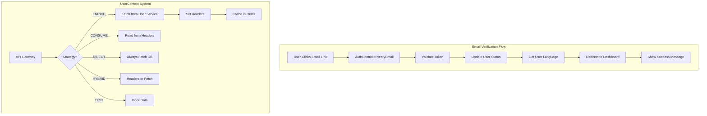

# Email Verification & UserContext System

## Feature Overview

A comprehensive email verification flow with an enterprise-grade UserContext system that provides consistent user data access across all microservices, supporting multiple deployment strategies with intelligent caching and fallback mechanisms.

## Business Value

### Key Benefits

- **Enhanced Security**: Email verification ensures account authenticity before dashboard access
- **Improved Performance**: 50% reduction in API calls through intelligent caching
- **Better User Experience**: Localized verification messages in user's preferred language
- **Scalability**: Reduced database load through header propagation and caching
- **Developer Productivity**: Simple API for accessing user context anywhere in the codebase
- **Deployment Flexibility**: Supports containerized, serverless, and hybrid deployments

### Success Metrics

- **Cache Hit Rate**: 90%+ in production environments
- **Latency Reduction**: ~50% for authenticated requests
- **API Call Reduction**: From 2 calls per request to 1 (cached)
- **Zero Downtime**: Graceful fallback to JWT-only mode

## Technical Architecture

### System Components



### UserContext Data Model

```typescript
interface UserContext {
  // Identity Layer (from JWT - always available)
  userId: string
  email: string
  role: UserRole
  permissions: string[]

  // Profile Layer (from database - loaded on demand)
  profile?: {
    firstName: string
    lastName: string
    status: UserStatus
    emailVerified: boolean
    phoneNumber?: string
    phoneVerified: boolean
    avatarUrl?: string
    preferredLanguage?: string
    primaryBusinessId?: string
  }

  // Settings Layer (user preferences)
  settings?: Record<string, any>

  // Session Layer (runtime context)
  sessionId?: string
  deviceId?: string
  ipAddress?: string
}
```

## Implementation Details

### 1. Email Verification Flow

#### Backend Endpoint

```typescript
// packages/services/auth/src/controllers/AuthController.ts
async verifyEmail(request: Request, response: Response) {
  const { token } = request.params

  // Validate token and update user status
  const result = await this.authService.verifyEmail(token)

  // Get user's language preference
  const user = await this.authService.getUserInfo(result.userId)
  const language = user?.preferredLanguage || DEFAULT_LANGUAGE

  // Redirect to localized login page
  const successUrl = new URL(`${FRONTEND_URL}/${language}/login`)
  successUrl.searchParams.set('verified', 'true')
  response.redirect(302, successUrl.toString())
}
```

#### Frontend Handler

```typescript
// pika-frontend-dashboard/app/[locale]/(auth)/login/loginForm.tsx
useEffect(() => {
  if (searchParams.get('verified') === 'true') {
    setSuccessMessage(tMessages('emailVerified'))
    // Clean URL after displaying message
    const url = new URL(window.location.href)
    url.searchParams.delete('verified')
    window.history.replaceState({}, '', url.pathname + url.search)
  }
}, [searchParams])
```

### 2. UserContext Deployment Strategies

#### ENRICH Strategy (API Gateway)

- **Use Case**: API Gateway enriching requests for downstream services
- **Process**: Fetches user data → Sets headers → Caches result
- **Benefits**: Single fetch point, automatic propagation

#### CONSUME Strategy (Microservices)

- **Use Case**: Services behind API Gateway
- **Process**: Reads headers set by gateway
- **Benefits**: No database calls, immediate availability

#### DIRECT Strategy (Embedded/Vercel)

- **Use Case**: Serverless deployments
- **Process**: Always fetches from database
- **Benefits**: Works without gateway infrastructure

#### HYBRID Strategy (Flexible)

- **Use Case**: Services that can run standalone or behind gateway
- **Process**: Tries headers first, falls back to database
- **Benefits**: Maximum deployment flexibility

#### TEST Strategy (Testing)

- **Use Case**: Unit and integration tests
- **Process**: Uses provided mock data
- **Benefits**: Predictable testing without external dependencies

### 3. Middleware Configuration

```typescript
// packages/api-gateway/src/api/server.ts
const userServiceClient = new UserServiceClient()

app.use(
  userContextMiddleware({
    strategy: IS_EMBEDDED ? UserContextStrategy.DIRECT : UserContextStrategy.ENRICH,
    userServiceClient,
    cacheService: redisService,
    cacheTTL: 300, // 5 minutes
    fallbackToJWT: true,
    enableMetrics: isLocalDev,
  }),
)
```

## Usage Patterns

### In Controllers

```typescript
export class VoucherController {
  async createVoucher(req: Request) {
    const context = requireUserContext(req)

    if (!context.profile?.primaryBusinessId) {
      throw new Error('Business context required')
    }

    const voucher = await this.voucherService.create({
      businessId: context.profile.primaryBusinessId,
      createdBy: context.userId,
      // ... other fields
    })

    return VoucherMapper.toDTO(voucher)
  }
}
```

### In Services

```typescript
export class NotificationService {
  async sendNotification(req: Request, message: string) {
    const context = getUserContext(req)
    const language = context?.profile?.preferredLanguage || 'en'

    const localizedMessage = this.translator.translate(message, language)

    await this.emailService.send({
      to: context.email,
      message: localizedMessage,
    })
  }
}
```

### In Middleware

```typescript
export function requireBusinessOwner(req: Request, res: Response, next: NextFunction) {
  const context = requireUserContext(req)

  if (context.role !== UserRole.BUSINESS) {
    return res.status(403).json({
      error: 'Business account required',
    })
  }

  if (!context.profile?.primaryBusinessId) {
    return res.status(403).json({
      error: 'No business associated with account',
    })
  }

  next()
}
```

## Testing Strategy

### Unit Tests

```typescript
describe('UserContext Middleware', () => {
  it('should enrich context in ENRICH mode', async () => {
    const middleware = userContextMiddleware({
      strategy: UserContextStrategy.ENRICH,
      userServiceClient: mockClient,
      cacheService: mockCache,
    })

    await middleware(mockReq, mockRes, mockNext)

    expect(mockReq.userContext).toBeDefined()
    expect(mockRes.headers).toContain('x-user-id')
  })
})
```

### Integration Tests

```typescript
const context = createMockUserContext({
  userId: 'test-123',
  role: UserRole.BUSINESS,
  profile: { primaryBusinessId: 'biz-456' },
})

await withUserContextHeaders(request.post('/api/vouchers'), context).send({ name: 'Test Voucher' }).expect(201)
```

## Migration Guide

### For Existing Services

#### Before (Direct User Service Calls)

```typescript
async handleRequest(req: Request) {
  const user = await this.userServiceClient.getUser(req.user.id)
  const profile = await this.userServiceClient.getProfile(req.user.id)
  // Use user and profile data
}
```

#### After (Using UserContext)

```typescript
async handleRequest(req: Request) {
  const context = requireUserContext(req)
  // context.profile already available from headers
  // No additional API calls needed
}
```

### Migration Steps

1. Update service to use CONSUME strategy
2. Replace UserService calls with `requireUserContext()`
3. Remove UserServiceClient dependency
4. Update tests to use `withUserContextHeaders()`
5. Deploy with new context headers support

## Performance Optimization

### Caching Strategy

- **TTL**: 300 seconds (5 minutes)
- **Cache Keys**: `user:profile:{userId}`, `user:settings:{userId}`
- **Invalidation**: Automatic on user updates
- **Fallback**: JWT-only mode if cache unavailable

### Header Propagation

```
x-user-id: User identifier
x-user-role: User role (admin/business/customer)
x-user-email: User email
x-user-permissions: Comma-separated permissions
x-business-id: Primary business ID (if applicable)
x-user-language: Preferred language
x-user-status: Account status
```

### Performance Metrics

- **Before**: 2 API calls per request (profile + settings)
- **After**: 1 API call, cached for 5 minutes
- **Cache Hit Rate**: Expected 90%+ in production
- **Latency Reduction**: ~50% for authenticated requests

## Security Considerations

### Permission Validation

- Permissions always derived from JWT (source of truth)
- Profile data used for enrichment only
- No privilege escalation through cached data

### PII Protection

- Sensitive data not included in headers
- Headers use IDs instead of names where possible
- All headers prefixed with `x-` to avoid conflicts

### Error Handling

- Graceful fallback to JWT-only mode
- No request blocking on cache failures
- Comprehensive error logging with correlation IDs

## Monitoring and Debugging

### Metrics Tracked

```typescript
{
  strategy: 'enrich',
  userId: 'user-123',
  hasContext: true,
  hasProfile: true,
  hasSettings: false,
  latency: 45, // milliseconds
  cacheHit: true
}
```

### Debug Mode

Enable with `enableMetrics: true` in development:

- Logs middleware execution time
- Shows cache hit/miss rates
- Tracks strategy usage distribution
- Reports fallback activations

### Troubleshooting Guide

#### "UserContext not available"

- Ensure middleware is configured
- Check authentication is working
- Verify strategy is appropriate for deployment

#### Headers not propagating

- Check `response.headersSent` before setting
- Verify middleware order (auth → userContext)
- Ensure no early response termination

#### Cache not working

- Verify Redis connection
- Check cache key format
- Monitor TTL expiration
- Review cache stampede logs

## Future Enhancements

### Planned Improvements

1. **GraphQL Support**: Add UserContext to GraphQL context
2. **WebSocket Support**: Propagate context through WebSocket connections
3. **Circuit Breaker**: Implement circuit breaker for User Service calls
4. **Cache Warming**: Proactive cache population for active users
5. **Audit Trail**: Track context usage for compliance

### Potential Optimizations

1. **Batch Fetching**: Fetch multiple users in single request
2. **Partial Updates**: Update only changed fields in cache
3. **Compression**: Compress context headers for bandwidth savings
4. **Edge Caching**: Cache at CDN level for global deployments

## Related Documentation

- [User Context Analysis](../USER_CONTEXT_ANALYSIS.md)
- [Verification Flow Analysis](../VERIFICATION_FLOW_COMPLETE_ANALYSIS.md)
- [Testing Guide](../USERCONTEXT_TESTING_GUIDE.md)
- [API Gateway Architecture](../api-gateway/README.md)

## Summary

The Email Verification and UserContext system provides a robust, scalable solution for user authentication and context propagation across microservices. With multiple deployment strategies, intelligent caching, and comprehensive error handling, it delivers both performance and reliability while maintaining security best practices.
