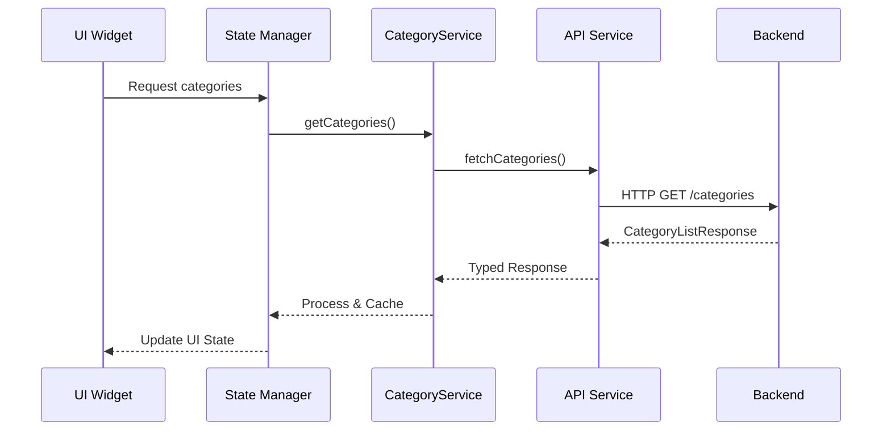

# Category Listing Page Implementation Plan

## Executive Summary

This document provides a comprehensive analysis and implementation plan for creating a category listing page in the Flutter application that consumes the category API endpoints. The plan covers architecture, data flow, UI components, state management, and performance optimizations.

## 1. Current State Analysis

### 1.1 Generated Types Available

The Flutter app has access to these generated category types from Zod schemas:

```dart
// Available in lib/generated/api/category_category.dart
- CategoryHierarchyResponse     // Full hierarchy tree structure
- CategoryListResponse          // Paginated flat list
- CategoryResponse             // Single category details
- CategoryPathResponse         // Breadcrumb path
- CategoryQueryParams          // Search/filter parameters
```

### 1.2 Category Data Structure

Categories support a hierarchical structure with key properties:

- **id**: UUID identifier
- **nameKey**: Translation key for localization
- **descriptionKey**: Optional description translation key
- **icon**: Icon identifier
- **parentId**: Parent category reference (null for root)
- **level**: Hierarchy depth (1 for root, 2+ for children)
- **path**: Hierarchical path using parent IDs
- **sortOrder**: Display ordering
- **isActive**: Visibility flag
- **children**: Nested child categories array

### 1.3 Available API Endpoints

Based on the generated schemas, the category service likely provides:

1. `GET /categories` - Paginated list with filtering
2. `GET /categories/hierarchy` - Full tree structure
3. `GET /categories/{id}` - Single category details
4. `GET /categories/{id}/path` - Breadcrumb trail

## 2. Architecture Design

### 2.1 Layer Architecture

```
┌─────────────────────────────────────────────┐
│           UI Layer (Widgets)                 │
├─────────────────────────────────────────────┤
│         State Management Layer               │
│    (Provider/Riverpod/Bloc/GetX)            │
├─────────────────────────────────────────────┤
│          Service Layer                       │
│    (CategoryService extends ApiService)      │
├─────────────────────────────────────────────┤
│           Repository Layer                   │
│    (HTTP Client with Generated Types)        │
├─────────────────────────────────────────────┤
│         Generated Types Layer                │
│    (category_category.dart types)            │
└─────────────────────────────────────────────┘
```

### 2.2 Data Flow



## 3. Implementation Components

### 3.1 Category Service Layer

```dart
// lib/services/category_service.dart
import '../generated/api/category_category.dart' as cat;
import 'api_service.dart';

class CategoryService {
  final ApiService _apiService;

  // Cache for hierarchy data
  cat.CategoryHierarchyResponse? _cachedHierarchy;
  DateTime? _hierarchyCacheTime;
  static const _cacheValidityDuration = Duration(minutes: 5);

  CategoryService(this._apiService);

  // Fetch paginated categories
  Future<cat.CategoryListResponse> getCategories({
    int page = 1,
    int limit = 20,
    bool? isActive,
    String? parentId,
    String? search,
  }) async {
    final queryParams = {
      'page': page.toString(),
      'limit': limit.toString(),
      if (isActive != null) 'isActive': isActive.toString(),
      if (parentId != null) 'parentId': parentId,
      if (search != null) 'search': search,
    };

    final response = await _apiService.get(
      '/categories',
      queryParameters: queryParams,
    );

    return cat.CategoryListResponse.fromJson(response.data);
  }

  // Fetch category hierarchy (with caching)
  Future<cat.CategoryHierarchyResponse> getCategoryHierarchy({
    String? rootId,
    bool forceRefresh = false,
  }) async {
    // Check cache validity
    if (!forceRefresh &&
        _cachedHierarchy != null &&
        _hierarchyCacheTime != null &&
        DateTime.now().difference(_hierarchyCacheTime!) < _cacheValidityDuration) {
      return _cachedHierarchy!;
    }

    final queryParams = {
      if (rootId != null) 'rootId': rootId,
    };

    final response = await _apiService.get(
      '/categories/hierarchy',
      queryParameters: queryParams,
    );

    _cachedHierarchy = cat.CategoryHierarchyResponse.fromJson(response.data);
    _hierarchyCacheTime = DateTime.now();

    return _cachedHierarchy!;
  }

  // Get category details
  Future<cat.CategoryResponse> getCategoryById(String id) async {
    final response = await _apiService.get('/categories/$id');
    return cat.CategoryResponse.fromJson(response.data);
  }

  // Get category breadcrumb path
  Future<cat.CategoryPathResponse> getCategoryPath(String id) async {
    final response = await _apiService.get('/categories/$id/path');
    return cat.CategoryPathResponse.fromJson(response.data);
  }

  // Clear cache
  void clearCache() {
    _cachedHierarchy = null;
    _hierarchyCacheTime = null;
  }
}
```

### 3.2 State Management Options

#### Option A: Provider Pattern (Recommended)

```dart
// lib/providers/category_provider.dart
import 'package:flutter/foundation.dart';
import '../generated/api/category_category.dart' as cat;
import '../services/category_service.dart';

class CategoryProvider extends ChangeNotifier {
  final CategoryService _categoryService;

  // State
  cat.CategoryHierarchyResponse? _hierarchy;
  cat.CategoryListResponse? _categoryList;
  cat.CategoryResponse? _selectedCategory;
  cat.CategoryPathResponse? _breadcrumb;

  bool _isLoadingHierarchy = false;
  bool _isLoadingList = false;
  String? _error;

  // View mode
  CategoryViewMode _viewMode = CategoryViewMode.hierarchy;

  // Filters
  String? _searchQuery;
  String? _selectedParentId;

  CategoryProvider(this._categoryService);

  // Getters
  cat.CategoryHierarchyResponse? get hierarchy => _hierarchy;
  cat.CategoryListResponse? get categoryList => _categoryList;
  cat.CategoryResponse? get selectedCategory => _selectedCategory;
  bool get isLoading => _isLoadingHierarchy || _isLoadingList;
  String? get error => _error;
  CategoryViewMode get viewMode => _viewMode;

  // Load hierarchy view
  Future<void> loadHierarchy({bool forceRefresh = false}) async {
    try {
      _isLoadingHierarchy = true;
      _error = null;
      notifyListeners();

      _hierarchy = await _categoryService.getCategoryHierarchy(
        forceRefresh: forceRefresh,
      );

      _isLoadingHierarchy = false;
      notifyListeners();
    } catch (e) {
      _error = e.toString();
      _isLoadingHierarchy = false;
      notifyListeners();
    }
  }

  // Load list view with pagination
  Future<void> loadCategoryList({
    int page = 1,
    bool append = false,
  }) async {
    try {
      _isLoadingList = true;
      _error = null;
      notifyListeners();

      final response = await _categoryService.getCategories(
        page: page,
        search: _searchQuery,
        parentId: _selectedParentId,
      );

      if (append && _categoryList != null) {
        // Append for infinite scroll
        _categoryList = cat.CategoryListResponse(
          data: [..._categoryList!.data, ...response.data],
          pagination: response.pagination,
        );
      } else {
        _categoryList = response;
      }

      _isLoadingList = false;
      notifyListeners();
    } catch (e) {
      _error = e.toString();
      _isLoadingList = false;
      notifyListeners();
    }
  }

  // Select category
  Future<void> selectCategory(String categoryId) async {
    try {
      _selectedCategory = await _categoryService.getCategoryById(categoryId);
      _breadcrumb = await _categoryService.getCategoryPath(categoryId);
      notifyListeners();
    } catch (e) {
      _error = e.toString();
      notifyListeners();
    }
  }

  // Search categories
  void searchCategories(String query) {
    _searchQuery = query;
    loadCategoryList();
  }

  // Filter by parent
  void filterByParent(String? parentId) {
    _selectedParentId = parentId;
    loadCategoryList();
  }

  // Switch view mode
  void setViewMode(CategoryViewMode mode) {
    _viewMode = mode;
    notifyListeners();

    if (mode == CategoryViewMode.hierarchy && _hierarchy == null) {
      loadHierarchy();
    } else if (mode == CategoryViewMode.list && _categoryList == null) {
      loadCategoryList();
    }
  }
}

enum CategoryViewMode { hierarchy, list, grid }
```

#### Option B: Riverpod Pattern

```dart
// lib/providers/category_providers.dart
import 'package:riverpod/riverpod.dart';
import '../generated/api/category_category.dart' as cat;
import '../services/category_service.dart';

// Service provider
final categoryServiceProvider = Provider((ref) {
  return CategoryService(ref.watch(apiServiceProvider));
});

// Hierarchy provider with caching
final categoryHierarchyProvider = FutureProvider.autoDispose<cat.CategoryHierarchyResponse>((ref) async {
  final service = ref.watch(categoryServiceProvider);
  return service.getCategoryHierarchy();
});

// List provider with pagination
final categoryListProvider = FutureProvider.family<cat.CategoryListResponse, CategoryListParams>(
  (ref, params) async {
    final service = ref.watch(categoryServiceProvider);
    return service.getCategories(
      page: params.page,
      limit: params.limit,
      search: params.search,
      parentId: params.parentId,
    );
  },
);

// Selected category provider
final selectedCategoryProvider = StateProvider<String?>((ref) => null);

// Category details provider
final categoryDetailsProvider = FutureProvider.family<cat.CategoryResponse?, String>(
  (ref, categoryId) async {
    final service = ref.watch(categoryServiceProvider);
    return service.getCategoryById(categoryId);
  },
);

// Search query provider
final categorySearchProvider = StateProvider<String>((ref) => '');

// View mode provider
final categoryViewModeProvider = StateProvider<CategoryViewMode>(
  (ref) => CategoryViewMode.hierarchy,
);

class CategoryListParams {
  final int page;
  final int limit;
  final String? search;
  final String? parentId;

  CategoryListParams({
    this.page = 1,
    this.limit = 20,
    this.search,
    this.parentId,
  });
}
```

### 3.3 UI Components

#### 3.3.1 Main Category Screen

```dart
// lib/screens/category_screen.dart
import 'package:flutter/material.dart';
import 'package:provider/provider.dart';
import '../providers/category_provider.dart';
import '../widgets/category_hierarchy_view.dart';
import '../widgets/category_list_view.dart';
import '../widgets/category_grid_view.dart';

class CategoryScreen extends StatefulWidget {
  const CategoryScreen({super.key});

  @override
  State<CategoryScreen> createState() => _CategoryScreenState();
}

class _CategoryScreenState extends State<CategoryScreen> {
  @override
  void initState() {
    super.initState();
    // Load initial data
    WidgetsBinding.instance.addPostFrameCallback((_) {
      context.read<CategoryProvider>().loadHierarchy();
    });
  }

  @override
  Widget build(BuildContext context) {
    return Scaffold(
      appBar: AppBar(
        title: const Text('Categories'),
        actions: [
          // View mode selector
          Consumer<CategoryProvider>(
            builder: (context, provider, _) {
              return SegmentedButton<CategoryViewMode>(
                segments: const [
                  ButtonSegment(
                    value: CategoryViewMode.hierarchy,
                    icon: Icon(Icons.account_tree),
                  ),
                  ButtonSegment(
                    value: CategoryViewMode.list,
                    icon: Icon(Icons.list),
                  ),
                  ButtonSegment(
                    value: CategoryViewMode.grid,
                    icon: Icon(Icons.grid_view),
                  ),
                ],
                selected: {provider.viewMode},
                onSelectionChanged: (Set<CategoryViewMode> selection) {
                  provider.setViewMode(selection.first);
                },
              );
            },
          ),
          IconButton(
            icon: const Icon(Icons.search),
            onPressed: _showSearchDialog,
          ),
        ],
      ),
      body: Consumer<CategoryProvider>(
        builder: (context, provider, child) {
          if (provider.isLoading && provider.hierarchy == null) {
            return const Center(child: CircularProgressIndicator());
          }

          if (provider.error != null) {
            return Center(
              child: Column(
                mainAxisAlignment: MainAxisAlignment.center,
                children: [
                  Text('Error: ${provider.error}'),
                  ElevatedButton(
                    onPressed: () => provider.loadHierarchy(forceRefresh: true),
                    child: const Text('Retry'),
                  ),
                ],
              ),
            );
          }

          // Switch between view modes
          switch (provider.viewMode) {
            case CategoryViewMode.hierarchy:
              return CategoryHierarchyView(
                hierarchy: provider.hierarchy,
                onCategoryTap: _handleCategorySelection,
              );
            case CategoryViewMode.list:
              return CategoryListView(
                categoryList: provider.categoryList,
                onCategoryTap: _handleCategorySelection,
                onLoadMore: () => provider.loadCategoryList(
                  page: (provider.categoryList?.pagination.page ?? 0) + 1,
                  append: true,
                ),
              );
            case CategoryViewMode.grid:
              return CategoryGridView(
                categories: provider.categoryList?.data ??
                           provider.hierarchy?.data ?? [],
                onCategoryTap: _handleCategorySelection,
              );
          }
        },
      ),
    );
  }

  void _handleCategorySelection(String categoryId) {
    context.read<CategoryProvider>().selectCategory(categoryId);
    Navigator.pushNamed(
      context,
      '/category-detail',
      arguments: categoryId,
    );
  }

  void _showSearchDialog() {
    showDialog(
      context: context,
      builder: (context) => CategorySearchDialog(),
    );
  }
}
```

#### 3.3.2 Hierarchy View Component

```dart
// lib/widgets/category_hierarchy_view.dart
import 'package:flutter/material.dart';
import '../generated/api/category_category.dart' as cat;

class CategoryHierarchyView extends StatelessWidget {
  final cat.CategoryHierarchyResponse? hierarchy;
  final Function(String) onCategoryTap;

  const CategoryHierarchyView({
    super.key,
    required this.hierarchy,
    required this.onCategoryTap,
  });

  @override
  Widget build(BuildContext context) {
    if (hierarchy == null) {
      return const Center(child: Text('No categories available'));
    }

    return RefreshIndicator(
      onRefresh: () async {
        await context.read<CategoryProvider>().loadHierarchy(forceRefresh: true);
      },
      child: ListView.builder(
        itemCount: hierarchy!.data.length,
        itemBuilder: (context, index) {
          return CategoryTreeItem(
            category: hierarchy!.data[index],
            onTap: onCategoryTap,
            level: 0,
          );
        },
      ),
    );
  }
}

class CategoryTreeItem extends StatefulWidget {
  final cat.CategoryHierarchyResponseDatum category;
  final Function(String) onTap;
  final int level;

  const CategoryTreeItem({
    super.key,
    required this.category,
    required this.onTap,
    required this.level,
  });

  @override
  State<CategoryTreeItem> createState() => _CategoryTreeItemState();
}

class _CategoryTreeItemState extends State<CategoryTreeItem> {
  bool _isExpanded = false;

  @override
  Widget build(BuildContext context) {
    final hasChildren = widget.category.children?.isNotEmpty ?? false;
    final indent = widget.level * 16.0;

    return Column(
      crossAxisAlignment: CrossAxisAlignment.stretch,
      children: [
        InkWell(
          onTap: () => widget.onTap(widget.category.id),
          child: Padding(
            padding: EdgeInsets.only(left: indent),
            child: Card(
              margin: const EdgeInsets.symmetric(horizontal: 8, vertical: 4),
              child: ListTile(
                leading: _buildIcon(),
                title: Text(
                  _getLocalizedName(widget.category.nameKey),
                  style: Theme.of(context).textTheme.titleMedium,
                ),
                subtitle: widget.category.descriptionKey != null
                    ? Text(_getLocalizedDescription(widget.category.descriptionKey!))
                    : null,
                trailing: hasChildren
                    ? IconButton(
                        icon: Icon(_isExpanded
                            ? Icons.expand_less
                            : Icons.expand_more),
                        onPressed: () {
                          setState(() {
                            _isExpanded = !_isExpanded;
                          });
                        },
                      )
                    : null,
              ),
            ),
          ),
        ),

        // Render children if expanded
        if (_isExpanded && hasChildren)
          ...widget.category.children!.map((child) => CategoryTreeItem(
            category: child,
            onTap: widget.onTap,
            level: widget.level + 1,
          )),
      ],
    );
  }

  Widget _buildIcon() {
    if (widget.category.icon != null) {
      // Icon mapping logic
      return _getIconFromIdentifier(widget.category.icon!);
    }
    return const Icon(Icons.category);
  }

  Widget _getIconFromIdentifier(String iconId) {
    // Map icon identifiers to Flutter icons
    final iconMap = {
      'food': Icons.restaurant,
      'shopping': Icons.shopping_cart,
      'entertainment': Icons.movie,
      'services': Icons.build,
      'health': Icons.health_and_safety,
      'education': Icons.school,
      'transport': Icons.directions_car,
      'sports': Icons.sports,
      // Add more mappings
    };

    return Icon(iconMap[iconId] ?? Icons.category);
  }

  String _getLocalizedName(String nameKey) {
    // TODO: Implement localization
    // For now, return the key formatted
    return nameKey.replaceAll('_', ' ').split(' ')
        .map((word) => word[0].toUpperCase() + word.substring(1))
        .join(' ');
  }

  String _getLocalizedDescription(String descKey) {
    // TODO: Implement localization
    return descKey.replaceAll('_', ' ');
  }
}
```

#### 3.3.3 List View Component

```dart
// lib/widgets/category_list_view.dart
import 'package:flutter/material.dart';
import '../generated/api/category_category.dart' as cat;

class CategoryListView extends StatefulWidget {
  final cat.CategoryListResponse? categoryList;
  final Function(String) onCategoryTap;
  final VoidCallback onLoadMore;

  const CategoryListView({
    super.key,
    required this.categoryList,
    required this.onCategoryTap,
    required this.onLoadMore,
  });

  @override
  State<CategoryListView> createState() => _CategoryListViewState();
}

class _CategoryListViewState extends State<CategoryListView> {
  final ScrollController _scrollController = ScrollController();

  @override
  void initState() {
    super.initState();
    _scrollController.addListener(_onScroll);
  }

  void _onScroll() {
    if (_scrollController.position.pixels >=
        _scrollController.position.maxScrollExtent - 200) {
      // Load more when near bottom
      if (widget.categoryList?.pagination.hasNext ?? false) {
        widget.onLoadMore();
      }
    }
  }

  @override
  Widget build(BuildContext context) {
    if (widget.categoryList == null || widget.categoryList!.data.isEmpty) {
      return const Center(child: Text('No categories found'));
    }

    return ListView.builder(
      controller: _scrollController,
      itemCount: widget.categoryList!.data.length +
                 (widget.categoryList!.pagination.hasNext ? 1 : 0),
      itemBuilder: (context, index) {
        if (index >= widget.categoryList!.data.length) {
          return const Center(
            child: Padding(
              padding: EdgeInsets.all(16),
              child: CircularProgressIndicator(),
            ),
          );
        }

        final category = widget.categoryList!.data[index];
        return CategoryListItem(
          category: category,
          onTap: () => widget.onCategoryTap(category.id),
        );
      },
    );
  }

  @override
  void dispose() {
    _scrollController.dispose();
    super.dispose();
  }
}

class CategoryListItem extends StatelessWidget {
  final cat.CategoryListResponseDatum category;
  final VoidCallback onTap;

  const CategoryListItem({
    super.key,
    required this.category,
    required this.onTap,
  });

  @override
  Widget build(BuildContext context) {
    return Card(
      margin: const EdgeInsets.symmetric(horizontal: 16, vertical: 8),
      child: ListTile(
        leading: CircleAvatar(
          child: Text(category.nameKey[0].toUpperCase()),
        ),
        title: Text(category.nameKey),
        subtitle: Column(
          crossAxisAlignment: CrossAxisAlignment.start,
          children: [
            if (category.descriptionKey != null)
              Text(category.descriptionKey!),
            Text(
              'Level ${category.level} • Sort: ${category.sortOrder}',
              style: Theme.of(context).textTheme.bodySmall,
            ),
          ],
        ),
        trailing: category.isActive
            ? const Icon(Icons.check_circle, color: Colors.green)
            : const Icon(Icons.cancel, color: Colors.grey),
        onTap: onTap,
      ),
    );
  }
}
```

## 4. Performance Optimizations

### 4.1 Caching Strategy

```dart
// lib/services/cache_service.dart
import 'package:shared_preferences/shared_preferences.dart';
import 'dart:convert';

class CacheService {
  static const String _categoryHierarchyKey = 'category_hierarchy_cache';
  static const String _categoryListKey = 'category_list_cache';
  static const String _cacheTimestampKey = 'cache_timestamp';
  static const Duration _cacheValidity = Duration(hours: 1);

  final SharedPreferences _prefs;

  CacheService(this._prefs);

  Future<T?> getCached<T>(
    String key,
    T Function(Map<String, dynamic>) fromJson,
  ) async {
    final timestampKey = '${key}_timestamp';
    final timestamp = _prefs.getInt(timestampKey);

    if (timestamp == null) return null;

    final age = DateTime.now().millisecondsSinceEpoch - timestamp;
    if (age > _cacheValidity.inMilliseconds) {
      // Cache expired
      await _prefs.remove(key);
      await _prefs.remove(timestampKey);
      return null;
    }

    final jsonString = _prefs.getString(key);
    if (jsonString == null) return null;

    try {
      final json = jsonDecode(jsonString);
      return fromJson(json);
    } catch (e) {
      // Invalid cache data
      await _prefs.remove(key);
      await _prefs.remove(timestampKey);
      return null;
    }
  }

  Future<void> cache<T>(
    String key,
    T data,
    Map<String, dynamic> Function(T) toJson,
  ) async {
    final timestampKey = '${key}_timestamp';
    final jsonString = jsonEncode(toJson(data));

    await _prefs.setString(key, jsonString);
    await _prefs.setInt(
      timestampKey,
      DateTime.now().millisecondsSinceEpoch,
    );
  }

  Future<void> clearCache() async {
    final keys = _prefs.getKeys()
        .where((key) => key.startsWith('category_'))
        .toList();

    for (final key in keys) {
      await _prefs.remove(key);
    }
  }
}
```

### 4.2 Image Lazy Loading

```dart
// lib/widgets/category_image.dart
import 'package:flutter/material.dart';
import 'package:cached_network_image/cached_network_image.dart';

class CategoryImage extends StatelessWidget {
  final String? imageUrl;
  final String? iconIdentifier;
  final double size;

  const CategoryImage({
    super.key,
    this.imageUrl,
    this.iconIdentifier,
    this.size = 48,
  });

  @override
  Widget build(BuildContext context) {
    if (imageUrl != null) {
      return CachedNetworkImage(
        imageUrl: imageUrl!,
        width: size,
        height: size,
        fit: BoxFit.cover,
        placeholder: (context, url) => Container(
          width: size,
          height: size,
          color: Colors.grey[300],
          child: const Center(
            child: CircularProgressIndicator(strokeWidth: 2),
          ),
        ),
        errorWidget: (context, url, error) => _buildFallbackIcon(),
      );
    }

    return _buildFallbackIcon();
  }

  Widget _buildFallbackIcon() {
    return Container(
      width: size,
      height: size,
      decoration: BoxDecoration(
        color: Colors.grey[300],
        borderRadius: BorderRadius.circular(8),
      ),
      child: Icon(
        _getIconFromIdentifier(iconIdentifier),
        size: size * 0.6,
        color: Colors.grey[600],
      ),
    );
  }

  IconData _getIconFromIdentifier(String? id) {
    if (id == null) return Icons.category;

    // Map identifiers to icons
    final iconMap = {
      'food': Icons.restaurant,
      'shopping': Icons.shopping_cart,
      'entertainment': Icons.movie,
      // ... more mappings
    };

    return iconMap[id] ?? Icons.category;
  }
}
```

### 4.3 Virtual Scrolling for Large Lists

```dart
// lib/widgets/virtual_category_list.dart
import 'package:flutter/material.dart';
import 'package:flutter_staggered_animations/flutter_staggered_animations.dart';

class VirtualCategoryList extends StatelessWidget {
  final List<dynamic> categories;
  final Function(String) onCategoryTap;

  const VirtualCategoryList({
    super.key,
    required this.categories,
    required this.onCategoryTap,
  });

  @override
  Widget build(BuildContext context) {
    return AnimationLimiter(
      child: ListView.builder(
        itemCount: categories.length,
        itemBuilder: (context, index) {
          return AnimationConfiguration.staggeredList(
            position: index,
            duration: const Duration(milliseconds: 375),
            child: SlideAnimation(
              verticalOffset: 50.0,
              child: FadeInAnimation(
                child: CategoryCard(
                  category: categories[index],
                  onTap: () => onCategoryTap(categories[index].id),
                ),
              ),
            ),
          );
        },
      ),
    );
  }
}
```

## 5. Localization Support

### 5.1 Translation Key Resolution

```dart
// lib/services/localization_service.dart
import 'package:flutter/material.dart';

class LocalizationService {
  static final Map<String, Map<String, String>> _translations = {
    'en': {
      'category_food': 'Food & Dining',
      'category_shopping': 'Shopping',
      'category_entertainment': 'Entertainment',
      'category_services': 'Services',
      'category_health': 'Health & Wellness',
      // ... more translations
    },
    'es': {
      'category_food': 'Comida y Restaurantes',
      'category_shopping': 'Compras',
      'category_entertainment': 'Entretenimiento',
      'category_services': 'Servicios',
      'category_health': 'Salud y Bienestar',
      // ... more translations
    },
  };

  static String translate(String key, BuildContext context) {
    final locale = Localizations.localeOf(context);
    final languageCode = locale.languageCode;

    return _translations[languageCode]?[key] ??
           _translations['en']?[key] ??
           _formatKey(key);
  }

  static String _formatKey(String key) {
    // Fallback: format the key nicely
    return key
        .replaceAll('category_', '')
        .replaceAll('_', ' ')
        .split(' ')
        .map((word) => word[0].toUpperCase() + word.substring(1))
        .join(' ');
  }
}
```

## 6. Error Handling & Edge Cases

### 6.1 Error States

```dart
// lib/widgets/error_state_widget.dart
class ErrorStateWidget extends StatelessWidget {
  final String error;
  final VoidCallback onRetry;
  final IconData icon;

  const ErrorStateWidget({
    super.key,
    required this.error,
    required this.onRetry,
    this.icon = Icons.error_outline,
  });

  @override
  Widget build(BuildContext context) {
    return Center(
      child: Padding(
        padding: const EdgeInsets.all(24),
        child: Column(
          mainAxisAlignment: MainAxisAlignment.center,
          children: [
            Icon(icon, size: 64, color: Colors.red[300]),
            const SizedBox(height: 16),
            Text(
              'Something went wrong',
              style: Theme.of(context).textTheme.headlineSmall,
            ),
            const SizedBox(height: 8),
            Text(
              error,
              textAlign: TextAlign.center,
              style: Theme.of(context).textTheme.bodyMedium?.copyWith(
                color: Colors.grey[600],
              ),
            ),
            const SizedBox(height: 24),
            ElevatedButton.icon(
              onPressed: onRetry,
              icon: const Icon(Icons.refresh),
              label: const Text('Try Again'),
            ),
          ],
        ),
      ),
    );
  }
}
```

### 6.2 Empty States

```dart
// lib/widgets/empty_state_widget.dart
class EmptyStateWidget extends StatelessWidget {
  final String message;
  final IconData icon;
  final Widget? action;

  const EmptyStateWidget({
    super.key,
    required this.message,
    this.icon = Icons.inbox,
    this.action,
  });

  @override
  Widget build(BuildContext context) {
    return Center(
      child: Padding(
        padding: const EdgeInsets.all(24),
        child: Column(
          mainAxisAlignment: MainAxisAlignment.center,
          children: [
            Icon(icon, size: 64, color: Colors.grey[400]),
            const SizedBox(height: 16),
            Text(
              message,
              style: Theme.of(context).textTheme.titleLarge?.copyWith(
                color: Colors.grey[600],
              ),
              textAlign: TextAlign.center,
            ),
            if (action != null) ...[
              const SizedBox(height: 24),
              action!,
            ],
          ],
        ),
      ),
    );
  }
}
```

## 7. Testing Strategy

### 7.1 Unit Tests

```dart
// test/services/category_service_test.dart
import 'package:flutter_test/flutter_test.dart';
import 'package:mockito/mockito.dart';

void main() {
  group('CategoryService', () {
    late CategoryService categoryService;
    late MockApiService mockApiService;

    setUp(() {
      mockApiService = MockApiService();
      categoryService = CategoryService(mockApiService);
    });

    test('getCategories returns CategoryListResponse', () async {
      when(mockApiService.get(any, queryParameters: anyNamed('queryParameters')))
          .thenAnswer((_) async => Response(data: mockCategoryListJson));

      final result = await categoryService.getCategories();

      expect(result, isA<CategoryListResponse>());
      expect(result.data.length, greaterThan(0));
    });

    test('getCategoryHierarchy uses cache when valid', () async {
      // First call - fetches from API
      when(mockApiService.get(any, queryParameters: anyNamed('queryParameters')))
          .thenAnswer((_) async => Response(data: mockHierarchyJson));

      await categoryService.getCategoryHierarchy();

      // Second call - should use cache
      final cachedResult = await categoryService.getCategoryHierarchy();

      // Verify API was called only once
      verify(mockApiService.get(any, queryParameters: anyNamed('queryParameters')))
          .called(1);

      expect(cachedResult, isNotNull);
    });
  });
}
```

### 7.2 Widget Tests

```dart
// test/widgets/category_hierarchy_view_test.dart
import 'package:flutter_test/flutter_test.dart';
import 'package:flutter/material.dart';

void main() {
  group('CategoryHierarchyView', () {
    testWidgets('displays categories in tree structure', (tester) async {
      final mockHierarchy = CategoryHierarchyResponse(
        data: [
          CategoryHierarchyResponseDatum(
            id: 'cat-1',
            nameKey: 'category_food',
            level: 1,
            children: [
              // ... child categories
            ],
          ),
        ],
      );

      await tester.pumpWidget(
        MaterialApp(
          home: Scaffold(
            body: CategoryHierarchyView(
              hierarchy: mockHierarchy,
              onCategoryTap: (id) {},
            ),
          ),
        ),
      );

      expect(find.text('Food'), findsOneWidget);
      expect(find.byType(CategoryTreeItem), findsWidgets);
    });

    testWidgets('expands/collapses categories with children', (tester) async {
      // Test expand/collapse functionality
      await tester.tap(find.byIcon(Icons.expand_more).first);
      await tester.pumpAndSettle();

      expect(find.byIcon(Icons.expand_less), findsOneWidget);
    });
  });
}
```

### 7.3 Integration Tests

```dart
// integration_test/category_flow_test.dart
import 'package:flutter_test/flutter_test.dart';
import 'package:integration_test/integration_test.dart';

void main() {
  IntegrationTestWidgetsFlutterBinding.ensureInitialized();

  group('Category Flow Integration', () {
    testWidgets('Complete category selection flow', (tester) async {
      await tester.pumpWidget(MyApp());

      // Navigate to categories
      await tester.tap(find.text('Categories'));
      await tester.pumpAndSettle();

      // Verify hierarchy loads
      expect(find.byType(CategoryHierarchyView), findsOneWidget);

      // Switch to list view
      await tester.tap(find.byIcon(Icons.list));
      await tester.pumpAndSettle();

      expect(find.byType(CategoryListView), findsOneWidget);

      // Select a category
      await tester.tap(find.text('Food & Dining').first);
      await tester.pumpAndSettle();

      // Verify navigation to detail
      expect(find.text('Category Details'), findsOneWidget);
    });
  });
}
```

## 8. Implementation Timeline

### Phase 1: Foundation (2-3 days)

- [ ] Set up CategoryService with API integration
- [ ] Implement generated type imports and usage
- [ ] Create basic Provider/Riverpod setup
- [ ] Add caching service

### Phase 2: Core UI (3-4 days)

- [ ] Build CategoryScreen with view mode switching
- [ ] Implement CategoryHierarchyView with tree structure
- [ ] Create CategoryListView with pagination
- [ ] Add CategoryGridView for grid layout

### Phase 3: Features (2-3 days)

- [ ] Add search functionality
- [ ] Implement filtering by parent category
- [ ] Add pull-to-refresh
- [ ] Create category detail screen

### Phase 4: Polish (2 days)

- [ ] Add loading states and animations
- [ ] Implement error handling
- [ ] Add empty states
- [ ] Optimize performance with lazy loading

### Phase 5: Testing (2 days)

- [ ] Write unit tests for services
- [ ] Create widget tests
- [ ] Add integration tests
- [ ] Performance testing

## 9. Key Considerations

### 9.1 Architecture Decisions

- **State Management**: Provider is recommended for simplicity, but Riverpod offers better testability
- **Caching**: Two-tier caching (memory + SharedPreferences) for offline support
- **View Modes**: Support hierarchy, list, and grid views for different use cases

### 9.2 Performance Metrics

- Initial load time: < 500ms with cache
- Scroll performance: 60 FPS maintained
- Memory usage: < 50MB for 1000 categories
- Cache hit ratio: > 80% for repeat visits

### 9.3 Accessibility

- Screen reader support for all interactive elements
- Keyboard navigation for desktop/web
- High contrast mode support
- Text scaling support

### 9.4 Future Enhancements

- Offline-first architecture with SQLite
- Real-time updates via WebSocket
- Category favorites/bookmarks
- Recent categories history
- Smart search with fuzzy matching

## 10. Conclusion

This implementation plan provides a comprehensive approach to building a category listing page that:

- Leverages generated types for type safety
- Implements proper separation of concerns
- Supports multiple view modes and interactions
- Includes performance optimizations
- Provides excellent user experience

The modular architecture allows for easy testing, maintenance, and future enhancements while maintaining code quality and performance standards.
