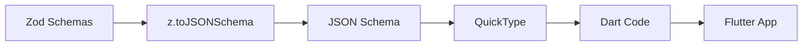

# Flutter Type Generation from Zod Schemas

## Overview

This document describes the automated type generation system that creates Dart/Flutter types from Zod schemas. This ensures type safety and consistency between the backend API and Flutter mobile application.

## Architecture

### Components

1. **Zod Schemas** (Source of Truth)
   - Located in `/src/domains/*/schemas/`
   - Define API request/response types in TypeScript
   - Use Zod for runtime validation

2. **Generation Script**
   - Located at `/scripts/generate-flutter-types.ts`
   - Converts Zod schemas → JSON Schema → Dart code
   - Handles deduplication and error recovery

3. **Generated Flutter Types**
   - Output to `/generated/flutter/lib/generated/api/`
   - Ready-to-use Dart classes with serialization
   - Automatically copied to Flutter project

### Generation Flow



## How It Works

### 1. Schema Discovery

The script automatically discovers all Zod schemas:

```typescript
const schemaFiles = glob.sync('src/domains/*/schemas/*.schema.ts')
```

### 2. Schema Export Collection

For each schema file, it collects all exported Zod schemas:

```typescript
// Extracts exports like:
export const LoginRequestSchema = z.object({...})
export const LoginResponseSchema = z.object({...})
```

### 3. Conversion Process

#### Native Zod 4 Conversion
```typescript
const jsonSchema = zodSchema.toJSONSchema()
```

#### QuickType Generation
```typescript
await quicktype({
  lang: 'dart',
  inputData: JSON.stringify(jsonSchema),
  rendererOptions: {
    'null-safety': 'true',
    'required-properties': 'true',
    'final-properties': 'false',
    'generate-copyWith': 'false',
    'use-freezed': 'false',
    'use-hive': 'false',
    'part-name': moduleName,
  }
})
```

### 4. Deduplication Strategy

When combined schema generation fails, the script:
1. Generates individual schemas separately
2. Tracks duplicate definitions (enums, classes, variables)
3. Skips duplicates when combining files

```typescript
const seenEnums = new Set<string>()
const seenClasses = new Set<string>()
const seenVariables = new Set<string>()

// Smart block detection with depth tracking
if (line.startsWith('enum ')) {
  const enumName = line.split(' ')[1].replace('{', '')
  if (seenEnums.has(enumName)) {
    skipBlock = true
    continue
  }
  seenEnums.add(enumName)
}
```

## Setup

### Prerequisites

1. **Backend Dependencies**
```bash
yarn add --dev quicktype quicktype-core glob
```

2. **Flutter Dependencies**
```yaml
# pubspec.yaml
dependencies:
  http: ^1.1.0
  shared_preferences: ^2.2.2
```

### Configuration

1. **Package.json Script**
```json
{
  "scripts": {
    "generate:flutter-types": "tsx scripts/generate-flutter-types.ts"
  }
}
```

2. **Environment Variables** (Optional)
```bash
FLUTTER_PROJECT_PATH=/path/to/flutter/project
```

## Usage

### Generating Types

Run from the backend directory:

```bash
yarn generate:flutter-types
```

Output:
```
🚀 Starting Flutter type generation from Zod schemas...
📂 Processing domain: auth
  ✅ Generated auth_login.dart (7 schemas)
  ✅ Generated auth_register.dart (5 schemas)
📂 Processing domain: business
  ✅ Generated business_business.dart (9 schemas)
...
✨ Flutter types generated successfully!
📊 Summary: 7 files, 113 serialization methods
```

### Using Generated Types in Flutter

#### 1. Import Generated Types
```dart
import 'package:your_app/generated/api/auth_login.dart';
import 'package:your_app/generated/api/user_profile.dart' as api;
```

#### 2. API Service Implementation
```dart
class ApiService {
  Future<AuthTokensResponse> login({
    required String email,
    required String password,
  }) async {
    final response = await http.post(
      Uri.parse('$baseUrl/auth/login'),
      body: jsonEncode({'email': email, 'password': password}),
    );
    
    if (response.statusCode == 200) {
      return AuthTokensResponse.fromJson(jsonDecode(response.body));
    }
    throw ApiException('Login failed');
  }
}
```

#### 3. Using in Widgets
```dart
class ProfileScreen extends StatefulWidget {
  api.CurrentUserProfile? profile;
  
  Widget _buildRoleBadge(api.Role role) {
    final config = switch (role) {
      api.Role.ADMIN => ('Admin', Colors.red),
      api.Role.BUSINESS => ('Business', Colors.blue),
      api.Role.CUSTOMER => ('Customer', Colors.green),
    };
    
    return Badge(text: config.$1, color: config.$2);
  }
}
```

## Type Safety Features

### 1. Null Safety
All generated types use Dart's null safety:
```dart
class CurrentUserProfile {
  final String id;          // Required
  final String? avatarUrl;  // Optional
}
```

### 2. Enum Support
Enums are generated with mapping utilities:
```dart
enum Role { ADMIN, BUSINESS, CUSTOMER }

final roleValues = EnumValues({
  "admin": Role.ADMIN,
  "business": Role.BUSINESS,
  "customer": Role.CUSTOMER
});
```

### 3. Nested Objects
Complex nested structures are properly handled:
```dart
class BusinessListResponse {
  final List<Datum> data;
  final Pagination pagination;
}

class Pagination {
  final int page;
  final int limit;
  final bool hasNext;
}
```

### 4. Date/Time Handling
DateTime fields are serialized as ISO strings:
```dart
factory Session.fromJson(Map<String, dynamic> json) => Session(
  createdAt: DateTime.parse(json["createdAt"]),
  lastActive: DateTime.parse(json["lastActive"]),
);
```

## Common Issues & Solutions

### Issue 1: Duplicate Enum Definitions

**Problem**: Multiple schemas define the same enum (e.g., `Role`, `Status`)

**Solution**: The script automatically deduplicates enums:
- Tracks seen enum names
- Skips duplicate definitions
- Preserves the first occurrence

### Issue 2: Import Conflicts

**Problem**: Generated types conflict with Flutter's built-in types (e.g., `Theme`)

**Solution**: Use aliased imports:
```dart
import '../generated/api/user_profile.dart' as api;

// Usage
api.Theme userTheme = api.Theme.DARK;
```

### Issue 3: QuickType Errors

**Problem**: "s.codePointAt is not a function" error

**Solution**: The script has automatic fallback:
1. Tries combined generation first
2. Falls back to individual schema generation
3. Combines with deduplication

### Issue 4: Missing Serialization

**Problem**: Custom types not serializing correctly

**Solution**: Ensure Zod schemas use supported types:
```typescript
// ✅ Good
z.string().datetime()  // ISO datetime string
z.number()            // Numeric values
z.boolean()           // Boolean flags

// ❌ Avoid
z.date()             // Use z.string().datetime() instead
z.map()              // Use z.record() instead
```

## Best Practices

### 1. Schema Naming Convention
```typescript
// Use descriptive suffixes
export const LoginRequestSchema = z.object({...})
export const LoginResponseSchema = z.object({...})
export const UserProfileSchema = z.object({...})
```

### 2. Shared Types
Create common schemas for reused types:
```typescript
// common.schema.ts
export const PaginationSchema = z.object({
  page: z.number(),
  limit: z.number(),
  total: z.number(),
})

// Use in other schemas
export const UsersListResponseSchema = z.object({
  data: z.array(UserSchema),
  pagination: PaginationSchema,
})
```

### 3. Documentation
Add JSDoc comments to schemas:
```typescript
export const UserSchema = z.object({
  /** Unique user identifier */
  id: z.string().uuid(),
  /** User's email address */
  email: z.string().email(),
})
```

### 4. Version Control
- Commit generated files for consistency
- Include generation in CI/CD pipeline
- Document breaking changes

## Testing

### Unit Tests
```dart
test('User serialization works correctly', () {
  final user = User(
    id: 'user-123',
    email: 'test@example.com',
    role: Role.CUSTOMER,
  );
  
  final json = user.toJson();
  final parsed = User.fromJson(json);
  
  expect(parsed.id, equals(user.id));
  expect(parsed.email, equals(user.email));
  expect(parsed.role, equals(user.role));
});
```

### Integration Tests
```dart
test('API call with generated types', () async {
  final apiService = ApiService();
  
  final response = await apiService.login(
    email: 'test@example.com',
    password: 'password123',
  );
  
  expect(response, isA<AuthTokensResponse>());
  expect(response.accessToken, isNotEmpty);
});
```

## Maintenance

### Updating Types
1. Modify Zod schemas in backend
2. Run `yarn generate:flutter-types`
3. Test in Flutter app
4. Commit both schema and generated files

### Adding New Domains
1. Create schemas in `/src/domains/[new-domain]/schemas/`
2. Follow naming convention: `*.schema.ts`
3. Run generation script
4. New files appear in `/generated/flutter/`

### Monitoring
- Check generation stats in console output
- Review README.md in generated folder
- Validate with `flutter analyze`

## Troubleshooting Checklist

- [ ] Zod schemas are properly exported
- [ ] Schema files follow `*.schema.ts` pattern
- [ ] QuickType is installed (`yarn add --dev quicktype`)
- [ ] Flutter project path is accessible
- [ ] Generated files compile without errors
- [ ] Imports use aliases for conflicting names
- [ ] Enums are properly deduplicated
- [ ] JSON serialization works both ways

## Support

For issues or improvements:
1. Check existing schemas for examples
2. Review generation script logs
3. Test with simplified schemas first
4. Ensure Flutter SDK is up-to-date