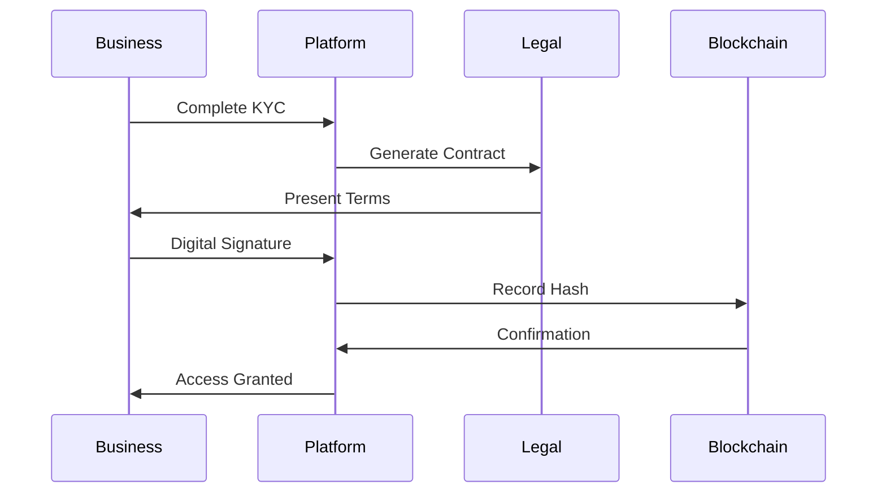

# Automated KYC Business Registration System

**Document Version:** 1.0  
**Created:** August 2025  
**Status:** Strategic Vision

## Vision Statement

Create a completely automated, intuitive business registration system that enables any business owner anywhere in Latin America to join VoucherBook within minutes through a fully digital, remote KYC (Know Your Customer) process that validates everything automatically - making the platform instantly scalable to any market.

## Core Philosophy

> "Make it so simple and intuitive that businesses WANT to participate"

The registration process should be so seamless that a business owner in Santiago, Chile can discover VoucherBook, register their business, get verified, and start creating vouchers - all within 30 minutes, without human intervention.

## System Overview

### The User Journey

1. **Discovery:** Business owner learns they can reach 10,000 real local customers
2. **Registration:** Simple web-based signup process
3. **Verification:** Automated document and identity validation
4. **Contract:** Digital contract signing
5. **Activation:** Immediate access to create vouchers

### Geographic Intelligence

- **Geo-targeted Content:** Show relevant content based on consumption area
- **Local Market Penetration:** Reach specific neighborhoods and demographics
- **Area-based Campaigns:** Launch targeted campaigns by city zones

## Automated KYC Components

### 1. Business Document Verification

**Required Documents:**

- Business license/registration
- Tax identification documents
- Proof of address
- Bank account verification
- Legal representative identification

**Automated Validation:**


**Technology Stack:**

- **OCR Service:** AWS Textract or Google Document AI
- **Validation APIs:** Government business registries
- **Risk Scoring:** ML-based document authenticity check

### 2. Identity Verification (Face Scanning)

**Biometric Validation Process:**

1. **Liveness Detection**
   - Real-time face scanning
   - Anti-spoofing measures
   - 3D depth analysis

2. **Document Matching**
   - Face match with ID photo
   - Confidence scoring
   - Age verification

3. **Behavioral Analysis**
   - Device fingerprinting
   - Location verification
   - Pattern recognition

**Implementation:**

```javascript
// Example verification flow
const verifyIdentity = async (user) => {
  const livenessCheck = await performLivenessDetection(user.videoStream)
  const documentMatch = await matchFaceWithDocument(user.face, user.document)
  const riskScore = await calculateRiskScore({
    liveness: livenessCheck,
    match: documentMatch,
    device: user.deviceFingerprint,
    location: user.geoLocation,
  })

  return {
    verified: riskScore.confidence > 0.95,
    score: riskScore,
    details: riskScore.factors,
  }
}
```

### 3. Digital Contract Management

**Smart Contract Features:**

- **Auto-generated Terms:** Based on business type and location
- **Multi-language Support:** Contracts in Spanish, Portuguese, English
- **Digital Signature:** Legally binding e-signatures
- **Blockchain Recording:** Immutable contract storage (optional)
- **Automatic Renewal:** Smart contract renewal reminders

**Contract Workflow:**



## Technical Architecture

### Microservices Design

```yaml
services:
  kyc-orchestrator:
    description: Main KYC workflow coordinator
    responsibilities:
      - Process management
      - Status tracking
      - Notification dispatch

  document-validator:
    description: Document processing and validation
    integrations:
      - OCR services
      - Government APIs
      - ML validation models

  biometric-service:
    description: Face scanning and liveness detection
    features:
      - Real-time video processing
      - Anti-spoofing detection
      - Face matching algorithms

  contract-service:
    description: Digital contract management
    capabilities:
      - Template generation
      - E-signature integration
      - Legal compliance checks

  risk-assessment:
    description: Comprehensive risk scoring
    components:
      - Fraud detection models
      - Business verification
      - Compliance checks
```

### Data Flow Architecture

```
┌──────────────┐     ┌──────────────┐     ┌──────────────┐
│   Frontend   │────▶│  API Gateway │────▶│     KYC      │
│   (React)    │     │   (Next.js)  │     │ Orchestrator │
└──────────────┘     └──────────────┘     └──────┬───────┘
                                                  │
                    ┌─────────────────────────────┼─────────────────────────────┐
                    │                             │                             │
            ┌───────▼────────┐          ┌────────▼────────┐          ┌─────────▼────────┐
            │   Document     │          │    Biometric    │          │    Contract      │
            │   Validator    │          │     Service     │          │    Service       │
            └───────┬────────┘          └────────┬────────┘          └─────────┬────────┘
                    │                             │                             │
                    └─────────────────────────────┼─────────────────────────────┘
                                                  │
                                          ┌───────▼────────┐
                                          │     Risk       │
                                          │   Assessment   │
                                          └───────┬────────┘
                                                  │
                                          ┌───────▼────────┐
                                          │   Decision     │
                                          │    Engine      │
                                          └────────────────┘
```

## Implementation Phases

### Phase 1: MVP (Months 1-2)

**Basic Automated Verification**

- Simple document upload and OCR
- Basic face matching with ID
- Template-based contracts
- Manual review fallback

### Phase 2: Enhanced Automation (Months 3-4)

**Advanced Verification**

- Government API integrations
- Liveness detection implementation
- Risk scoring algorithms
- Automated approval for low-risk

### Phase 3: Full Automation (Months 5-6)

**Complete KYC Automation**

- ML-based fraud detection
- Behavioral analysis
- Smart contract generation
- Real-time decision making

### Phase 4: Scale & Optimize (Months 7+)

**Market Expansion Ready**

- Multi-country support
- Regulatory compliance automation
- Advanced risk models
- White-label capability

## Geographic Expansion Strategy

### Market Entry Approach

**Pilot Market: Paraguay**

- Test full KYC flow
- Validate with local regulations
- Optimize for local documents

**Expansion Markets (Priority Order):**

1. **Chile** (Months 7-9)
   - Strong digital infrastructure
   - Clear regulatory framework
   - High smartphone penetration

2. **Uruguay** (Months 10-12)
   - Similar market to Paraguay
   - Progressive digital policies
   - Small market for testing

3. **Argentina** (Year 2)
   - Large market opportunity
   - Complex regulations
   - High inflation considerations

4. **Brazil** (Year 2+)
   - Massive market
   - Portuguese language
   - Specific regulatory requirements

### Localization Requirements

**Per Country Needs:**

- Document type mappings
- Government API integrations
- Legal framework compliance
- Language translations
- Payment method integrations

## Success Metrics

### KYC Performance Indicators

| Metric                       | Target     | Measurement |
| ---------------------------- | ---------- | ----------- |
| Registration Completion Rate | >80%       | Daily       |
| Average Time to Verify       | <5 minutes | Per user    |
| Automated Approval Rate      | >70%       | Weekly      |
| False Positive Rate          | <5%        | Weekly      |
| Document Processing Accuracy | >95%       | Daily       |
| User Satisfaction Score      | >4.5/5     | Weekly      |

### Business Impact Metrics

| Metric                     | Target    | Timeline |
| -------------------------- | --------- | -------- |
| Business Acquisition Cost  | <$10      | 6 months |
| Time to First Voucher      | <1 hour   | 3 months |
| Geographic Coverage        | 10 cities | Year 1   |
| Cross-border Registrations | 20%       | Year 2   |

## Compliance & Security

### Regulatory Compliance

**Data Protection:**

- GDPR compliance for EU expansion
- LGPD compliance for Brazil
- Local data residency requirements
- Right to deletion implementation

**Financial Regulations:**

- AML (Anti-Money Laundering) checks
- CTF (Counter-Terrorist Financing) screening
- PEP (Politically Exposed Persons) verification
- Sanctions list checking

### Security Measures

**Data Security:**

- End-to-end encryption for sensitive data
- Secure document storage (encrypted at rest)
- Tokenization of personal information
- Regular security audits

**Access Control:**

- Role-based access to KYC data
- Audit trails for all access
- Time-limited data retention
- Secure API endpoints

## Technology Stack

### Core Technologies

```yaml
frontend:
  - React 19 with Next.js 15
  - Real-time video capture (WebRTC)
  - Progressive form validation
  - Multi-language support

backend:
  - Node.js microservices
  - PostgreSQL for data storage
  - Redis for session management
  - AWS Lambda for processing

integrations:
  - AWS Rekognition (face recognition)
  - AWS Textract (document OCR)
  - Government APIs (business validation)
  - DocuSign (e-signatures)

ml_services:
  - TensorFlow (fraud detection)
  - Custom risk scoring models
  - Behavioral analysis algorithms
```

## Cost Analysis

### Development Costs

| Component                | Cost (USD)   | Timeline     |
| ------------------------ | ------------ | ------------ |
| KYC Platform Development | $150,000     | 6 months     |
| Third-party Integrations | $30,000      | 2 months     |
| ML Model Development     | $50,000      | 3 months     |
| Security Audit           | $20,000      | 1 month      |
| **Total Development**    | **$250,000** | **6 months** |

### Operational Costs (Monthly)

| Service              | Cost (USD) | Volume                |
| -------------------- | ---------- | --------------------- |
| Face Recognition API | $2,000     | 10,000 verifications  |
| Document OCR         | $1,500     | 10,000 documents      |
| Government API calls | $500       | 5,000 checks          |
| Infrastructure       | $3,000     | AWS/Cloud             |
| **Total Monthly**    | **$7,000** | **10,000 businesses** |

### Cost Per Verification

- **Target Cost:** <$2 per complete KYC
- **At Scale (100K/month):** <$0.50 per KYC
- **ROI:** Each verified business generates $50+ monthly revenue

## Competitive Advantages

### Why This System Wins

1. **Speed:** 5-minute verification vs. 2-3 days traditional
2. **Coverage:** Works across Latin America
3. **Cost:** 90% cheaper than manual verification
4. **Accuracy:** 95%+ automated approval rate
5. **Scalability:** Handle 10,000+ registrations daily
6. **User Experience:** Mobile-first, intuitive design

### Unique Differentiators

- **Geo-targeted Onboarding:** Localized experience
- **Real-time Verification:** Instant business activation
- **Multi-country Support:** Single platform, multiple markets
- **White-label Ready:** Sell the solution to other platforms
- **Compliance Built-in:** Automatic regulatory updates

## Risk Mitigation

### Technical Risks

| Risk             | Impact   | Mitigation                   |
| ---------------- | -------- | ---------------------------- |
| API Downtime     | High     | Multiple provider redundancy |
| False Rejections | Medium   | Manual review queue          |
| Fraud Attempts   | High     | ML-based detection           |
| Data Breach      | Critical | Encryption & security audits |

### Business Risks

| Risk               | Impact | Mitigation                      |
| ------------------ | ------ | ------------------------------- |
| Regulatory Changes | High   | Flexible rule engine            |
| Market Resistance  | Medium | Gradual rollout with incentives |
| Competition        | Medium | Fast execution & patents        |
| Cost Overruns      | Low    | Phased implementation           |

## Future Enhancements

### Advanced Features (Year 2+)

1. **Blockchain Identity:** Decentralized identity verification
2. **AI Risk Scoring:** Predictive business success models
3. **Instant Credit Lines:** Based on verification data
4. **Cross-platform Identity:** Portable business verification
5. **Voice Biometrics:** Additional security layer

### Platform Extensions

- **KYC-as-a-Service:** Sell to other platforms
- **Business Credit Scoring:** Financial services integration
- **Regulatory Compliance API:** Automated compliance checking
- **Identity Wallet:** User-controlled identity management

## Success Story Vision

> "A restaurant owner in Santiago, Chile discovers VoucherBook at 2 PM. By 2:30 PM, they've completed registration, uploaded documents, verified their identity, and signed the contract. By 3 PM, they've created their first voucher campaign. By 5 PM, 100 customers have already saved their voucher. The next morning, the first customers arrive with vouchers, and the owner sees real-time redemption metrics on their beautiful, responsive admin dashboard."

## Implementation Roadmap

### Immediate Actions (Week 1-2)

- Assemble KYC development team
- Select technology providers
- Design UX/UI mockups
- Define MVP scope

### Month 1 Deliverables

- Basic document upload system
- OCR integration prototype
- Database schema design
- API architecture

### Month 3 Milestones

- Complete MVP with basic KYC
- Face recognition integration
- Risk scoring algorithm v1
- Pilot with 100 businesses

### Month 6 Goals

- Full automation achieved
- 1,000+ businesses onboarded
- <$5 cost per verification
- 95% automated approval rate

## Conclusion

The automated KYC system transforms VoucherBook from a local platform into a globally scalable solution. By removing friction from business onboarding, we enable rapid market expansion while maintaining security and compliance. This system becomes a competitive moat and potential revenue stream as a white-label solution.

The investment in automation pays for itself through reduced operational costs, faster market entry, and the ability to scale without proportional increases in support staff. Most importantly, it delivers on the promise of making business participation so simple and intuitive that they can't resist joining.

---

**Document Status:** Strategic Vision  
**Next Review:** Q3 2025  
**Owner:** VoucherBook Product Strategy Team
