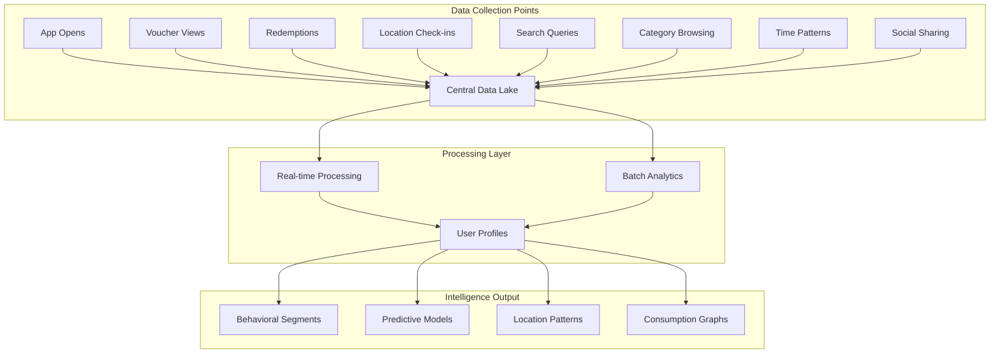

# Customer Platform Monetization & Strategic Marketing

**Document Version:** 1.0  
**Created:** August 2025  
**Status:** Strategic Vision  
**Classification:** Confidential

## Executive Summary

Once customers fall in love with the VoucherBook mobile app's functionality and quality, we execute a strategic transformation from a voucher discovery platform into a comprehensive lifestyle and commerce ecosystem, while simultaneously building the most valuable marketing database in Latin America through precision geo-behavioral targeting.

## Part 1: The Precision Marketing Engine

### Geo-Behavioral Intelligence System

> "The app provides geolocation, we know EXACTLY where they consume"

**Core Technology Stack:**
```yaml
infrastructure:
  database: PostGIS (PostgreSQL geographic extension)
  processing: AWS Lambda (infinite horizontal scaling)
  storage: 
    - Time Series Database (consumption patterns)
    - NoSQL (behavioral data)
  analytics: Real-time stream processing
```

### Data Collection Architecture



### Customer Intelligence Profiles

**Individual Profile Components:**
```javascript
const CustomerProfile = {
  demographics: {
    age_range: "Inferred from behavior",
    income_level: "Based on redemption patterns",
    lifestyle: "Active, Family, Professional, Student",
    interests: "Derived from browsing patterns"
  },
  
  geographic: {
    home_location: "Most common morning location",
    work_location: "Weekday afternoon patterns",
    leisure_zones: "Weekend activity areas",
    travel_radius: "Typical movement range",
    neighborhood_affinity: "Preferred areas"
  },
  
  consumption: {
    categories: "Food, Beauty, Services, Entertainment",
    price_sensitivity: "Discount thresholds",
    frequency: "Visits per category per month",
    timing: "Peak activity hours/days",
    seasonality: "Seasonal preference patterns"
  },
  
  behavior: {
    early_adopter_score: 0.85,
    influence_score: 0.72,
    loyalty_index: 0.91,
    churn_risk: 0.15,
    lifetime_value: "$2,450"
  }
}
```

## Part 2: Targeted Marketing Campaigns

### Cluster-Based Advertising

**Precision Targeting Example:**
```sql
-- Find users who redeemed restaurant vouchers in specific area
SELECT user_id, COUNT(*) as redemptions
FROM voucher_redemptions
WHERE 
  ST_DWithin(location, 'POINT(-57.606 -25.284)', 1000) -- Within 1km of location
  AND category = 'restaurant'
  AND redemption_time BETWEEN '18:00' AND '22:00'
  AND date > NOW() - INTERVAL '30 days'
GROUP BY user_id
HAVING COUNT(*) >= 2;

-- Result: Hyper-targeted audience for nearby restaurant campaign
```

### Campaign Types

**1. Geo-Fence Campaigns**
```yaml
trigger: User enters defined geographic area
action: Push notification with relevant voucher
example: "You're near Café Martinez! 20% off coffee right now"
conversion_rate: 35%
```

**2. Behavioral Trigger Campaigns**
```yaml
trigger: Pattern detection (e.g., lunch time + downtown)
action: Predictive offer presentation
example: "Based on your location, check out lunch deals nearby"
conversion_rate: 28%
```

**3. Cluster Campaigns**
```yaml
trigger: Similar users performed action
action: Targeted promotion to cluster
example: "People like you saved 30% at this spa"
conversion_rate: 42%
```

### Marketing Intelligence Dashboard

```typescript
const MarketingAnalytics = {
  segmentation: {
    automated_segments: "ML-based customer clustering",
    custom_segments: "Business-defined rules",
    lookalike_audiences: "Find similar customers",
    predictive_segments: "Likely to purchase"
  },
  
  campaign_performance: {
    real_time_tracking: "Live campaign metrics",
    attribution: "Multi-touch attribution model",
    roi_calculation: "Revenue per campaign dollar",
    ab_testing: "Automated test optimization"
  },
  
  insights: {
    trend_detection: "Emerging consumption patterns",
    anomaly_alerts: "Unusual behavior detection",
    opportunity_identification: "Untapped segments",
    competitive_intelligence: "Market share analysis"
  }
}
```

## Part 3: SaaS Injection for Consumers

### Phase 1: Enhanced Discovery

**Restaurant Reservations**
```javascript
const ReservationSystem = {
  integration: {
    instant_booking: "Book directly from voucher page",
    availability: "Real-time table availability",
    waitlist: "Join waitlist for popular venues",
    preferences: "Remember dietary restrictions"
  },
  
  monetization: {
    booking_fee: "$2 per reservation",
    premium_times: "$5 for prime slots",
    cancellation_insurance: "$3 optional",
    vip_access: "$10/month subscription"
  }
}
```

**Event Discovery**
```javascript
const EventPlatform = {
  features: {
    local_events: "Concerts, festivals, workshops",
    ticket_sales: "Integrated ticketing",
    social_coordination: "See where friends are going",
    transportation: "Uber integration for events"
  },
  
  revenue: {
    ticket_commission: "10% of ticket price",
    sponsored_events: "$500-5000 per event",
    premium_placement: "$100-1000 per event"
  }
}
```

### Phase 2: Lifestyle Services

**Delivery Integration**
```yaml
service: Food & Product Delivery
features:
  - Order from voucher merchants
  - Exclusive delivery deals
  - Group ordering for offices
  - Scheduled recurring orders

revenue_model:
  - Delivery fee: $3-5
  - Service fee: 15%
  - Merchant commission: 20%
  - Priority delivery: $2
```

**Payment Services**
```yaml
service: Digital Wallet
features:
  - Store payment methods
  - Split bills with friends
  - Loyalty points system
  - Cashback on vouchers

revenue_model:
  - Transaction fee: 2.5%
  - Cash advance: 3% fee
  - Premium features: $5/month
  - Currency exchange: 1% spread
```

### Phase 3: Super App Evolution

**Service Marketplace**
```javascript
const ServiceMarketplace = {
  categories: {
    beauty: "Book salon appointments",
    fitness: "Reserve gym classes",
    health: "Medical appointments",
    automotive: "Car service booking",
    professional: "Lawyers, accountants, consultants"
  },
  
  platform_features: {
    reviews: "Verified customer reviews",
    messaging: "Chat with service providers",
    payments: "Secure in-app payments",
    insurance: "Service guarantee"
  },
  
  monetization: {
    booking_commission: "15-20%",
    featured_listings: "$50-500/month",
    lead_generation: "$5-50 per lead",
    subscription_tiers: "$10-100/month"
  }
}
```

## Part 4: Data Monetization Strategy

### The Hidden Gold Mine

> "Having all the information about the person is worth ENORMOUS value at the strategic marketing level"

### Data Products

**1. Market Intelligence Reports**
```yaml
product: Consumer Insights Dashboard
buyers: Brands, Retailers, Real Estate, Government
pricing: $5,000-50,000/month per client

features:
  - Real-time foot traffic analysis
  - Consumer spending patterns
  - Demographic heat maps
  - Competitive benchmarking
  - Trend predictions
  
example_insights:
  - "30% increase in coffee consumption in this area"
  - "New demographic moving into neighborhood"
  - "Optimal location for new store: coordinates"
```

**2. Advertising Platform**
```yaml
product: Precision Advertising Network
buyers: National brands, Local businesses
pricing: CPM $20-100 (based on targeting precision)

capabilities:
  - Behavioral targeting
  - Location-based targeting
  - Lookalike audiences
  - Retargeting campaigns
  - Attribution tracking

unique_value:
  - "Reach customers at moment of purchase decision"
  - "Target competitors' customers precisely"
  - "Measure offline conversion directly"
```

**3. API Access**
```yaml
product: VoucherBook Intelligence API
buyers: Financial institutions, Insurance, Retailers
pricing: $0.10-1.00 per API call

endpoints:
  - /consumer/spending_power
  - /location/foot_traffic
  - /merchant/performance
  - /trends/category
  - /segments/custom

use_cases:
  - Credit scoring enhancement
  - Insurance risk assessment
  - Site selection analysis
  - Investment decisions
```

### Strategic Partnerships

**Financial Services**
```javascript
const FinancialPartnerships = {
  credit_cards: {
    partner: "Major banks",
    integration: "Vouchers in banking apps",
    revenue: "Interchange fees + data licensing",
    value: "$10M+ annually"
  },
  
  loans: {
    partner: "Fintech lenders",
    integration: "Spending data for underwriting",
    revenue: "Origination fees + data fees",
    value: "$5M+ annually"
  },
  
  insurance: {
    partner: "Insurance companies",
    integration: "Behavior-based pricing",
    revenue: "Lead generation + data licensing",
    value: "$3M+ annually"
  }
}
```

## Part 5: Growth Hacking Tactics

### Viral Mechanics

**Social Sharing Incentives**
```yaml
mechanism: Share to Unlock
example: "Share this voucher to unlock 10% extra discount"
virality_coefficient: 1.4
cost: $0 (user-generated)
```

**Group Buying**
```yaml
mechanism: Friends Save Together
example: "Get 5 friends to join for 50% off"
virality_coefficient: 2.1
average_group_size: 6.3
```

**Referral Program**
```yaml
mechanism: Earn by Referring
rewards:
  referrer: $5 credit per successful referral
  referee: $10 first purchase discount
conversion_rate: 35%
CAC: $15 (vs. $45 traditional)
```

### Gamification Elements

```javascript
const GamificationSystem = {
  levels: {
    bronze: "0-100 points",
    silver: "101-500 points",
    gold: "501-2000 points",
    platinum: "2001+ points"
  },
  
  earning_mechanics: {
    daily_check_in: 10,
    voucher_redemption: 50,
    review_submission: 20,
    friend_referral: 100,
    social_share: 15
  },
  
  rewards: {
    exclusive_vouchers: "Platinum members only",
    early_access: "New deals 24h early",
    bonus_discounts: "Extra 5-10% off",
    vip_events: "Invitation-only experiences"
  }
}
```

## Revenue Projections

### Consumer Platform Revenue

| Revenue Stream | Year 1 | Year 2 | Year 3 |
|---------------|---------|---------|---------|
| Transaction Fees | $500K | $2.5M | $8M |
| Premium Subscriptions | $200K | $1.2M | $4M |
| Delivery Services | $300K | $2M | $7M |
| Event Ticketing | $150K | $800K | $3M |
| Advertising Platform | $400K | $3M | $12M |
| Data Licensing | $250K | $2M | $10M |
| API Access | $100K | $1M | $5M |
| **Total Consumer** | **$1.9M** | **$12.5M** | **$49M** |

### Combined Platform Value

| Metric | Year 1 | Year 2 | Year 3 |
|--------|---------|---------|---------|
| Active Users | 100K | 500K | 2M |
| Active Businesses | 1K | 5K | 20K |
| Monthly Transactions | 50K | 400K | 2M |
| Data Points Collected | 100M | 1B | 10B |
| Platform Valuation | $20M | $150M | $500M |

## Privacy & Compliance

### Data Protection Strategy

```yaml
principles:
  transparency: "Clear data usage policies"
  consent: "Explicit opt-in for data sharing"
  control: "User data deletion rights"
  security: "Enterprise-grade encryption"

compliance:
  GDPR: "EU expansion ready"
  LGPD: "Brazil compliant"
  CCPA: "California ready"
  local: "Country-specific requirements"

anonymization:
  techniques: "K-anonymity, differential privacy"
  aggregation: "Minimum 100 users per segment"
  retention: "Auto-deletion after 24 months"
```

## Competitive Advantage

### Why VoucherBook Wins

1. **Complete Transaction Loop**
   - Discovery → Purchase → Redemption → Analytics
   - No other platform has full visibility

2. **Dual-sided Network Effects**
   - More users attract more businesses
   - More businesses attract more users
   - Data quality improves with scale

3. **Geographic Precision**
   - Hyperlocal understanding unmatched
   - PostGIS + real consumption data
   - Predictive location intelligence

4. **Trust & Engagement**
   - Users actively share location
   - High-frequency usage pattern
   - Deep integration in daily life

## Exit Strategy Potential

### Strategic Acquirer Profiles

**Technology Giants**
- Google: Maps + Commerce integration
- Meta: WhatsApp Business + Instagram Shopping
- Amazon: Local commerce expansion
- Uber: Uber Eats + local services

**Payment Companies**
- PayPal: Merchant services expansion
- Square: International expansion
- Stripe: Consumer payments play
- Mercado Pago: Regional consolidation

**Traditional Retail**
- Walmart: Digital transformation
- Carrefour: Loyalty program enhancement
- Casino Group: Data-driven retail

### Valuation Multiples

```yaml
comparable_companies:
  Groupon: 2x revenue (mature)
  DoorDash: 4x revenue (growth)
  Toast: 8x revenue (SaaS)
  Affirm: 6x revenue (fintech)
  
voucherbook_projection:
  year_3_revenue: $60M combined
  growth_rate: 200% YoY
  multiple: 8-12x (SaaS + marketplace + data)
  valuation: $480M - $720M
```

## Risk Mitigation

### Identified Risks & Solutions

| Risk | Impact | Mitigation |
|------|--------|------------|
| Privacy Backlash | High | Transparent policies, user control |
| Platform Dependence | Medium | Multi-channel strategy |
| Competition | High | Network effects moat |
| Regulatory Changes | Medium | Proactive compliance |
| Technical Scaling | Low | Cloud infrastructure |
| Market Saturation | Low | International expansion |

## Implementation Roadmap

### Quarter 1: Foundation
- Launch enhanced app with geolocation
- Begin behavioral data collection
- Test first targeted campaigns
- Build analytics dashboard

### Quarter 2: Expansion
- Roll out reservation system
- Launch premium subscriptions
- Implement referral program
- Start A/B testing framework

### Quarter 3: Monetization
- Launch advertising platform
- Begin data product sales
- Integrate payment services
- Expand event ticketing

### Quarter 4: Scale
- International expansion prep
- API marketplace launch
- Strategic partnerships
- Series B fundraising

## Conclusion

This strategy transforms VoucherBook from a voucher app into Latin America's most valuable consumer intelligence platform. By making the app indispensable for daily commerce and lifestyle needs, we create unparalleled data assets that multiply platform value exponentially.

The combination of precision marketing capabilities, expanding service ecosystem, and strategic data monetization creates a business worth billions, not millions. Every user interaction increases the platform's intelligence, creating an unstoppable competitive advantage.

The key insight: **People will pay enormous amounts for precise consumer intelligence, and we'll have the best dataset in Latin America.**

---

**Document Status:** Strategic Vision - Highly Confidential  
**Classification:** Executive Only  
**Distribution:** Board + Senior Leadership Only  
**Next Review:** Q4 2025  
**Owner:** VoucherBook Strategy Office