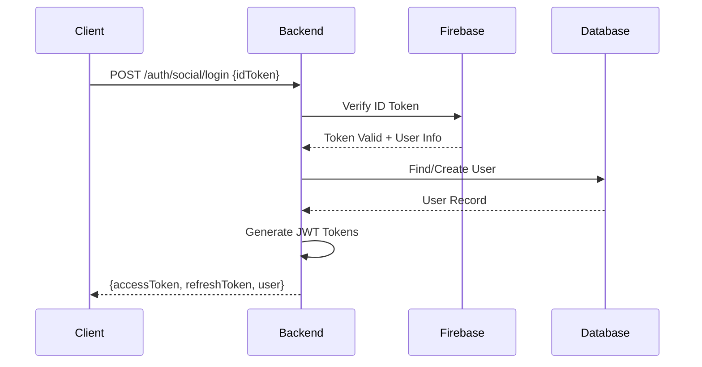

# Firebase Social Login Implementation Plan

## Executive Summary

This document outlines the comprehensive plan for implementing Firebase Authentication with social login capabilities in the VoucherBook backend platform. The implementation leverages existing infrastructure while introducing Firebase as the primary identity provider for OAuth 2.0 social authentication.

## Current State Analysis

### Existing Authentication Infrastructure

#### 1. **JWT Token System**

- **Location**: `packages/auth/src/services/JwtTokenService.ts`
- **Algorithm**: RS256 (RSA signatures)
- **Token Types**: Access (2h) and Refresh (7d) tokens
- **Features**: Redis-based token blacklisting, token refresh mechanism

#### 2. **Local Authentication Strategy**

- **Location**: `packages/auth/src/strategies/LocalAuthStrategy.ts`
- **Features**: Email/password authentication, email verification, password reset
- **Integration**: UserService, CommunicationService, BusinessService

#### 3. **Identity Provider Architecture**

- **Registry**: `packages/auth/src/infrastructure/IdentityProviderRegistry.ts`
- **Interface**: `packages/auth/src/domain/interfaces/IdentityProvider.ts`
- **Factory Pattern**: Support for multiple identity providers

#### 4. **Database Schema Preparation**

- **UserIdentity Table**: Ready for Firebase integration
  - Fields: `firebaseUid`, `provider`, `providerId`
  - Support for multiple providers per user
- **UserAuthMethod Table**: Track authentication methods
- **UserDevice Table**: Device management and FCM tokens

#### 5. **OAuth 2.0 Endpoints**

- **Schemas**: `packages/api/src/schemas/auth/public/oauth.ts`
- **Token Operations**: Issue, refresh, introspect, revoke
- **User Info Endpoint**: OpenID Connect compatible

### Firebase Remnants Found

1. **Database Models** (`packages/database/prisma/models/auth.prisma`):
   - UserIdentity table with `firebaseUid` field
   - Provider tracking for "firebase", "google", "facebook", "apple"
   - Device management with FCM token support

2. **Documentation References**:
   - Previous Firebase implementation diagrams
   - Security architecture mentions Firebase Auth

## Implementation Strategy

### Phase 1: Firebase Setup and Configuration

#### 1.1 Firebase Project Configuration

```typescript
// packages/environment/src/constants/firebase.ts
export const FIREBASE_CONFIG = {
  apiKey: process.env.FIREBASE_API_KEY,
  authDomain: process.env.FIREBASE_AUTH_DOMAIN,
  projectId: process.env.FIREBASE_PROJECT_ID,
  storageBucket: process.env.FIREBASE_STORAGE_BUCKET,
  messagingSenderId: process.env.FIREBASE_MESSAGING_SENDER_ID,
  appId: process.env.FIREBASE_APP_ID,
  measurementId: process.env.FIREBASE_MEASUREMENT_ID,
}

export const FIREBASE_SERVICE_ACCOUNT = {
  type: 'service_account',
  projectId: process.env.FIREBASE_PROJECT_ID,
  privateKeyId: process.env.FIREBASE_PRIVATE_KEY_ID,
  privateKey: process.env.FIREBASE_PRIVATE_KEY?.replace(/\\n/g, '\n'),
  clientEmail: process.env.FIREBASE_CLIENT_EMAIL,
  clientId: process.env.FIREBASE_CLIENT_ID,
  authUri: 'https://accounts.google.com/o/oauth2/auth',
  tokenUri: 'https://oauth2.googleapis.com/token',
  authProviderX509CertUrl: 'https://www.googleapis.com/oauth2/v1/certs',
  clientX509CertUrl: process.env.FIREBASE_CLIENT_CERT_URL,
}
```

#### 1.2 Environment Variables

```bash
# Firebase Configuration
FIREBASE_API_KEY=
FIREBASE_AUTH_DOMAIN=
FIREBASE_PROJECT_ID=
FIREBASE_STORAGE_BUCKET=
FIREBASE_MESSAGING_SENDER_ID=
FIREBASE_APP_ID=
FIREBASE_MEASUREMENT_ID=

# Firebase Admin SDK
FIREBASE_PRIVATE_KEY_ID=
FIREBASE_PRIVATE_KEY=
FIREBASE_CLIENT_EMAIL=
FIREBASE_CLIENT_ID=
FIREBASE_CLIENT_CERT_URL=

# Social Provider Configuration
GOOGLE_CLIENT_ID=
GOOGLE_CLIENT_SECRET=
FACEBOOK_APP_ID=
FACEBOOK_APP_SECRET=
APPLE_CLIENT_ID=
APPLE_TEAM_ID=
APPLE_KEY_ID=
APPLE_PRIVATE_KEY=
```

### Phase 2: Firebase Identity Provider Implementation

#### 2.1 FirebaseIdentityProvider Class

```typescript
// packages/auth/src/infrastructure/providers/FirebaseIdentityProvider.ts
import * as admin from 'firebase-admin'
import { IdentityProvider, TokenPayload } from '../../domain/interfaces/IdentityProvider.js'

export class FirebaseIdentityProvider implements IdentityProvider {
  private app: admin.app.App

  constructor(private config: FirebaseConfig) {
    this.app = admin.initializeApp({
      credential: admin.credential.cert(config.serviceAccount),
      projectId: config.projectId,
    })
  }

  async verifyToken(token: string): Promise<TokenPayload> {
    const decodedToken = await this.app.auth().verifyIdToken(token)
    return {
      sub: decodedToken.uid,
      email: decodedToken.email,
      email_verified: decodedToken.email_verified,
      provider: decodedToken.firebase.sign_in_provider,
      iss: decodedToken.iss,
      exp: decodedToken.exp,
      iat: decodedToken.iat,
    }
  }

  async getUserProfile(userId: string): Promise<admin.auth.UserRecord> {
    return this.app.auth().getUser(userId)
  }
}
```

#### 2.2 Firebase Auth Strategy

```typescript
// packages/auth/src/strategies/FirebaseAuthStrategy.ts
export class FirebaseAuthStrategy implements AuthStrategy {
  readonly name = 'firebase'

  constructor(
    private firebaseProvider: FirebaseIdentityProvider,
    private userService: UserService,
    private tokenService: JwtTokenService,
  ) {}

  async authenticate(credentials: FirebaseCredentials): Promise<AuthResult> {
    // 1. Verify Firebase ID token
    const firebaseUser = await this.firebaseProvider.verifyToken(credentials.idToken)

    // 2. Find or create user in our database
    let user = await this.userService.findByFirebaseUid(firebaseUser.sub)

    if (!user) {
      // Create new user from Firebase profile
      user = await this.createUserFromFirebase(firebaseUser)
    }

    // 3. Update user identity record
    await this.updateUserIdentity(user.id, firebaseUser)

    // 4. Generate our JWT tokens
    const tokens = await this.tokenService.generateTokens(user)

    return {
      success: true,
      user,
      tokens,
    }
  }
}
```

### Phase 3: Social Login Endpoints

#### 3.1 Social Authentication Controller

```typescript
// packages/services/auth/src/controllers/SocialAuthController.ts
export class SocialAuthController {
  constructor(private authService: IAuthService) {}

  async socialLogin(request: Request<{}, {}, SocialLoginRequest>, response: Response, next: NextFunction): Promise<void> {
    try {
      const { provider, idToken, accessToken } = request.body

      const result = await this.authService.socialLogin({
        provider,
        idToken,
        accessToken,
      })

      response.json({
        user: UserMapper.toDTO(result.user),
        accessToken: result.accessToken,
        refreshToken: result.refreshToken,
        tokenType: 'Bearer',
        expiresIn: 7200,
      })
    } catch (error) {
      next(error)
    }
  }

  async linkAccount(request: Request<{}, {}, LinkAccountRequest>, response: Response, next: NextFunction): Promise<void> {
    try {
      const userId = request.user!.id
      const { provider, idToken } = request.body

      await this.authService.linkSocialAccount(userId, provider, idToken)

      response.json({
        success: true,
        message: `${provider} account linked successfully`,
      })
    } catch (error) {
      next(error)
    }
  }
}
```

#### 3.2 API Schema Updates

```typescript
// packages/api/src/schemas/auth/public/social.ts
export const SocialLoginRequest = z.object({
  provider: z.enum(['google', 'facebook', 'apple']),
  idToken: z.string().describe('Firebase ID token from social provider'),
  accessToken: z.string().optional().describe('Provider access token'),
  deviceInfo: DeviceInfoSchema.optional(),
})

export const LinkAccountRequest = z.object({
  provider: z.enum(['google', 'facebook', 'apple']),
  idToken: z.string().describe('Firebase ID token to link'),
})

export const SocialLoginResponse = z.object({
  user: AuthUserResponse,
  accessToken: JWTToken,
  refreshToken: JWTToken,
  tokenType: z.literal('Bearer'),
  expiresIn: z.number(),
  isNewUser: z.boolean(),
})
```

### Phase 4: Database Operations

#### 4.1 User Repository Extensions

```typescript
// packages/services/user/src/repositories/UserRepository.ts
export class UserRepository {
  async findByFirebaseUid(firebaseUid: string): Promise<User | null> {
    const userIdentity = await this.prisma.userIdentity.findUnique({
      where: { firebaseUid },
      include: { user: true },
    })
    return userIdentity?.user || null
  }

  async createUserIdentity(data: { userId: string; provider: string; providerId: string; firebaseUid: string; providerData: any }): Promise<UserIdentity> {
    return this.prisma.userIdentity.create({
      data: {
        ...data,
        lastSignInMethod: data.provider,
        isEmailVerified: data.providerData.email_verified || false,
      },
    })
  }

  async linkSocialAccount(userId: string, provider: string, providerId: string, firebaseUid: string, providerData: any): Promise<void> {
    await this.prisma.userIdentity.upsert({
      where: {
        provider_providerId: { provider, providerId },
      },
      update: {
        firebaseUid,
        providerData,
        lastLogin: new Date(),
      },
      create: {
        userId,
        provider,
        providerId,
        firebaseUid,
        providerData,
      },
    })
  }
}
```

### Phase 5: Migration Strategy

#### 5.1 Database Migrations

```sql
-- Migration: Add social login support
ALTER TABLE users ADD COLUMN IF NOT EXISTS avatar_url VARCHAR(500);
ALTER TABLE users ADD COLUMN IF NOT EXISTS provider_data JSONB DEFAULT '{}';

-- Ensure UserIdentity table has all required indexes
CREATE INDEX IF NOT EXISTS idx_user_identities_firebase_uid
  ON user_identities(firebase_uid);
CREATE INDEX IF NOT EXISTS idx_user_identities_provider_id
  ON user_identities(provider, provider_id);
```

#### 5.2 Gradual Migration Path

1. **Dual Authentication**: Support both local and Firebase auth simultaneously
2. **Account Linking**: Allow existing users to link social accounts
3. **Migration Prompts**: Encourage password users to add social login
4. **Monitoring**: Track authentication method usage
5. **Deprecation**: Phase out local-only authentication (optional)

### Phase 6: Security Considerations

#### 6.1 Token Validation Flow



#### 6.2 Security Measures

1. **Token Verification**: Always verify Firebase tokens server-side
2. **Rate Limiting**: Apply rate limits to social login endpoints
3. **Account Linking**: Require authentication to link accounts
4. **Email Verification**: Trust Firebase's email verification
5. **Audit Logging**: Log all authentication events
6. **Device Tracking**: Track devices for suspicious activity

### Phase 7: Testing Strategy

#### 7.1 Unit Tests

```typescript
// packages/auth/src/test/FirebaseIdentityProvider.test.ts
describe('FirebaseIdentityProvider', () => {
  it('should verify valid Firebase token')
  it('should reject invalid Firebase token')
  it('should retrieve user profile')
  it('should handle token expiration')
})
```

#### 7.2 Integration Tests

```typescript
// packages/services/auth/src/test/social-auth.test.ts
describe('Social Authentication', () => {
  it('should login with Google')
  it('should login with Facebook')
  it('should create new user on first social login')
  it('should link social account to existing user')
  it('should prevent duplicate account linking')
})
```

#### 7.3 E2E Tests

```typescript
describe('Social Login Flow', () => {
  it('should complete Google OAuth flow')
  it('should handle account linking')
  it('should maintain session after social login')
})
```

## Implementation Timeline

### Week 1: Setup and Configuration

- [ ] Configure Firebase project
- [ ] Set up environment variables
- [ ] Install Firebase Admin SDK
- [ ] Create FirebaseIdentityProvider

### Week 2: Core Implementation

- [ ] Implement FirebaseAuthStrategy
- [ ] Create SocialAuthController
- [ ] Update API schemas
- [ ] Extend UserRepository

### Week 3: Integration

- [ ] Wire up endpoints
- [ ] Update authentication middleware
- [ ] Implement account linking
- [ ] Add device tracking

### Week 4: Testing and Deployment

- [ ] Write comprehensive tests
- [ ] Security audit
- [ ] Documentation
- [ ] Staged deployment

## Monitoring and Success Metrics

### Key Performance Indicators

1. **Authentication Success Rate**: >95%
2. **Token Verification Latency**: <100ms
3. **Account Linking Success**: >99%
4. **Social Provider Availability**: >99.9%

### Monitoring Setup

```typescript
// Metrics to track
metrics.counter('auth.social.login', { provider, success })
metrics.histogram('auth.firebase.verification.duration')
metrics.gauge('auth.active.sessions.social')
```

## Risk Mitigation

### Potential Risks and Mitigations

1. **Firebase Service Outage**
   - Mitigation: Implement fallback to cached tokens
   - Backup: Consider multi-provider strategy

2. **Token Verification Performance**
   - Mitigation: Cache verified tokens in Redis
   - Optimization: Batch verification requests

3. **Account Duplication**
   - Mitigation: Email-based account merging
   - Prevention: Unique constraints on email

4. **Data Privacy Compliance**
   - Mitigation: Minimal data storage
   - Compliance: GDPR-compliant data handling

## Dependencies

### NPM Packages

```json
{
  "firebase-admin": "^12.0.0",
  "firebase": "^10.7.0",
  "@firebase/auth": "^1.5.0"
}
```

### Infrastructure Requirements

- Firebase project with Authentication enabled
- Social provider apps (Google, Facebook, Apple)
- Redis for token caching
- PostgreSQL with identity schema

## Best Practices

### Code Organization

1. **Separation of Concerns**: Keep Firebase logic in identity provider
2. **Dependency Injection**: Use DI for testability
3. **Error Handling**: Comprehensive error mapping
4. **Logging**: Detailed authentication audit trail

### Security Best Practices

1. **Server-side Validation**: Never trust client tokens
2. **Secure Storage**: Encrypt sensitive provider data
3. **Rate Limiting**: Prevent brute force attacks
4. **Session Management**: Implement proper session lifecycle

### Performance Optimization

1. **Token Caching**: Cache verified tokens (5 min TTL)
2. **User Caching**: Cache user profiles (10 min TTL)
3. **Connection Pooling**: Reuse Firebase app instances
4. **Async Operations**: Non-blocking token verification

## Conclusion

This implementation plan provides a comprehensive approach to integrating Firebase social login while maintaining compatibility with the existing JWT-based authentication system. The phased approach ensures minimal disruption to existing users while providing modern social authentication capabilities.

The architecture leverages existing patterns (Identity Provider, Auth Strategy) and database schemas (UserIdentity, UserAuthMethod) that were already prepared for this integration, making the implementation straightforward and maintainable.

## Appendix

### A. Firebase Console Configuration

1. **Enable Authentication Providers**:
   - Google Sign-In
   - Facebook Login
   - Apple Sign-In

2. **Configure OAuth Redirect URIs**:
   - Production: `https://api.voucherbook.com/auth/callback`
   - Staging: `https://staging-api.voucherbook.com/auth/callback`
   - Development: `http://localhost:5500/auth/callback`

3. **Security Rules**:
   ```javascript
   {
     "rules": {
       ".read": false,
       ".write": false
     }
   }
   ```

### B. Client Integration Example

```typescript
// Frontend Firebase initialization
import { initializeApp } from 'firebase/app'
import { getAuth, signInWithPopup, GoogleAuthProvider } from 'firebase/auth'

const app = initializeApp(firebaseConfig)
const auth = getAuth(app)

async function signInWithGoogle() {
  const provider = new GoogleAuthProvider()
  const result = await signInWithPopup(auth, provider)
  const idToken = await result.user.getIdToken()

  // Send to backend
  const response = await fetch('/api/v1/auth/social/login', {
    method: 'POST',
    headers: { 'Content-Type': 'application/json' },
    body: JSON.stringify({
      provider: 'google',
      idToken,
    }),
  })

  const { accessToken, refreshToken, user } = await response.json()
  // Store tokens and proceed
}
```

### C. Configuration Checklist

- [ ] Firebase project created
- [ ] Authentication enabled in Firebase Console
- [ ] Social providers configured
- [ ] Service account key generated
- [ ] Environment variables set
- [ ] OAuth redirect URIs whitelisted
- [ ] Client SDK configured
- [ ] CORS settings updated
- [ ] Rate limiting configured
- [ ] Monitoring alerts set up
