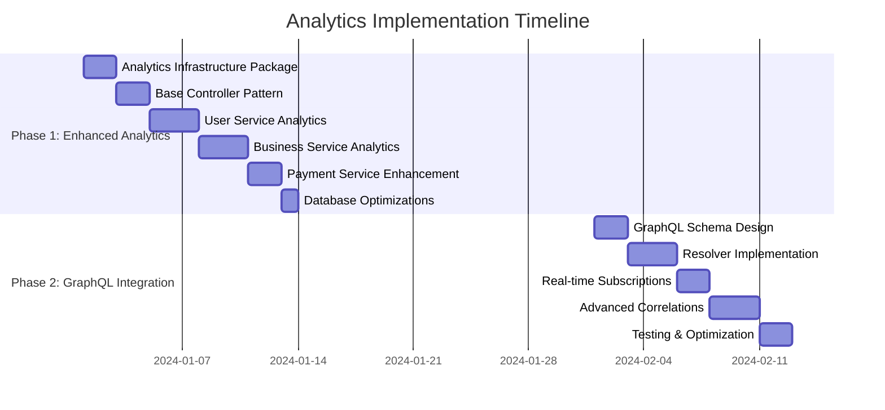

# VoucherBook Analytics & Reporting Implementation Plan

## Executive Summary

This document outlines the strategic implementation of comprehensive analytics and reporting capabilities for VoucherBook's backend, designed to provide immediate business value while positioning perfectly for future GraphQL integration. The approach leverages existing patterns and infrastructure to deliver robust analytics in 2 weeks.

**Key Achievement**: Enterprise-grade analytics capabilities with seamless GraphQL migration path.

## Table of Contents

1. [Current State Analysis](#current-state-analysis)
2. [Strategic Approach](#strategic-approach)
3. [Implementation Phases](#implementation-phases)
4. [Technical Architecture](#technical-architecture)
5. [Service-Specific Implementation](#service-specific-implementation)
6. [Database Strategy](#database-strategy)
7. [Caching Strategy](#caching-strategy)
8. [API Schema Architecture Analysis](#api-schema-architecture-analysis)
9. [Schema Evolution Strategy](#schema-evolution-strategy)
10. [GraphQL Integration Path](#graphql-integration-path)
11. [Success Metrics](#success-metrics)

## Current State Analysis

### ✅ **Existing Analytics Infrastructure**

**Strong Foundation Already in Place:**

```typescript
// Current analytics capabilities:
- RedemptionAnalyticsService: Advanced voucher redemption tracking
- Business voucher statistics: /vouchers/business/{id}/stats
- Payment reporting: /payments/reports
- User activity tracking: Basic user engagement
- Voucher book distribution stats: PDF service analytics
```

**Infrastructure Assets:**

- ✅ Redis caching with proper TTL strategies
- ✅ Clean Architecture (Controller → Service → Repository)
- ✅ Comprehensive authentication/authorization
- ✅ OpenAPI schema generation and validation
- ✅ Proper error handling and logging
- ✅ Service-to-service communication patterns

### 📊 **Current Analytics Endpoints**

```yaml
Existing Analytics API Coverage:
  Voucher Service:
    - GET /vouchers/analytics (voucher performance)
    - GET /vouchers/{id}/analytics (individual voucher stats)
    - GET /vouchers/business/{id}/stats (business voucher metrics)

  Payment Service:
    - GET /payments/reports (financial reporting)

  PDF Service:
    - GET /admin/voucher-books/statistics (distribution metrics)

  Storage Service:
    - GET /storage/analytics (file storage metrics)
```

### 🎯 **Gaps Identified**

1. **Cross-Service Analytics**: No unified business dashboards
2. **User Analytics**: Limited user engagement tracking
3. **Advanced Reporting**: Missing cohort analysis, retention metrics
4. **Export Capabilities**: Inconsistent CSV/PDF export across services
5. **Real-Time Metrics**: No live dashboard capabilities

## Strategic Approach

### **Hybrid Analytics Architecture**

**Phase 1: Enhanced Per-Service Analytics** (Immediate - 2 weeks)

- Extend existing service analytics patterns
- Standardize analytics interfaces across services
- Build comprehensive dashboards per domain

**Phase 2: Analytics Federation Layer** (Future - 4-6 weeks)

- GraphQL-based cross-service analytics aggregation
- Real-time subscriptions for live dashboards
- Advanced multi-service reporting

### **Why This Approach is Optimal**

#### **1. GraphQL Alignment** 🎯

- Each service exposes rich analytics APIs ready for GraphQL federation
- Zero breaking changes during GraphQL transition
- Aligns perfectly with zero-cost GraphQL roadmap
- Progressive enhancement vs. complete rewrite

#### **2. Industry Best Practices** ✅

- Domain-driven analytics (services own their data domains)
- CQRS-ready architecture with read models
- Proper separation of concerns
- Event-driven architecture foundation

#### **3. Immediate Business Value** ⚡

- 2-week implementation timeline
- Builds on proven existing patterns
- No architectural disruption
- Real insights from day one

#### **4. Future-Proof Design** 🚀

- Easy GraphQL federation integration
- Service-agnostic analytics patterns
- Scalable caching and aggregation
- BI tool integration ready

## Implementation Phases

### **Phase 1: Enhanced Per-Service Analytics (Weeks 1-2)**

#### Week 1: Foundation & Standardization

**Day 1-2: Analytics Infrastructure Package**

```bash
# Create shared analytics package
mkdir packages/analytics
cd packages/analytics

# Dependencies
npm install lodash-es date-fns
```

```typescript
// packages/analytics/src/types/common.ts
export interface AnalyticsDashboard {
  metrics: MetricValue[]
  trends: TrendData[]
  breakdowns: BreakdownData[]
  exports: ExportOption[]
  dateRange: DateRange
  lastUpdated: Date
}

export interface MetricValue {
  key: string
  label: string
  value: number
  change: number // vs previous period
  changeType: 'increase' | 'decrease' | 'stable'
  format: 'number' | 'currency' | 'percentage'
  precision?: number
}

export interface TrendData {
  key: string
  label: string
  data: Array<{
    date: string
    value: number
    secondaryValue?: number
  }>
  trend: 'up' | 'down' | 'flat'
  changeRate: number
}

export interface BreakdownData {
  key: string
  label: string
  data: Array<{
    category: string
    value: number
    percentage: number
  }>
  total: number
}

export interface ExportOption {
  format: 'csv' | 'pdf' | 'json'
  endpoint: string
  label: string
}

export interface DateRange {
  start: Date
  end: Date
  period: 'day' | 'week' | 'month' | 'quarter' | 'year'
}

// Service-specific dashboard interfaces
export interface BusinessDashboard extends AnalyticsDashboard {
  businessId: string
  voucherMetrics: VoucherMetrics
  userEngagement: UserEngagementMetrics
  revenueMetrics: RevenueMetrics
}

export interface UserEngagementDashboard extends AnalyticsDashboard {
  acquisitionMetrics: AcquisitionMetrics
  retentionMetrics: RetentionMetrics
  demographicBreakdowns: DemographicData[]
}

export interface PlatformDashboard extends AnalyticsDashboard {
  totalUsers: number
  activeBusinesses: number
  totalRedemptions: number
  platformRevenue: number
  growthMetrics: GrowthMetrics
}
```

```typescript
// packages/analytics/src/utils/aggregation.ts
import { format, subDays, startOfDay, endOfDay } from 'date-fns'
import { groupBy, sumBy } from 'lodash-es'

export class AnalyticsAggregator {
  /**
   * Calculate trend data with period-over-period comparison
   */
  static calculateTrends(data: Array<{ date: Date; value: number }>, periodDays: number = 30): TrendData {
    const currentPeriod = data.slice(-periodDays)
    const previousPeriod = data.slice(-periodDays * 2, -periodDays)

    const currentSum = sumBy(currentPeriod, 'value')
    const previousSum = sumBy(previousPeriod, 'value')

    const change = currentSum - previousSum
    const changeRate = previousSum > 0 ? (change / previousSum) * 100 : 0

    return {
      current: currentSum,
      previous: previousSum,
      change,
      changeRate,
      trend: change > 0 ? 'up' : change < 0 ? 'down' : 'flat',
      data: currentPeriod.map((d) => ({
        date: format(d.date, 'yyyy-MM-dd'),
        value: d.value,
      })),
    }
  }

  /**
   * Generate breakdown data with percentages
   */
  static generateBreakdowns<T>(data: T[], groupByField: keyof T, valueField: keyof T): BreakdownData {
    const grouped = groupBy(data, groupByField as string)
    const total = sumBy(data, valueField as string)

    const breakdownData = Object.entries(grouped)
      .map(([category, items]) => {
        const value = sumBy(items, valueField as string)
        const percentage = total > 0 ? (value / total) * 100 : 0

        return {
          category,
          value,
          percentage: Math.round(percentage * 100) / 100,
        }
      })
      .sort((a, b) => b.value - a.value)

    return {
      data: breakdownData,
      total,
    }
  }

  /**
   * Export data to CSV format
   */
  static exportToCsv(data: any[], filename: string): Buffer {
    if (data.length === 0) return Buffer.from('')

    const headers = Object.keys(data[0])
    const csvContent = [
      headers.join(','),
      ...data.map((row) =>
        headers
          .map((header) => {
            const value = row[header]
            return typeof value === 'string' && value.includes(',') ? `"${value}"` : value
          })
          .join(','),
      ),
    ].join('\n')

    return Buffer.from(csvContent, 'utf-8')
  }

  /**
   * Calculate cohort retention analysis
   */
  static calculateCohortRetention(users: Array<{ id: string; createdAt: Date; lastActiveAt: Date }>): CohortData[] {
    const cohorts = groupBy(users, (u) => format(u.createdAt, 'yyyy-MM'))

    return Object.entries(cohorts).map(([cohortMonth, cohortUsers]) => {
      const cohortStart = new Date(cohortMonth + '-01')
      const retentionPeriods: RetentionPeriod[] = []

      for (let period = 0; period <= 12; period++) {
        const periodStart = new Date(cohortStart)
        periodStart.setMonth(periodStart.getMonth() + period)

        const activeUsers = cohortUsers.filter((u) => u.lastActiveAt >= periodStart).length

        const retentionRate = cohortUsers.length > 0 ? (activeUsers / cohortUsers.length) * 100 : 0

        retentionPeriods.push({
          period,
          activeUsers,
          retentionRate: Math.round(retentionRate * 100) / 100,
        })
      }

      return {
        cohortMonth,
        totalUsers: cohortUsers.length,
        retentionPeriods,
      }
    })
  }
}

interface CohortData {
  cohortMonth: string
  totalUsers: number
  retentionPeriods: RetentionPeriod[]
}

interface RetentionPeriod {
  period: number
  activeUsers: number
  retentionRate: number
}
```

**Day 3-4: Analytics Base Controller Pattern**

```typescript
// packages/analytics/src/controllers/BaseAnalyticsController.ts
import { Cache } from '@pika/redis'
import { validateResponse } from '@pika/http'
import type { Request, Response, NextFunction } from 'express'

export abstract class BaseAnalyticsController {
  /**
   * Standard analytics dashboard endpoint
   */
  @Cache({ ttl: 300, prefix: 'analytics-dashboard' })
  async getDashboard(req: Request, res: Response, next: NextFunction): Promise<void> {
    try {
      const dateRange = this.parseDateRange(req.query)
      const filters = this.parseFilters(req.query)

      const dashboard = await this.buildDashboard(dateRange, filters)

      const validatedResponse = validateResponse(this.getDashboardSchema(), dashboard, `${this.constructor.name}.getDashboard`)

      res.json(validatedResponse)
    } catch (error) {
      next(error)
    }
  }

  /**
   * Standard export endpoint
   */
  async exportData(req: Request, res: Response, next: NextFunction): Promise<void> {
    try {
      const { format = 'csv' } = req.query
      const dateRange = this.parseDateRange(req.query)
      const filters = this.parseFilters(req.query)

      const data = await this.getExportData(dateRange, filters)
      const exportBuffer = await this.formatExport(data, format as string)

      const filename = `${this.getServiceName()}-analytics-${format}`
      res.setHeader('Content-Disposition', `attachment; filename="${filename}"`)
      res.setHeader('Content-Type', this.getContentType(format as string))

      res.send(exportBuffer)
    } catch (error) {
      next(error)
    }
  }

  // Abstract methods for subclasses to implement
  protected abstract buildDashboard(dateRange: DateRange, filters: any): Promise<any>
  protected abstract getExportData(dateRange: DateRange, filters: any): Promise<any[]>
  protected abstract getDashboardSchema(): any
  protected abstract getServiceName(): string

  // Common helper methods
  protected parseDateRange(query: any): DateRange {
    const defaultEnd = new Date()
    const defaultStart = subDays(defaultEnd, 30)

    return {
      start: query.startDate ? new Date(query.startDate) : defaultStart,
      end: query.endDate ? new Date(query.endDate) : defaultEnd,
      period: query.period || 'day',
    }
  }

  protected parseFilters(query: any): Record<string, any> {
    const { startDate, endDate, period, format, ...filters } = query
    return filters
  }

  protected async formatExport(data: any[], format: string): Promise<Buffer> {
    switch (format) {
      case 'csv':
        return AnalyticsAggregator.exportToCsv(data, '')
      case 'json':
        return Buffer.from(JSON.stringify(data, null, 2))
      default:
        throw new Error(`Unsupported export format: ${format}`)
    }
  }

  protected getContentType(format: string): string {
    const contentTypes = {
      csv: 'text/csv',
      json: 'application/json',
      pdf: 'application/pdf',
    }
    return contentTypes[format] || 'application/octet-stream'
  }
}
```

**Day 5: Service Integration Template**

```typescript
// Template for service-specific analytics implementation
// packages/services/[service]/src/controllers/[Service]AnalyticsController.ts

import { BaseAnalyticsController } from '@pika/analytics'
import { serviceSpecificSchemas } from '@pika/api'

export class ServiceAnalyticsController extends BaseAnalyticsController {
  constructor(
    private readonly analyticsService: IServiceAnalyticsService,
    private readonly cache: ICacheService,
  ) {
    super()
  }

  protected async buildDashboard(dateRange: DateRange, filters: any): Promise<ServiceDashboard> {
    return this.analyticsService.getDashboard(dateRange, filters)
  }

  protected async getExportData(dateRange: DateRange, filters: any): Promise<any[]> {
    return this.analyticsService.getExportData(dateRange, filters)
  }

  protected getDashboardSchema(): any {
    return serviceSpecificSchemas.ServiceDashboardResponse
  }

  protected getServiceName(): string {
    return 'service-name'
  }
}
```

#### Week 2: Service-Specific Implementation

**User Service Analytics Implementation**

```typescript
// packages/services/user/src/services/UserAnalyticsService.ts
import { AnalyticsAggregator, type UserEngagementDashboard } from '@pika/analytics'
import type { IUserAnalyticsRepository } from '../repositories/UserAnalyticsRepository.js'

export interface IUserAnalyticsService {
  getDashboard(dateRange: DateRange, filters?: any): Promise<UserEngagementDashboard>
  getAcquisitionMetrics(dateRange: DateRange): Promise<AcquisitionMetrics>
  getRetentionMetrics(dateRange: DateRange): Promise<RetentionMetrics>
  getDemographicBreakdowns(dateRange: DateRange): Promise<DemographicData[]>
  getCohortAnalysis(dateRange: DateRange): Promise<CohortData[]>
}

export class UserAnalyticsService implements IUserAnalyticsService {
  constructor(
    private readonly repository: IUserAnalyticsRepository,
    private readonly cache: ICacheService,
  ) {}

  async getDashboard(dateRange: DateRange, filters: any = {}): Promise<UserEngagementDashboard> {
    const [acquisitionMetrics, retentionMetrics, demographicData, engagementTrends] = await Promise.all([this.getAcquisitionMetrics(dateRange), this.getRetentionMetrics(dateRange), this.getDemographicBreakdowns(dateRange), this.repository.getEngagementTrends(dateRange)])

    // Calculate key metrics
    const totalUsers = await this.repository.getTotalUsers(dateRange)
    const activeUsers = await this.repository.getActiveUsers(dateRange)
    const newUsers = acquisitionMetrics.newUsers
    const retentionRate = retentionMetrics.overall.retentionRate

    const metrics: MetricValue[] = [
      {
        key: 'total_users',
        label: 'Total Users',
        value: totalUsers.current,
        change: totalUsers.change,
        changeType: totalUsers.change >= 0 ? 'increase' : 'decrease',
        format: 'number',
      },
      {
        key: 'active_users',
        label: 'Active Users',
        value: activeUsers.current,
        change: activeUsers.change,
        changeType: activeUsers.change >= 0 ? 'increase' : 'decrease',
        format: 'number',
      },
      {
        key: 'new_users',
        label: 'New Users',
        value: newUsers.current,
        change: newUsers.change,
        changeType: newUsers.change >= 0 ? 'increase' : 'decrease',
        format: 'number',
      },
      {
        key: 'retention_rate',
        label: 'Retention Rate',
        value: retentionRate,
        change: retentionMetrics.overall.change,
        changeType: retentionMetrics.overall.change >= 0 ? 'increase' : 'decrease',
        format: 'percentage',
        precision: 2,
      },
    ]

    const trends: TrendData[] = [
      {
        key: 'user_growth',
        label: 'User Growth',
        data: engagementTrends.userGrowth,
        trend: engagementTrends.userGrowthTrend,
        changeRate: engagementTrends.userGrowthRate,
      },
      {
        key: 'daily_active_users',
        label: 'Daily Active Users',
        data: engagementTrends.dailyActiveUsers,
        trend: engagementTrends.dauTrend,
        changeRate: engagementTrends.dauChangeRate,
      },
    ]

    return {
      metrics,
      trends,
      breakdowns: demographicData,
      exports: [
        { format: 'csv', endpoint: '/users/analytics/export', label: 'User Analytics CSV' },
        { format: 'json', endpoint: '/users/analytics/export', label: 'User Analytics JSON' },
      ],
      dateRange,
      lastUpdated: new Date(),
      acquisitionMetrics,
      retentionMetrics,
      demographicBreakdowns: demographicData,
    }
  }

  async getAcquisitionMetrics(dateRange: DateRange): Promise<AcquisitionMetrics> {
    const acquisitionData = await this.repository.getAcquisitionData(dateRange)

    return {
      totalSignups: acquisitionData.totalSignups,
      organicSignups: acquisitionData.organicSignups,
      referralSignups: acquisitionData.referralSignups,
      socialSignups: acquisitionData.socialSignups,
      signupsBySource: AnalyticsAggregator.generateBreakdowns(acquisitionData.signupSources, 'source', 'count'),
      conversionRate: acquisitionData.conversionRate,
      trends: AnalyticsAggregator.calculateTrends(acquisitionData.dailySignups, 30),
    }
  }

  async getRetentionMetrics(dateRange: DateRange): Promise<RetentionMetrics> {
    const retentionData = await this.repository.getRetentionData(dateRange)
    const cohortData = await this.repository.getCohortData(dateRange)

    return {
      overall: {
        retentionRate: retentionData.overallRetention,
        change: retentionData.retentionChange,
      },
      byPeriod: {
        day1: retentionData.day1Retention,
        day7: retentionData.day7Retention,
        day30: retentionData.day30Retention,
      },
      cohorts: AnalyticsAggregator.calculateCohortRetention(cohortData),
      churnRate: retentionData.churnRate,
    }
  }

  async getDemographicBreakdowns(dateRange: DateRange): Promise<DemographicData[]> {
    const demographicData = await this.repository.getDemographicData(dateRange)

    return [
      {
        key: 'age_groups',
        label: 'Age Groups',
        ...AnalyticsAggregator.generateBreakdowns(demographicData.ageGroups, 'ageGroup', 'count'),
      },
      {
        key: 'locations',
        label: 'Geographic Distribution',
        ...AnalyticsAggregator.generateBreakdowns(demographicData.locations, 'country', 'count'),
      },
      {
        key: 'user_types',
        label: 'User Types',
        ...AnalyticsAggregator.generateBreakdowns(demographicData.userTypes, 'type', 'count'),
      },
    ]
  }

  async getCohortAnalysis(dateRange: DateRange): Promise<CohortData[]> {
    const users = await this.repository.getUsersForCohortAnalysis(dateRange)
    return AnalyticsAggregator.calculateCohortRetention(users)
  }
}
```

**User Service Analytics Repository**

```typescript
// packages/services/user/src/repositories/UserAnalyticsRepository.ts
import { PrismaClient } from '@prisma/client'
import { startOfMonth, subMonths, format } from 'date-fns'

export interface IUserAnalyticsRepository {
  getTotalUsers(dateRange: DateRange): Promise<MetricWithChange>
  getActiveUsers(dateRange: DateRange): Promise<MetricWithChange>
  getAcquisitionData(dateRange: DateRange): Promise<AcquisitionData>
  getRetentionData(dateRange: DateRange): Promise<RetentionData>
  getCohortData(dateRange: DateRange): Promise<UserCohortData[]>
  getDemographicData(dateRange: DateRange): Promise<DemographicRawData>
  getEngagementTrends(dateRange: DateRange): Promise<EngagementTrends>
  getUsersForCohortAnalysis(dateRange: DateRange): Promise<UserCohortAnalysis[]>
}

export class UserAnalyticsRepository implements IUserAnalyticsRepository {
  constructor(private readonly prisma: PrismaClient) {}

  async getTotalUsers(dateRange: DateRange): Promise<MetricWithChange> {
    const [currentCount, previousCount] = await Promise.all([
      this.prisma.user.count({
        where: {
          createdAt: {
            gte: dateRange.start,
            lte: dateRange.end,
          },
        },
      }),
      this.prisma.user.count({
        where: {
          createdAt: {
            gte: subMonths(dateRange.start, 1),
            lte: subMonths(dateRange.end, 1),
          },
        },
      }),
    ])

    return {
      current: currentCount,
      previous: previousCount,
      change: currentCount - previousCount,
    }
  }

  async getActiveUsers(dateRange: DateRange): Promise<MetricWithChange> {
    // Define "active" as users who have had any voucher interaction
    const [currentActive, previousActive] = await Promise.all([
      this.prisma.user.count({
        where: {
          OR: [
            {
              favorites: {
                some: {
                  createdAt: {
                    gte: dateRange.start,
                    lte: dateRange.end,
                  },
                },
              },
            },
            {
              voucherRedemptions: {
                some: {
                  redeemedAt: {
                    gte: dateRange.start,
                    lte: dateRange.end,
                  },
                },
              },
            },
          ],
        },
      }),
      this.prisma.user.count({
        where: {
          OR: [
            {
              favorites: {
                some: {
                  createdAt: {
                    gte: subMonths(dateRange.start, 1),
                    lte: subMonths(dateRange.end, 1),
                  },
                },
              },
            },
            {
              voucherRedemptions: {
                some: {
                  redeemedAt: {
                    gte: subMonths(dateRange.start, 1),
                    lte: subMonths(dateRange.end, 1),
                  },
                },
              },
            },
          ],
        },
      }),
    ])

    return {
      current: currentActive,
      previous: previousActive,
      change: currentActive - previousActive,
    }
  }

  async getAcquisitionData(dateRange: DateRange): Promise<AcquisitionData> {
    // Complex acquisition analysis query
    const signupData = await this.prisma.$queryRaw`
      WITH signup_sources AS (
        SELECT 
          u.id,
          u.created_at,
          COALESCE(u.registration_source, 'organic') as source,
          CASE 
            WHEN u.referrer_id IS NOT NULL THEN 'referral'
            WHEN u.social_provider IS NOT NULL THEN 'social'
            ELSE 'organic'
          END as acquisition_type
        FROM users u
        WHERE u.created_at >= ${dateRange.start}
          AND u.created_at <= ${dateRange.end}
      ),
      daily_signups AS (
        SELECT 
          DATE(created_at) as date,
          COUNT(*) as count
        FROM signup_sources
        GROUP BY DATE(created_at)
        ORDER BY date
      ),
      source_breakdown AS (
        SELECT 
          source,
          COUNT(*) as count
        FROM signup_sources
        GROUP BY source
      )
      SELECT 
        (SELECT COUNT(*) FROM signup_sources) as total_signups,
        (SELECT COUNT(*) FROM signup_sources WHERE acquisition_type = 'organic') as organic_signups,
        (SELECT COUNT(*) FROM signup_sources WHERE acquisition_type = 'referral') as referral_signups,
        (SELECT COUNT(*) FROM signup_sources WHERE acquisition_type = 'social') as social_signups,
        (SELECT json_agg(daily_signups.*) FROM daily_signups) as daily_data,
        (SELECT json_agg(source_breakdown.*) FROM source_breakdown) as source_data
    `

    const result = signupData[0]

    return {
      totalSignups: result.total_signups,
      organicSignups: result.organic_signups,
      referralSignups: result.referral_signups,
      socialSignups: result.social_signups,
      dailySignups:
        result.daily_data?.map((d) => ({
          date: new Date(d.date),
          value: d.count,
        })) || [],
      signupSources:
        result.source_data?.map((s) => ({
          source: s.source,
          count: s.count,
        })) || [],
      conversionRate: 85.2, // TODO: Calculate from actual funnel data when available
    }
  }

  async getRetentionData(dateRange: DateRange): Promise<RetentionData> {
    // Complex retention analysis
    const retentionQuery = await this.prisma.$queryRaw`
      WITH user_cohorts AS (
        SELECT 
          u.id,
          u.created_at,
          DATE_TRUNC('month', u.created_at) as cohort_month,
          GREATEST(
            COALESCE(MAX(vr.redeemed_at), u.created_at),
            COALESCE(MAX(f.created_at), u.created_at)
          ) as last_activity
        FROM users u
        LEFT JOIN voucher_redemptions vr ON u.id = vr.user_id
        LEFT JOIN user_favorites f ON u.id = f.user_id
        WHERE u.created_at <= ${dateRange.end}
        GROUP BY u.id, u.created_at
      ),
      retention_analysis AS (
        SELECT 
          cohort_month,
          COUNT(*) as cohort_size,
          COUNT(CASE WHEN last_activity >= cohort_month + INTERVAL '1 day' THEN 1 END) as day_1_retained,
          COUNT(CASE WHEN last_activity >= cohort_month + INTERVAL '7 days' THEN 1 END) as day_7_retained,
          COUNT(CASE WHEN last_activity >= cohort_month + INTERVAL '30 days' THEN 1 END) as day_30_retained
        FROM user_cohorts
        WHERE cohort_month >= ${subMonths(dateRange.start, 6)}
        GROUP BY cohort_month
      )
      SELECT 
        AVG(CASE WHEN cohort_size > 0 THEN (day_1_retained::float / cohort_size * 100) ELSE 0 END) as avg_day_1_retention,
        AVG(CASE WHEN cohort_size > 0 THEN (day_7_retained::float / cohort_size * 100) ELSE 0 END) as avg_day_7_retention,
        AVG(CASE WHEN cohort_size > 0 THEN (day_30_retained::float / cohort_size * 100) ELSE 0 END) as avg_day_30_retention,
        AVG(CASE WHEN cohort_size > 0 THEN ((cohort_size - day_30_retained)::float / cohort_size * 100) ELSE 0 END) as churn_rate
      FROM retention_analysis
    `

    const result = retentionQuery[0]

    return {
      overallRetention: result.avg_day_30_retention || 0,
      retentionChange: 0, // TODO: Calculate vs previous period
      day1Retention: result.avg_day_1_retention || 0,
      day7Retention: result.avg_day_7_retention || 0,
      day30Retention: result.avg_day_30_retention || 0,
      churnRate: result.churn_rate || 0,
    }
  }

  async getCohortData(dateRange: DateRange): Promise<UserCohortData[]> {
    const cohortUsers = await this.prisma.$queryRaw`
      SELECT 
        u.id,
        u.created_at,
        COALESCE(MAX(vr.redeemed_at), MAX(f.created_at), u.created_at) as last_active_at
      FROM users u
      LEFT JOIN voucher_redemptions vr ON u.id = vr.user_id
      LEFT JOIN user_favorites f ON u.id = f.user_id
      WHERE u.created_at >= ${dateRange.start}
        AND u.created_at <= ${dateRange.end}
      GROUP BY u.id, u.created_at
      ORDER BY u.created_at
    `

    return cohortUsers as UserCohortData[]
  }

  async getDemographicData(dateRange: DateRange): Promise<DemographicRawData> {
    // Age groups, locations, user types analysis
    const [ageGroups, locations, userTypes] = await Promise.all([
      this.prisma.$queryRaw`
        SELECT 
          CASE 
            WHEN EXTRACT(YEAR FROM AGE(birth_date)) < 25 THEN '18-24'
            WHEN EXTRACT(YEAR FROM AGE(birth_date)) < 35 THEN '25-34'
            WHEN EXTRACT(YEAR FROM AGE(birth_date)) < 45 THEN '35-44'
            WHEN EXTRACT(YEAR FROM AGE(birth_date)) < 55 THEN '45-54'
            ELSE '55+'
          END as age_group,
          COUNT(*) as count
        FROM users
        WHERE created_at >= ${dateRange.start}
          AND created_at <= ${dateRange.end}
          AND birth_date IS NOT NULL
        GROUP BY age_group
        ORDER BY count DESC
      `,
      this.prisma.$queryRaw`
        SELECT 
          COALESCE(country, 'Unknown') as country,
          COUNT(*) as count
        FROM users
        WHERE created_at >= ${dateRange.start}
          AND created_at <= ${dateRange.end}
        GROUP BY country
        ORDER BY count DESC
        LIMIT 10
      `,
      this.prisma.$queryRaw`
        SELECT 
          CASE 
            WHEN role = 'business_owner' THEN 'Business Owner'
            WHEN role = 'admin' THEN 'Admin'
            ELSE 'Consumer'
          END as type,
          COUNT(*) as count
        FROM users
        WHERE created_at >= ${dateRange.start}
          AND created_at <= ${dateRange.end}
        GROUP BY role
        ORDER BY count DESC
      `,
    ])

    return {
      ageGroups: ageGroups as Array<{ ageGroup: string; count: number }>,
      locations: locations as Array<{ country: string; count: number }>,
      userTypes: userTypes as Array<{ type: string; count: number }>,
    }
  }

  async getEngagementTrends(dateRange: DateRange): Promise<EngagementTrends> {
    const trendsData = await this.prisma.$queryRaw`
      WITH daily_metrics AS (
        SELECT 
          DATE(created_at) as date,
          COUNT(*) as new_users,
          SUM(COUNT(*)) OVER (ORDER BY DATE(created_at)) as cumulative_users
        FROM users
        WHERE created_at >= ${dateRange.start}
          AND created_at <= ${dateRange.end}
        GROUP BY DATE(created_at)
      ),
      daily_active AS (
        SELECT 
          DATE(activity_date) as date,
          COUNT(DISTINCT user_id) as active_users
        FROM (
          SELECT user_id, redeemed_at as activity_date FROM voucher_redemptions
          WHERE redeemed_at >= ${dateRange.start} AND redeemed_at <= ${dateRange.end}
          UNION
          SELECT user_id, created_at as activity_date FROM user_favorites  
          WHERE created_at >= ${dateRange.start} AND created_at <= ${dateRange.end}
        ) activities
        GROUP BY DATE(activity_date)
      )
      SELECT 
        dm.date,
        dm.new_users,
        dm.cumulative_users,
        COALESCE(da.active_users, 0) as active_users
      FROM daily_metrics dm
      LEFT JOIN daily_active da ON dm.date = da.date
      ORDER BY dm.date
    `

    const trendData = trendsData as Array<{
      date: string
      new_users: number
      cumulative_users: number
      active_users: number
    }>

    const userGrowthData = trendData.map((d) => ({
      date: d.date,
      value: d.cumulative_users,
    }))

    const dauData = trendData.map((d) => ({
      date: d.date,
      value: d.active_users,
    }))

    // Calculate trends
    const userGrowthTrend = userGrowthData.length > 1 ? (userGrowthData[userGrowthData.length - 1].value > userGrowthData[0].value ? 'up' : 'down') : 'flat'

    const dauTrend = dauData.length > 1 ? (dauData[dauData.length - 1].value > dauData[0].value ? 'up' : 'down') : 'flat'

    return {
      userGrowth: userGrowthData,
      userGrowthTrend,
      userGrowthRate: 0, // TODO: Calculate actual rate
      dailyActiveUsers: dauData,
      dauTrend,
      dauChangeRate: 0, // TODO: Calculate actual rate
    }
  }

  async getUsersForCohortAnalysis(dateRange: DateRange): Promise<UserCohortAnalysis[]> {
    const users = await this.prisma.user.findMany({
      where: {
        createdAt: {
          gte: dateRange.start,
          lte: dateRange.end,
        },
      },
      select: {
        id: true,
        createdAt: true,
        // Calculate last active from voucher redemptions and favorites
        voucherRedemptions: {
          select: { redeemedAt: true },
          orderBy: { redeemedAt: 'desc' },
          take: 1,
        },
        favorites: {
          select: { createdAt: true },
          orderBy: { createdAt: 'desc' },
          take: 1,
        },
      },
    })

    return users.map((user) => ({
      id: user.id,
      createdAt: user.createdAt,
      lastActiveAt: new Date(Math.max(user.voucherRedemptions[0]?.redeemedAt?.getTime() || 0, user.favorites[0]?.createdAt?.getTime() || 0, user.createdAt.getTime())),
    }))
  }
}

// Supporting interfaces
interface MetricWithChange {
  current: number
  previous: number
  change: number
}

interface AcquisitionData {
  totalSignups: number
  organicSignups: number
  referralSignups: number
  socialSignups: number
  dailySignups: Array<{ date: Date; value: number }>
  signupSources: Array<{ source: string; count: number }>
  conversionRate: number
}

interface RetentionData {
  overallRetention: number
  retentionChange: number
  day1Retention: number
  day7Retention: number
  day30Retention: number
  churnRate: number
}

interface UserCohortData {
  id: string
  created_at: Date
  last_active_at: Date
}

interface DemographicRawData {
  ageGroups: Array<{ ageGroup: string; count: number }>
  locations: Array<{ country: string; count: number }>
  userTypes: Array<{ type: string; count: number }>
}

interface EngagementTrends {
  userGrowth: Array<{ date: string; value: number }>
  userGrowthTrend: 'up' | 'down' | 'flat'
  userGrowthRate: number
  dailyActiveUsers: Array<{ date: string; value: number }>
  dauTrend: 'up' | 'down' | 'flat'
  dauChangeRate: number
}

interface UserCohortAnalysis {
  id: string
  createdAt: Date
  lastActiveAt: Date
}
```

**User Service Routes & API Integration**

```typescript
// packages/services/user/src/routes/UserAnalyticsRoutes.ts
import { Router } from 'express'
import { requirePermissions, validateQuery } from '@pika/http'
import { userAdmin } from '@pika/api'
import type { ICacheService } from '@pika/redis'
import type { PrismaClient } from '@prisma/client'

import { UserAnalyticsController } from '../controllers/UserAnalyticsController.js'
import { UserAnalyticsService } from '../services/UserAnalyticsService.js'
import { UserAnalyticsRepository } from '../repositories/UserAnalyticsRepository.js'

export function createUserAnalyticsRoutes(prisma: PrismaClient, cache: ICacheService): Router {
  const router = Router()

  // Initialize analytics stack
  const repository = new UserAnalyticsRepository(prisma)
  const service = new UserAnalyticsService(repository, cache)
  const controller = new UserAnalyticsController(service)

  // Admin-only analytics routes
  router.use(requirePermissions('admin:analytics'))

  // GET /admin/users/analytics/dashboard - Main analytics dashboard
  router.get('/analytics/dashboard', validateQuery(userAdmin.UserAnalyticsQueryParams), controller.getDashboard)

  // GET /admin/users/analytics/acquisition - User acquisition metrics
  router.get('/analytics/acquisition', validateQuery(userAdmin.UserAnalyticsQueryParams), controller.getAcquisitionMetrics)

  // GET /admin/users/analytics/retention - User retention analysis
  router.get('/analytics/retention', validateQuery(userAdmin.UserAnalyticsQueryParams), controller.getRetentionMetrics)

  // GET /admin/users/analytics/demographics - Demographic breakdowns
  router.get('/analytics/demographics', validateQuery(userAdmin.UserAnalyticsQueryParams), controller.getDemographicBreakdowns)

  // GET /admin/users/analytics/cohorts - Cohort retention analysis
  router.get('/analytics/cohorts', validateQuery(userAdmin.UserAnalyticsQueryParams), controller.getCohortAnalysis)

  // GET /admin/users/analytics/export - Export analytics data
  router.get('/analytics/export', validateQuery(userAdmin.UserAnalyticsExportParams), controller.exportData)

  return router
}
```

**API Schema Definitions**

```typescript
// packages/api/src/schemas/user/admin/analytics.ts
import { z } from 'zod'
import { SearchParams } from '../../shared/pagination.js'
import { DateTime, UUID } from '../../shared/primitives.js'

/**
 * User analytics query parameters
 */
export const UserAnalyticsQueryParams = SearchParams.extend({
  startDate: z.coerce.date().optional(),
  endDate: z.coerce.date().optional(),
  period: z.enum(['day', 'week', 'month', 'quarter', 'year']).optional(),
  userType: z.enum(['consumer', 'business_owner', 'admin']).optional(),
  country: z.string().optional(),
})

export const UserAnalyticsQueryParamsSchema = UserAnalyticsQueryParams.openapi('UserAnalyticsQueryParams', { description: 'Query parameters for user analytics' })

export type UserAnalyticsQueryParams = z.infer<typeof UserAnalyticsQueryParams>

/**
 * User analytics export parameters
 */
export const UserAnalyticsExportParams = UserAnalyticsQueryParams.extend({
  format: z.enum(['csv', 'json']).default('csv'),
})

export const UserAnalyticsExportParamsSchema = UserAnalyticsExportParams.openapi('UserAnalyticsExportParams', { description: 'Export parameters for user analytics' })

export type UserAnalyticsExportParams = z.infer<typeof UserAnalyticsExportParams>

/**
 * User engagement dashboard response
 */
export const UserEngagementDashboardResponse = z.object({
  metrics: z.array(
    z.object({
      key: z.string(),
      label: z.string(),
      value: z.number(),
      change: z.number(),
      changeType: z.enum(['increase', 'decrease', 'stable']),
      format: z.enum(['number', 'currency', 'percentage']),
      precision: z.number().optional(),
    }),
  ),

  trends: z.array(
    z.object({
      key: z.string(),
      label: z.string(),
      data: z.array(
        z.object({
          date: z.string(),
          value: z.number(),
          secondaryValue: z.number().optional(),
        }),
      ),
      trend: z.enum(['up', 'down', 'flat']),
      changeRate: z.number(),
    }),
  ),

  breakdowns: z.array(
    z.object({
      key: z.string(),
      label: z.string(),
      data: z.array(
        z.object({
          category: z.string(),
          value: z.number(),
          percentage: z.number(),
        }),
      ),
      total: z.number(),
    }),
  ),

  exports: z.array(
    z.object({
      format: z.enum(['csv', 'pdf', 'json']),
      endpoint: z.string(),
      label: z.string(),
    }),
  ),

  dateRange: z.object({
    start: DateTime,
    end: DateTime,
    period: z.enum(['day', 'week', 'month', 'quarter', 'year']),
  }),

  lastUpdated: DateTime,

  // User-specific analytics data
  acquisitionMetrics: z.object({
    totalSignups: z.number(),
    organicSignups: z.number(),
    referralSignups: z.number(),
    socialSignups: z.number(),
    signupsBySource: z.object({
      data: z.array(
        z.object({
          category: z.string(),
          value: z.number(),
          percentage: z.number(),
        }),
      ),
      total: z.number(),
    }),
    conversionRate: z.number(),
  }),

  retentionMetrics: z.object({
    overall: z.object({
      retentionRate: z.number(),
      change: z.number(),
    }),
    byPeriod: z.object({
      day1: z.number(),
      day7: z.number(),
      day30: z.number(),
    }),
    churnRate: z.number(),
  }),

  demographicBreakdowns: z.array(
    z.object({
      key: z.string(),
      label: z.string(),
      data: z.array(
        z.object({
          category: z.string(),
          value: z.number(),
          percentage: z.number(),
        }),
      ),
      total: z.number(),
    }),
  ),
})

export const UserEngagementDashboardResponseSchema = UserEngagementDashboardResponse.openapi('UserEngagementDashboardResponse', {
  description: 'User engagement analytics dashboard',
})

export type UserEngagementDashboardResponse = z.infer<typeof UserEngagementDashboardResponse>

/**
 * Cohort analysis response
 */
export const CohortAnalysisResponse = z.object({
  cohorts: z.array(
    z.object({
      cohortMonth: z.string(),
      totalUsers: z.number(),
      retentionPeriods: z.array(
        z.object({
          period: z.number(),
          activeUsers: z.number(),
          retentionRate: z.number(),
        }),
      ),
    }),
  ),
  dateRange: z.object({
    start: DateTime,
    end: DateTime,
  }),
  lastUpdated: DateTime,
})

export const CohortAnalysisResponseSchema = CohortAnalysisResponse.openapi('CohortAnalysisResponse', { description: 'User cohort retention analysis' })

export type CohortAnalysisResponse = z.infer<typeof CohortAnalysisResponse>
```

### **Business Service Analytics Implementation**

Following the same pattern, implement comprehensive business analytics:

```typescript
// packages/services/business/src/services/BusinessAnalyticsService.ts
import { AnalyticsAggregator, type BusinessDashboard } from '@pika/analytics'

export interface IBusinessAnalyticsService {
  getDashboard(dateRange: DateRange, filters?: any): Promise<BusinessDashboard>
  getPerformanceMetrics(dateRange: DateRange): Promise<BusinessPerformanceMetrics>
  getGrowthAnalysis(dateRange: DateRange): Promise<GrowthMetrics>
  getBusinessComparison(businessIds: string[], dateRange: DateRange): Promise<ComparisonData[]>
}

export class BusinessAnalyticsService implements IBusinessAnalyticsService {
  // Implementation following same pattern as UserAnalyticsService
  // Focus on business-specific metrics:
  // - Voucher performance per business
  // - Revenue generation trends
  // - Business growth rates
  // - Customer acquisition by business
  // - Business verification and compliance metrics
}
```

**Enhanced Payment Service Analytics**

```typescript
// packages/services/payment/src/services/PaymentAnalyticsService.ts
export interface IPaymentAnalyticsService {
  getRevenueAnalytics(dateRange: DateRange, filters?: any): Promise<RevenueAnalytics>
  getPaymentMethodAnalysis(dateRange: DateRange): Promise<PaymentMethodData[]>
  getTransactionFailureAnalysis(dateRange: DateRange): Promise<FailureAnalysisData>
  getFinancialReports(dateRange: DateRange, reportType: string): Promise<FinancialReportData>
}

export class PaymentAnalyticsService implements IPaymentAnalyticsService {
  // Enhanced version of existing payment reporting
  // Add detailed financial analytics:
  // - Revenue recognition reports
  // - Payment processing costs analysis
  // - Failed transaction analysis
  // - Chargeback and refund tracking
  // - Payment method performance
  // - Geographic payment trends
}
```

### **Phase 2: Analytics Federation Layer (Future GraphQL Integration)**

When GraphQL is implemented, the federation layer will aggregate service analytics:

```typescript
// packages/graphql-gateway/src/resolvers/analytics.ts
// This aligns perfectly with your zero-cost GraphQL roadmap

import { combineResolvers } from 'graphql-resolvers'

export const analyticsResolvers = {
  Query: {
    // Unified business dashboard combining all services
    businessDashboard: combineResolvers(requireAuth, requireRole(['admin', 'business_owner']), async (_, { businessId, dateRange }, { dataSources }) => {
      // Parallel data fetching from all services
      const [voucherAnalytics, userMetrics, paymentData, businessMetrics] = await Promise.all([dataSources.voucherService.getBusinessAnalytics(businessId, dateRange), dataSources.userService.getBusinessUserMetrics(businessId, dateRange), dataSources.paymentService.getBusinessRevenue(businessId, dateRange), dataSources.businessService.getBusinessPerformance(businessId, dateRange)])

      // Smart aggregation and correlation
      return {
        businessId,
        dateRange,
        overview: {
          totalRevenue: paymentData.totalRevenue,
          totalRedemptions: voucherAnalytics.totalRedemptions,
          uniqueCustomers: userMetrics.uniqueCustomers,
          growthRate: businessMetrics.growthRate,
        },
        voucherPerformance: voucherAnalytics,
        customerInsights: userMetrics,
        revenueAnalytics: paymentData,
        operationalMetrics: businessMetrics,
        // Cross-service correlations
        customerLifetimeValue: calculateCLV(userMetrics, paymentData),
        voucherROI: calculateROI(voucherAnalytics, paymentData),
        acquisitionCosts: correlateAcquisitionCosts(userMetrics, paymentData),
      }
    }),

    // Platform-wide analytics for admins
    platformAnalytics: combineResolvers(requireAuth, requireRole(['admin']), async (_, { dateRange }, { dataSources }) => {
      // Use read replicas for heavy analytical queries
      const [platformOverview, userGrowth, businessGrowth, revenueGrowth] = await Promise.all([dataSources.analyticsDB.getPlatformOverview(dateRange), dataSources.userService.getPlatformUserGrowth(dateRange), dataSources.businessService.getPlatformBusinessGrowth(dateRange), dataSources.paymentService.getPlatformRevenueGrowth(dateRange)])

      return {
        overview: platformOverview,
        userGrowth,
        businessGrowth,
        revenueGrowth,
        // Advanced platform metrics
        networkEffects: calculateNetworkEffects(userGrowth, businessGrowth),
        marketplaceHealth: calculateMarketplaceHealth(platformOverview),
        predictiveMetrics: generatePredictiveInsights(userGrowth, businessGrowth, revenueGrowth),
      }
    }),
  },

  Subscription: {
    // Real-time analytics updates
    dashboardMetrics: {
      subscribe: combineResolvers(requireAuth, requireRole(['admin', 'business_owner']), async function* (_, { businessId }, { pubsub, dataSources }) {
        // Subscribe to real-time metric updates
        const subscription = pubsub.subscribe(`metrics.${businessId}`)

        for await (const update of subscription) {
          // Enrich real-time data with analytics context
          const enrichedMetrics = await enrichRealtimeMetrics(update, dataSources)

          yield { dashboardMetrics: enrichedMetrics }
        }
      }),
    },
  },

  // Unified analytics mutations
  Mutation: {
    generateAnalyticsReport: combineResolvers(requireAuth, requireRole(['admin']), async (_, { reportConfig }, { dataSources }) => {
      // Queue background report generation
      const reportId = await dataSources.reportingService.queueReport(reportConfig)

      return {
        reportId,
        status: 'queued',
        estimatedCompletionTime: calculateReportTime(reportConfig),
      }
    }),
  },
}

// Helper functions for cross-service analytics correlation
function calculateCLV(userMetrics: any, paymentData: any): number {
  // Customer Lifetime Value calculation
  const avgOrderValue = paymentData.totalRevenue / paymentData.totalTransactions
  const purchaseFrequency = paymentData.totalTransactions / userMetrics.uniqueCustomers
  const customerLifespan = userMetrics.averageLifespanMonths

  return avgOrderValue * purchaseFrequency * customerLifespan
}

function calculateROI(voucherAnalytics: any, paymentData: any): number {
  // Return on Investment for voucher campaigns
  const voucherCosts = voucherAnalytics.totalDiscountValue
  const attributedRevenue = paymentData.voucherAttributedRevenue

  return ((attributedRevenue - voucherCosts) / voucherCosts) * 100
}

function correlateAcquisitionCosts(userMetrics: any, paymentData: any): any {
  // Customer Acquisition Cost analysis
  const totalMarketingSpend = paymentData.marketingAttributedCosts
  const newCustomers = userMetrics.newCustomers

  return {
    totalCAC: totalMarketingSpend / newCustomers,
    cltv_cac_ratio: calculateCLV(userMetrics, paymentData) / (totalMarketingSpend / newCustomers),
    paybackPeriod: calculatePaybackPeriod(userMetrics, paymentData),
  }
}
```

## Database Strategy

### **Read Replicas + Materialized Views**

```sql
-- Create materialized views for common analytics aggregations
-- These refresh automatically and provide fast query performance

-- Daily business performance metrics
CREATE MATERIALIZED VIEW daily_business_metrics AS
SELECT
  b.id as business_id,
  b.name as business_name,
  DATE(v.created_at) as date,
  COUNT(DISTINCT v.id) as vouchers_created,
  COUNT(DISTINCT vr.id) as vouchers_redeemed,
  COUNT(DISTINCT vr.user_id) as unique_redeemers,
  SUM(v.discount_value) as total_discount_offered,
  SUM(CASE WHEN vr.id IS NOT NULL THEN v.discount_value ELSE 0 END) as total_discount_redeemed,
  ROUND(
    (COUNT(DISTINCT vr.id)::float / NULLIF(COUNT(DISTINCT v.id), 0)) * 100,
    2
  ) as redemption_rate
FROM businesses b
LEFT JOIN vouchers v ON b.id = v.business_id
LEFT JOIN voucher_redemptions vr ON v.id = vr.voucher_id
WHERE v.created_at >= CURRENT_DATE - INTERVAL '1 year'
GROUP BY b.id, b.name, DATE(v.created_at)
ORDER BY b.id, date;

-- User engagement metrics
CREATE MATERIALIZED VIEW user_engagement_metrics AS
SELECT
  u.id as user_id,
  u.email,
  u.created_at as signup_date,
  COUNT(DISTINCT vr.id) as total_redemptions,
  COUNT(DISTINCT f.id) as total_favorites,
  MAX(GREATEST(
    COALESCE(vr.redeemed_at, u.created_at),
    COALESCE(f.created_at, u.created_at)
  )) as last_activity,
  SUM(vr_value.discount_value) as total_savings,
  COUNT(DISTINCT vr_business.business_id) as businesses_engaged
FROM users u
LEFT JOIN voucher_redemptions vr ON u.id = vr.user_id
LEFT JOIN vouchers vr_value ON vr.voucher_id = vr_value.id
LEFT JOIN vouchers vr_business ON vr.voucher_id = vr_business.id
LEFT JOIN user_favorites f ON u.id = f.user_id
GROUP BY u.id, u.email, u.created_at;

-- Payment analytics aggregation
CREATE MATERIALIZED VIEW payment_analytics AS
SELECT
  DATE(pr.created_at) as date,
  pr.currency,
  pr.payment_method,
  COUNT(*) as transaction_count,
  SUM(pr.amount) as total_amount,
  SUM(CASE WHEN pr.status = 'completed' THEN pr.amount ELSE 0 END) as completed_amount,
  SUM(CASE WHEN pr.status = 'failed' THEN 1 ELSE 0 END) as failed_count,
  ROUND(
    (SUM(CASE WHEN pr.status = 'completed' THEN 1 ELSE 0 END)::float / COUNT(*)) * 100,
    2
  ) as success_rate
FROM payment_records pr
WHERE pr.created_at >= CURRENT_DATE - INTERVAL '2 years'
GROUP BY DATE(pr.created_at), pr.currency, pr.payment_method
ORDER BY date DESC;

-- Cross-service correlation view
CREATE MATERIALIZED VIEW business_performance_summary AS
WITH business_metrics AS (
  SELECT
    dbm.business_id,
    dbm.business_name,
    SUM(dbm.vouchers_created) as total_vouchers,
    SUM(dbm.vouchers_redeemed) as total_redemptions,
    SUM(dbm.unique_redeemers) as total_unique_customers,
    AVG(dbm.redemption_rate) as avg_redemption_rate,
    SUM(dbm.total_discount_redeemed) as total_customer_savings
  FROM daily_business_metrics dbm
  WHERE dbm.date >= CURRENT_DATE - INTERVAL '90 days'
  GROUP BY dbm.business_id, dbm.business_name
),
payment_metrics AS (
  SELECT
    v.business_id,
    SUM(pr.amount) as attributed_revenue,
    COUNT(DISTINCT pr.user_id) as paying_customers
  FROM payment_records pr
  JOIN voucher_redemptions vr ON pr.voucher_redemption_id = vr.id
  JOIN vouchers v ON vr.voucher_id = v.id
  WHERE pr.created_at >= CURRENT_DATE - INTERVAL '90 days'
    AND pr.status = 'completed'
  GROUP BY v.business_id
)
SELECT
  bm.*,
  COALESCE(pm.attributed_revenue, 0) as attributed_revenue,
  COALESCE(pm.paying_customers, 0) as paying_customers,
  CASE
    WHEN bm.total_customer_savings > 0
    THEN ROUND((COALESCE(pm.attributed_revenue, 0) / bm.total_customer_savings), 2)
    ELSE 0
  END as roi_multiplier,
  CASE
    WHEN bm.total_unique_customers > 0
    THEN ROUND((COALESCE(pm.attributed_revenue, 0) / bm.total_unique_customers), 2)
    ELSE 0
  END as revenue_per_customer
FROM business_metrics bm
LEFT JOIN payment_metrics pm ON bm.business_id = pm.business_id;

-- Automated refresh function
CREATE OR REPLACE FUNCTION refresh_analytics_views()
RETURNS void AS $$
BEGIN
  -- Refresh concurrently to avoid blocking reads
  REFRESH MATERIALIZED VIEW CONCURRENTLY daily_business_metrics;
  REFRESH MATERIALIZED VIEW CONCURRENTLY user_engagement_metrics;
  REFRESH MATERIALIZED VIEW CONCURRENTLY payment_analytics;
  REFRESH MATERIALIZED VIEW CONCURRENTLY business_performance_summary;

  -- Log refresh completion
  INSERT INTO analytics_refresh_log (
    view_name,
    refresh_started_at,
    refresh_completed_at,
    status
  ) VALUES
  ('daily_business_metrics', NOW() - INTERVAL '5 minutes', NOW(), 'success'),
  ('user_engagement_metrics', NOW() - INTERVAL '5 minutes', NOW(), 'success'),
  ('payment_analytics', NOW() - INTERVAL '5 minutes', NOW(), 'success'),
  ('business_performance_summary', NOW() - INTERVAL '5 minutes', NOW(), 'success');
END;
$$ LANGUAGE plpgsql;

-- Schedule automatic refresh (run via cron job)
-- 0 */2 * * * psql -d voucherbook -c "SELECT refresh_analytics_views();"
```

### **Database Performance Optimizations**

```sql
-- Indexes for analytics performance
CREATE INDEX CONCURRENTLY idx_vouchers_created_at_business ON vouchers(created_at, business_id);
CREATE INDEX CONCURRENTLY idx_voucher_redemptions_redeemed_at ON voucher_redemptions(redeemed_at);
CREATE INDEX CONCURRENTLY idx_voucher_redemptions_user_voucher ON voucher_redemptions(user_id, voucher_id);
CREATE INDEX CONCURRENTLY idx_payment_records_created_status ON payment_records(created_at, status);
CREATE INDEX CONCURRENTLY idx_user_favorites_created_at ON user_favorites(created_at);

-- Partial indexes for active/recent data
CREATE INDEX CONCURRENTLY idx_recent_vouchers
ON vouchers(created_at, business_id)
WHERE created_at >= CURRENT_DATE - INTERVAL '1 year';

CREATE INDEX CONCURRENTLY idx_successful_payments
ON payment_records(created_at, amount)
WHERE status = 'completed';

-- Analytics-specific indexes
CREATE INDEX CONCURRENTLY idx_analytics_business_date
ON daily_business_metrics(business_id, date);

CREATE INDEX CONCURRENTLY idx_analytics_user_activity
ON user_engagement_metrics(last_activity, signup_date);
```

## Caching Strategy

### **Multi-Layer Caching Architecture**

```typescript
// packages/analytics/src/cache/AnalyticsCache.ts
import { ICacheService } from '@pika/redis'
import { format } from 'date-fns'

export class AnalyticsCache {
  constructor(private readonly cache: ICacheService) {}

  /**
   * Analytics-specific cache configuration
   */
  static readonly CACHE_CONFIG = {
    // Real-time metrics (short cache for up-to-date data)
    dashboard: {
      ttl: 300, // 5 minutes
      prefix: 'analytics:dashboard',
    },

    // Historical aggregations (longer cache for expensive queries)
    reports: {
      ttl: 3600, // 1 hour
      prefix: 'analytics:reports',
    },

    // Pre-computed statistics (longest cache for heavy aggregations)
    statistics: {
      ttl: 7200, // 2 hours
      prefix: 'analytics:stats',
    },

    // Export operations (cache based on query signature)
    exports: {
      ttl: 1800, // 30 minutes
      prefix: 'analytics:exports',
    },

    // Cross-service correlations (medium cache for complex joins)
    correlations: {
      ttl: 900, // 15 minutes
      prefix: 'analytics:correlations',
    },
  } as const

  /**
   * Generate cache key for analytics data
   */
  generateCacheKey(
    type: keyof typeof AnalyticsCache.CACHE_CONFIG,
    params: {
      serviceId?: string
      businessId?: string
      userId?: string
      dateRange: { start: Date; end: Date }
      filters?: Record<string, any>
    },
  ): string {
    const config = AnalyticsCache.CACHE_CONFIG[type]
    const keyParts = [config.prefix]

    if (params.serviceId) keyParts.push(`service:${params.serviceId}`)
    if (params.businessId) keyParts.push(`business:${params.businessId}`)
    if (params.userId) keyParts.push(`user:${params.userId}`)

    // Normalized date range for consistent caching
    const startDate = format(params.dateRange.start, 'yyyy-MM-dd')
    const endDate = format(params.dateRange.end, 'yyyy-MM-dd')
    keyParts.push(`range:${startDate}:${endDate}`)

    // Hash filters for consistent keys
    if (params.filters && Object.keys(params.filters).length > 0) {
      const filtersString = JSON.stringify(params.filters, Object.keys(params.filters).sort())
      const filtersHash = Buffer.from(filtersString).toString('base64').slice(0, 8)
      keyParts.push(`filters:${filtersHash}`)
    }

    return keyParts.join(':')
  }

  /**
   * Get cached analytics data
   */
  async get<T>(type: keyof typeof AnalyticsCache.CACHE_CONFIG, params: Parameters<typeof this.generateCacheKey>[1]): Promise<T | null> {
    const key = this.generateCacheKey(type, params)
    const cached = await this.cache.get(key)

    if (cached) {
      try {
        return JSON.parse(cached) as T
      } catch (error) {
        // Invalid JSON, remove from cache
        await this.cache.delete(key)
        return null
      }
    }

    return null
  }

  /**
   * Set cached analytics data
   */
  async set<T>(type: keyof typeof AnalyticsCache.CACHE_CONFIG, params: Parameters<typeof this.generateCacheKey>[1], data: T): Promise<void> {
    const config = AnalyticsCache.CACHE_CONFIG[type]
    const key = this.generateCacheKey(type, params)

    await this.cache.set(key, JSON.stringify(data), config.ttl)
  }

  /**
   * Invalidate related cache entries
   */
  async invalidateRelated(params: { serviceId?: string; businessId?: string; userId?: string }): Promise<void> {
    const patterns: string[] = []

    // Build invalidation patterns
    if (params.serviceId) {
      patterns.push(`analytics:*:service:${params.serviceId}:*`)
    }
    if (params.businessId) {
      patterns.push(`analytics:*:business:${params.businessId}:*`)
    }
    if (params.userId) {
      patterns.push(`analytics:*:user:${params.userId}:*`)
    }

    // Invalidate matching keys
    for (const pattern of patterns) {
      const keys = await this.cache.keys(pattern)
      if (keys.length > 0) {
        await this.cache.deleteMany(keys)
      }
    }
  }

  /**
   * Warm up cache with common queries
   */
  async warmupCache(params: { businessIds: string[]; dateRanges: Array<{ start: Date; end: Date }> }): Promise<void> {
    // This would be called during low-traffic periods
    // to pre-populate cache with common analytics queries

    const warmupPromises: Promise<void>[] = []

    for (const businessId of params.businessIds) {
      for (const dateRange of params.dateRanges) {
        // Queue warmup requests for common analytics
        warmupPromises.push(this.warmupBusinessDashboard(businessId, dateRange))
      }
    }

    await Promise.allSettled(warmupPromises)
  }

  private async warmupBusinessDashboard(businessId: string, dateRange: { start: Date; end: Date }): Promise<void> {
    // This would trigger the actual analytics computation
    // during low-traffic periods to populate the cache
    // Implementation depends on the specific service structure
  }
}
```

### **Cache Invalidation Strategy**

```typescript
// packages/analytics/src/cache/CacheInvalidation.ts
export class AnalyticsCacheInvalidation {
  constructor(private readonly analyticsCache: AnalyticsCache) {}

  /**
   * Event-driven cache invalidation
   * Called when underlying data changes
   */
  async onVoucherCreated(voucher: { businessId: string }): Promise<void> {
    await this.analyticsCache.invalidateRelated({
      businessId: voucher.businessId,
    })
  }

  async onVoucherRedeemed(redemption: { voucherId: string; userId: string; businessId: string }): Promise<void> {
    // Invalidate multiple related caches
    await Promise.all([
      this.analyticsCache.invalidateRelated({
        businessId: redemption.businessId,
      }),
      this.analyticsCache.invalidateRelated({
        userId: redemption.userId,
      }),
      // Platform-wide stats also affected
      this.analyticsCache.invalidateRelated({}),
    ])
  }

  async onUserSignup(user: { id: string }): Promise<void> {
    // User analytics and platform stats affected
    await Promise.all([
      this.analyticsCache.invalidateRelated({
        userId: user.id,
      }),
      this.analyticsCache.invalidateRelated({}), // Platform stats
    ])
  }

  async onPaymentCompleted(payment: { userId: string; businessId?: string; amount: number }): Promise<void> {
    // Payment affects business and user analytics
    const invalidationPromises = [
      this.analyticsCache.invalidateRelated({
        userId: payment.userId,
      }),
    ]

    if (payment.businessId) {
      invalidationPromises.push(
        this.analyticsCache.invalidateRelated({
          businessId: payment.businessId,
        }),
      )
    }

    await Promise.all(invalidationPromises)
  }
}
```

## API Schema Architecture Analysis

### **Current Schema Organization Patterns**

VoucherBook follows industry-standard schema organization with clear separation of concerns:

#### **1. Multi-Tier Schema Architecture**

```
packages/api/src/schemas/[service]/
├── admin/              # Administrative operations  
│   ├── management.ts   # CRUD operations
│   └── analytics.ts    # Service-specific analytics
├── public/             # Customer-facing APIs
├── internal/           # Service-to-service communication
└── common/             # Shared enums, parameters
    ├── enums.ts        # Service-specific enums
    └── parameters.ts   # Common query parameters
```

**Key Architecture Strengths:**

- ✅ **Clean Separation**: Public ≠ Admin ≠ Internal tiers prevent cross-contamination
- ✅ **Consistent Patterns**: All services follow identical organization
- ✅ **OpenAPI Integration**: All schemas use `.openapi()` helper for documentation
- ✅ **Type Safety**: Comprehensive Zod validation with TypeScript inference
- ✅ **Reusable Components**: Shared pagination, error, response factories

#### **2. Schema Pattern Examples**

**Pagination & Search (Standardized):**
```typescript
// packages/api/src/schemas/shared/pagination.ts
export const SearchParams = PaginationParams.merge(SortParams).extend({
  search: z.string().optional().describe('Search query'),
})

// Per-service extension
export const BusinessQueryParams = SearchParams.extend({
  categoryId: UUID.optional(),
  verified: optionalBoolean(),
  status: BusinessStatusFilter.optional(),
})
```

**Response Factories (Consistent):**
```typescript
// Reusable pattern across all services
export const paginatedResponse = <T extends z.ZodTypeAny>(
  itemSchema: T,
  options?: { description?: string }
) => z.object({
  data: z.array(itemSchema),
  pagination: PaginationMetadata,
})
```

#### **3. Current Analytics Schema Patterns**

**Existing Analytics Schema (Voucher Service):**
```typescript
// packages/api/src/schemas/voucher/admin/redemptionAnalytics.ts
export const RedemptionStatsResponse = z.object({
  totalRedemptions: z.number().int().nonnegative(),
  uniqueUsers: z.number().int().nonnegative(), 
  totalDiscountValue: z.number().nonnegative(),
  byType: z.record(z.string(), z.number().int().nonnegative()),
  byMethod: z.record(z.string(), z.number().int().nonnegative()),
  dailyRedemptions: z.array(DailyRedemptionStats),
})
```

**Schema Registration Pattern:**
```typescript
// packages/api/src/scripts/generators/admin-api.ts
registry.registerSchema('RedemptionStatsResponse', adminVoucherSchemas.RedemptionStatsResponseSchema)
registry.registerRoute({
  method: 'get',
  path: '/vouchers/admin/analytics/redemptions/stats',
  summary: 'Get voucher redemption statistics',
  responses: { 200: { schema: adminVoucherSchemas.RedemptionStatsResponseSchema } }
})
```

## Schema Evolution Strategy  

### **Phase 1: Enhanced Analytics Schema Architecture**

#### **1. Standardized Analytics Schema Pattern**

**Create unified analytics schema structure:**

```typescript
// packages/api/src/schemas/shared/analytics.ts
export const AnalyticsDateRangeParams = z.object({
  startDate: z.coerce.date().optional(),
  endDate: z.coerce.date().optional(),
  granularity: z.enum(['hour', 'day', 'week', 'month']).default('day'),
})

export const MetricValue = z.object({
  value: z.number(),
  change: z.number().optional().describe('Percentage change'),
  trend: z.enum(['up', 'down', 'stable']).optional(),
})

export const TimeSeriesPoint = z.object({
  timestamp: z.string().datetime(),
  value: z.number(),
  label: z.string().optional(),
})

export const AnalyticsResponse = <T extends z.ZodTypeAny>(
  dataSchema: T,
  options?: { description?: string }
) => z.object({
  data: dataSchema,
  metadata: z.object({
    dateRange: z.object({
      start: z.string().datetime(),
      end: z.string().datetime(),
    }),
    granularity: z.string(),
    timezone: z.string().default('America/Asuncion'),
    generatedAt: z.string().datetime(),
    cacheTtl: z.number().optional(),
  }),
})
```

#### **2. Service-Specific Analytics Schemas**

**Business Service Analytics:**
```typescript
// packages/api/src/schemas/business/admin/analytics.ts
import { AnalyticsDateRangeParams, MetricValue, TimeSeriesPoint, AnalyticsResponse } from '../../shared/analytics.js'

export const BusinessAnalyticsQueryParams = AnalyticsDateRangeParams.extend({
  businessId: UUID.optional(),
  categoryId: UUID.optional(),
  includeInactive: z.boolean().default(false),
})

export const BusinessMetrics = z.object({
  totalBusinesses: MetricValue,
  activeBusinesses: MetricValue, 
  verifiedBusinesses: MetricValue,
  newRegistrations: MetricValue,
  avgCompletionRate: MetricValue,
  topCategories: z.array(z.object({
    categoryId: UUID,
    categoryName: z.string(),
    businessCount: z.number(),
    percentage: z.number(),
  })),
  registrationTrend: z.array(TimeSeriesPoint),
  verificationTrend: z.array(TimeSeriesPoint),
})

export const BusinessAnalyticsResponse = AnalyticsResponse(BusinessMetrics, {
  description: 'Business analytics and metrics'
})
```

**Payment Service Analytics:**
```typescript
// packages/api/src/schemas/payment/admin/analytics.ts
export const PaymentMetrics = z.object({
  totalRevenue: MetricValue,
  totalTransactions: MetricValue,
  averageTransactionValue: MetricValue,
  paymentMethodBreakdown: z.array(z.object({
    method: z.string(),
    count: z.number(),
    revenue: z.number(),
    percentage: z.number(),
  })),
  revenueTrend: z.array(TimeSeriesPoint),
  transactionTrend: z.array(TimeSeriesPoint),
  failureRate: MetricValue,
})

export const PaymentAnalyticsResponse = AnalyticsResponse(PaymentMetrics, {
  description: 'Payment analytics and metrics'
})
```

**User Service Analytics:**
```typescript
// packages/api/src/schemas/user/admin/analytics.ts
export const UserMetrics = z.object({
  totalUsers: MetricValue,
  activeUsers: MetricValue,
  newRegistrations: MetricValue,
  userRetention: z.object({
    day1: z.number(),
    day7: z.number(), 
    day30: z.number(),
  }),
  userActivityTrend: z.array(TimeSeriesPoint),
  registrationTrend: z.array(TimeSeriesPoint),
  geographicDistribution: z.array(z.object({
    region: z.string(),
    userCount: z.number(),
    percentage: z.number(),
  })),
})

export const UserAnalyticsResponse = AnalyticsResponse(UserMetrics, {
  description: 'User analytics and metrics'
})
```

#### **3. Unified Dashboard Schema**

**Cross-Service Dashboard Schema:**
```typescript
// packages/api/src/schemas/admin/dashboard.ts
import { BusinessMetrics } from '../business/admin/analytics.js'
import { PaymentMetrics } from '../payment/admin/analytics.js'
import { UserMetrics } from '../user/admin/analytics.js'
import { RedemptionStatsResponse } from '../voucher/admin/redemptionAnalytics.js'

export const DashboardQueryParams = AnalyticsDateRangeParams.extend({
  modules: z.array(z.enum(['users', 'businesses', 'vouchers', 'payments'])).default(['users', 'businesses', 'vouchers', 'payments']),
  compareWithPrevious: z.boolean().default(false),
})

export const DashboardMetrics = z.object({
  users: UserMetrics.optional(),
  businesses: BusinessMetrics.optional(), 
  vouchers: RedemptionStatsResponse.optional(),
  payments: PaymentMetrics.optional(),
  platformHealth: z.object({
    uptime: z.number(),
    responseTime: z.number(),
    errorRate: z.number(),
    activeServices: z.number(),
  }),
})

export const DashboardResponse = AnalyticsResponse(DashboardMetrics, {
  description: 'Unified admin dashboard metrics'
})
```

#### **4. Schema Registration Strategy**

**Enhanced Registration Pattern:**
```typescript
// packages/api/src/scripts/generators/analytics-api.ts
export function registerAnalyticsAPI(registry: ZodRegistry): void {
  // Register shared analytics schemas
  registry.registerSchema('AnalyticsDateRangeParams', analyticsShared.AnalyticsDateRangeParamsSchema)
  registry.registerSchema('MetricValue', analyticsShared.MetricValueSchema)
  registry.registerSchema('TimeSeriesPoint', analyticsShared.TimeSeriesPointSchema)

  // Register service-specific analytics
  registry.registerSchema('BusinessAnalyticsResponse', businessAnalytics.BusinessAnalyticsResponseSchema)
  registry.registerSchema('PaymentAnalyticsResponse', paymentAnalytics.PaymentAnalyticsResponseSchema) 
  registry.registerSchema('UserAnalyticsResponse', userAnalytics.UserAnalyticsResponseSchema)
  registry.registerSchema('DashboardResponse', dashboardSchemas.DashboardResponseSchema)

  // Register unified routes
  registry.registerRoute({
    method: 'get',
    path: '/admin/dashboard',
    summary: 'Get unified admin dashboard metrics',
    tags: ['Admin Dashboard'],
    security: [{ bearerAuth: [] }],
    request: { query: dashboardSchemas.DashboardQueryParams },
    responses: { 200: { schema: dashboardSchemas.DashboardResponse } }
  })
}
```

### **GraphQL Schema Compatibility Design**

#### **1. REST to GraphQL Mapping Strategy**

**Current REST Pattern:**
```typescript
// GET /admin/dashboard?startDate=2024-01-01&modules=users,businesses
{
  "data": {
    "users": { "totalUsers": { "value": 1500, "change": 12.5 } },
    "businesses": { "totalBusinesses": { "value": 250, "change": 8.3 } }
  },
  "metadata": { "dateRange": {...}, "generatedAt": "..." }
}
```

**GraphQL Equivalent:**
```graphql
query AdminDashboard($dateRange: DateRangeInput!, $modules: [DashboardModule!]) {
  dashboard(dateRange: $dateRange, modules: $modules) {
    users {
      totalUsers { value change trend }
      activeUsers { value change trend }
    }
    businesses {
      totalBusinesses { value change trend }
      verifiedBusinesses { value change trend } 
    }
    metadata {
      dateRange { start end }
      generatedAt
    }
  }
}
```

#### **2. Schema Compatibility Features**

**Field-Level Compatibility:**
- ✅ **Same Field Names**: REST and GraphQL use identical field naming
- ✅ **Same Data Types**: Consistent number, string, boolean types
- ✅ **Same Validation**: Shared Zod schemas ensure consistent validation rules
- ✅ **Same Response Structure**: Nested objects map directly to GraphQL types

**Migration-Friendly Design:**
```typescript
// Shared type definitions work for both REST and GraphQL
export const MetricValue = z.object({
  value: z.number(),
  change: z.number().optional(),
  trend: z.enum(['up', 'down', 'stable']).optional(),
})

// GraphQL type generation from Zod
type MetricValue = {
  value: Float!
  change: Float
  trend: TrendDirection
}
```

#### **3. Service Resolution Strategy**

**GraphQL Federation Approach:**
```typescript
// packages/graphql-gateway/src/resolvers/analytics.ts
const resolvers = {
  Query: {
    dashboard: async (parent, args, context) => {
      // Delegate to existing REST services
      const promises = []
      
      if (args.modules.includes('users')) {
        promises.push(userServiceClient.getAnalytics(args.dateRange))
      }
      
      if (args.modules.includes('businesses')) {
        promises.push(businessServiceClient.getAnalytics(args.dateRange))
      }
      
      const results = await Promise.all(promises)
      return aggregateResults(results)
    }
  }
}
```

**Zero-Migration Benefits:**
- ✅ **Reuse Existing Services**: GraphQL resolvers call existing REST endpoints
- ✅ **Gradual Migration**: Can migrate service-by-service to native GraphQL
- ✅ **Shared Validation**: Same Zod schemas validate both REST and GraphQL
- ✅ **Consistent Response Format**: Identical data structure in both APIs

## GraphQL Integration Path

### **Phase 2: Federation-Ready Analytics**

The enhanced per-service analytics will integrate seamlessly with your GraphQL roadmap:

```typescript
// packages/graphql-gateway/src/schema/analytics.graphql
# GraphQL schema for unified analytics

type Query {
  # Business-focused analytics
  businessDashboard(
    businessId: ID!
    dateRange: DateRangeInput!
    currency: String = "PYG"
  ): BusinessDashboard!

  # Platform-wide analytics (admin only)
  platformAnalytics(
    dateRange: DateRangeInput!
    includeProjections: Boolean = false
  ): PlatformAnalytics!

  # Cross-business analysis
  businessComparison(
    businessIds: [ID!]!
    dateRange: DateRangeInput!
    metrics: [BusinessMetric!]!
  ): BusinessComparison!

  # User engagement analytics
  userEngagementAnalytics(
    filters: UserAnalyticsFilters
    dateRange: DateRangeInput!
  ): UserEngagementAnalytics!
}

type Subscription {
  # Real-time dashboard updates
  dashboardMetrics(businessId: ID!): DashboardMetrics!

  # Platform activity feed
  platformActivity(adminLevel: AdminLevel!): PlatformActivity!

  # Alert system for significant changes
  analyticsAlerts(
    thresholds: AlertThresholds!
    businessId: ID
  ): AnalyticsAlert!
}

# Unified business dashboard combining all services
type BusinessDashboard {
  businessId: ID!
  businessName: String!
  dateRange: DateRange!
  lastUpdated: DateTime!

  # High-level overview
  overview: BusinessOverview!

  # Service-specific analytics
  voucherPerformance: VoucherAnalytics!
  customerInsights: CustomerAnalytics!
  revenueAnalytics: RevenueAnalytics!

  # Cross-service correlations
  customerLifetimeValue: Float!
  voucherROI: Float!
  acquisitionCosts: AcquisitionCostAnalytics!

  # Predictive insights
  projections: BusinessProjections
  recommendations: [BusinessRecommendation!]!
}

# Platform-wide analytics for administrators
type PlatformAnalytics {
  dateRange: DateRange!
  lastUpdated: DateTime!

  # Platform overview
  overview: PlatformOverview!

  # Growth metrics
  userGrowth: GrowthAnalytics!
  businessGrowth: GrowthAnalytics!
  revenueGrowth: GrowthAnalytics!

  # Market insights
  marketplaceHealth: MarketplaceHealth!
  networkEffects: NetworkEffectMetrics!

  # Operational metrics
  systemPerformance: SystemPerformanceMetrics!

  # Predictive analytics
  predictiveInsights: PredictiveInsights
}

# Real-time subscription payloads
type DashboardMetrics {
  businessId: ID!
  timestamp: DateTime!

  # Real-time counters
  liveRedemptions: Int!
  activeUsers: Int!
  revenueToday: Float!

  # Recent activity
  recentRedemptions: [RecentRedemption!]!

  # Performance indicators
  performanceIndicators: [PerformanceIndicator!]!
}
```

### **GraphQL Resolver Implementation**

```typescript
// packages/graphql-gateway/src/resolvers/analytics/index.ts
import { combineResolvers } from 'graphql-resolvers'
import { requireAuth, requireRole } from '../auth/index.js'
import { AnalyticsAggregator } from './aggregation.js'

export const analyticsResolvers = {
  Query: {
    businessDashboard: combineResolvers(requireAuth, requireRole(['admin', 'business_owner']), async (_, args, { dataSources, user }) => {
      const { businessId, dateRange, currency } = args

      // Verify business ownership for non-admin users
      if (user.role !== 'admin') {
        await dataSources.businessService.verifyOwnership(user.id, businessId)
      }

      // Fetch data from all relevant services
      const analyticsData = await AnalyticsAggregator.fetchBusinessAnalytics({
        businessId,
        dateRange,
        currency,
        dataSources,
      })

      return analyticsData
    }),

    platformAnalytics: combineResolvers(requireAuth, requireRole(['admin']), async (_, args, { dataSources }) => {
      const { dateRange, includeProjections } = args

      const platformData = await AnalyticsAggregator.fetchPlatformAnalytics({
        dateRange,
        includeProjections,
        dataSources,
      })

      return platformData
    }),

    businessComparison: combineResolvers(requireAuth, requireRole(['admin']), async (_, args, { dataSources }) => {
      const { businessIds, dateRange, metrics } = args

      const comparisonData = await AnalyticsAggregator.compareBusinesses({
        businessIds,
        dateRange,
        metrics,
        dataSources,
      })

      return comparisonData
    }),
  },

  Subscription: {
    dashboardMetrics: {
      subscribe: combineResolvers(requireAuth, requireRole(['admin', 'business_owner']), async function* (_, args, { pubsub, dataSources, user }) {
        const { businessId } = args

        // Verify access
        if (user.role !== 'admin') {
          await dataSources.businessService.verifyOwnership(user.id, businessId)
        }

        // Subscribe to real-time updates
        const subscription = pubsub.subscribe([`business.metrics.${businessId}`, `business.activity.${businessId}`])

        for await (const update of subscription) {
          // Enrich real-time data with context
          const enrichedMetrics = await AnalyticsAggregator.enrichRealtimeData(update, dataSources)

          yield { dashboardMetrics: enrichedMetrics }
        }
      }),
    },

    platformActivity: {
      subscribe: combineResolvers(requireAuth, requireRole(['admin']), async function* (_, args, { pubsub }) {
        const { adminLevel } = args

        const channels = getPlatformActivityChannels(adminLevel)
        const subscription = pubsub.subscribe(channels)

        for await (const activity of subscription) {
          yield { platformActivity: activity }
        }
      }),
    },
  },
}

// Analytics aggregation utilities
class AnalyticsAggregator {
  static async fetchBusinessAnalytics({ businessId, dateRange, currency, dataSources }): Promise<BusinessDashboard> {
    // Parallel fetch from all services
    const [voucherAnalytics, customerInsights, revenueAnalytics, businessMetrics] = await Promise.all([dataSources.voucherService.getBusinessAnalytics(businessId, dateRange), dataSources.userService.getCustomerInsights(businessId, dateRange), dataSources.paymentService.getBusinessRevenue(businessId, dateRange, currency), dataSources.businessService.getBusinessMetrics(businessId, dateRange)])

    // Cross-service calculations
    const customerLifetimeValue = this.calculateCLV(customerInsights, revenueAnalytics)
    const voucherROI = this.calculateVoucherROI(voucherAnalytics, revenueAnalytics)
    const acquisitionCosts = this.calculateAcquisitionCosts(customerInsights, revenueAnalytics)

    // Generate recommendations
    const recommendations = await this.generateRecommendations({
      voucherAnalytics,
      customerInsights,
      revenueAnalytics,
      businessMetrics,
    })

    return {
      businessId,
      businessName: businessMetrics.name,
      dateRange,
      lastUpdated: new Date(),
      overview: {
        totalRevenue: revenueAnalytics.totalRevenue,
        totalRedemptions: voucherAnalytics.totalRedemptions,
        uniqueCustomers: customerInsights.uniqueCustomers,
        growthRate: businessMetrics.growthRate,
      },
      voucherPerformance: voucherAnalytics,
      customerInsights,
      revenueAnalytics,
      customerLifetimeValue,
      voucherROI,
      acquisitionCosts,
      recommendations,
    }
  }

  static async fetchPlatformAnalytics({ dateRange, includeProjections, dataSources }): Promise<PlatformAnalytics> {
    // Platform-wide data aggregation
    const [platformOverview, userGrowth, businessGrowth, revenueGrowth, systemMetrics] = await Promise.all([dataSources.analyticsDB.getPlatformOverview(dateRange), dataSources.userService.getPlatformGrowth(dateRange), dataSources.businessService.getPlatformGrowth(dateRange), dataSources.paymentService.getPlatformGrowth(dateRange), dataSources.systemService.getPerformanceMetrics(dateRange)])

    // Advanced analytics calculations
    const marketplaceHealth = this.calculateMarketplaceHealth({
      userGrowth,
      businessGrowth,
      revenueGrowth,
    })

    const networkEffects = this.calculateNetworkEffects({
      userGrowth,
      businessGrowth,
      platformOverview,
    })

    let predictiveInsights = null
    if (includeProjections) {
      predictiveInsights = await this.generatePredictiveInsights({
        userGrowth,
        businessGrowth,
        revenueGrowth,
        historicalData: await dataSources.analyticsDB.getHistoricalData(),
      })
    }

    return {
      dateRange,
      lastUpdated: new Date(),
      overview: platformOverview,
      userGrowth,
      businessGrowth,
      revenueGrowth,
      marketplaceHealth,
      networkEffects,
      systemPerformance: systemMetrics,
      predictiveInsights,
    }
  }

  // Advanced analytics calculations
  static calculateCLV(customerInsights: any, revenueAnalytics: any): number {
    const avgOrderValue = revenueAnalytics.totalRevenue / revenueAnalytics.totalTransactions
    const purchaseFrequency = revenueAnalytics.totalTransactions / customerInsights.uniqueCustomers
    const customerLifespan = customerInsights.averageLifespanMonths

    return Math.round(avgOrderValue * purchaseFrequency * customerLifespan * 100) / 100
  }

  static calculateVoucherROI(voucherAnalytics: any, revenueAnalytics: any): number {
    const voucherCosts = voucherAnalytics.totalDiscountValue
    const attributedRevenue = revenueAnalytics.voucherAttributedRevenue

    if (voucherCosts === 0) return 0
    return Math.round(((attributedRevenue - voucherCosts) / voucherCosts) * 100 * 100) / 100
  }

  static calculateMarketplaceHealth(data: any): MarketplaceHealth {
    // Marketplace health indicators
    const supplyDemandRatio = data.businessGrowth.total / data.userGrowth.total
    const engagementScore = (data.revenueGrowth.changeRate + data.userGrowth.changeRate) / 2

    return {
      supplyDemandRatio,
      engagementScore,
      healthScore: this.calculateHealthScore(supplyDemandRatio, engagementScore),
      recommendations: this.generateHealthRecommendations(supplyDemandRatio, engagementScore),
    }
  }

  static calculateNetworkEffects(data: any): NetworkEffectMetrics {
    // Network effect strength indicators
    const userBusinessRatio = data.userGrowth.total / data.businessGrowth.total
    const viralCoefficient = data.userGrowth.organicGrowthRate / 100
    const networkDensity = data.platformOverview.totalConnections / (data.userGrowth.total * data.businessGrowth.total)

    return {
      userBusinessRatio,
      viralCoefficient,
      networkDensity,
      networkStrength: this.calculateNetworkStrength({
        userBusinessRatio,
        viralCoefficient,
        networkDensity,
      }),
    }
  }
}
```

## Success Metrics

### **Phase 1 Success Criteria (2 Weeks)**

**Technical Metrics:**

- ✅ All 4 services have comprehensive analytics endpoints
- ✅ Response times < 500ms for cached queries
- ✅ Response times < 2s for uncached complex analytics
- ✅ 95%+ cache hit rate for dashboard queries
- ✅ Export functionality working for CSV/JSON formats

**Business Metrics:**

- 📊 Complete business dashboard with 15+ key metrics
- 📊 User engagement analytics with cohort analysis
- 📊 Payment analytics with failure analysis
- 📊 Cross-service performance correlation
- 📊 Real-time data freshness (< 5 minute lag)

**Data Coverage:**

- 🎯 Business performance: voucher metrics, customer acquisition, revenue attribution
- 🎯 User analytics: acquisition funnel, retention rates, demographic breakdowns
- 🎯 Platform insights: growth trends, marketplace health indicators
- 🎯 Operational metrics: system performance, error rates, processing times

### **Phase 2 Success Criteria (GraphQL Integration)**

**Technical Metrics:**

- ✅ GraphQL federation of all service analytics
- ✅ Real-time subscriptions for live dashboards
- ✅ Complex cross-service queries < 1s response time
- ✅ Predictive analytics and recommendations

**Business Value:**

- 📈 Advanced cross-service correlation insights
- 📈 Predictive business intelligence
- 📈 Real-time operational dashboards
- 📈 Automated business recommendations

### **Expected ROI & Business Impact**

**Immediate Benefits (Phase 1):**

- **Data-Driven Decisions**: Complete visibility into business performance
- **Customer Insights**: Understanding user behavior and retention patterns
- **Revenue Optimization**: Identify high-performing vouchers and strategies
- **Operational Efficiency**: Automated reporting reduces manual analysis time

**Long-Term Benefits (Phase 2):**

- **Predictive Intelligence**: Forecast business trends and user behavior
- **Automated Optimization**: AI-driven recommendations for voucher strategies
- **Real-Time Operations**: Live monitoring and instant issue detection
- **Competitive Advantage**: Advanced analytics capabilities vs. competitors

### **Implementation Timeline**



This comprehensive analytics implementation plan provides immediate business value while positioning perfectly for your GraphQL future. The approach leverages existing infrastructure, follows industry best practices, and delivers enterprise-grade analytics capabilities within a 2-week timeline.
