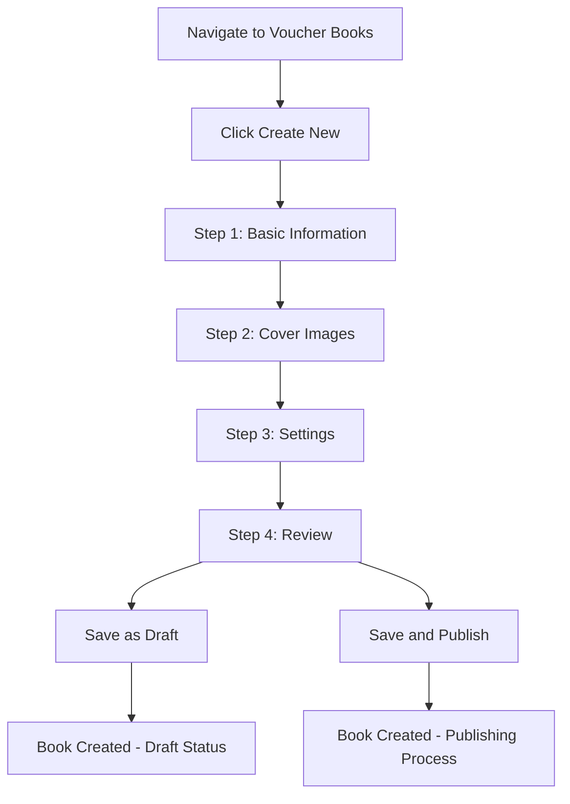
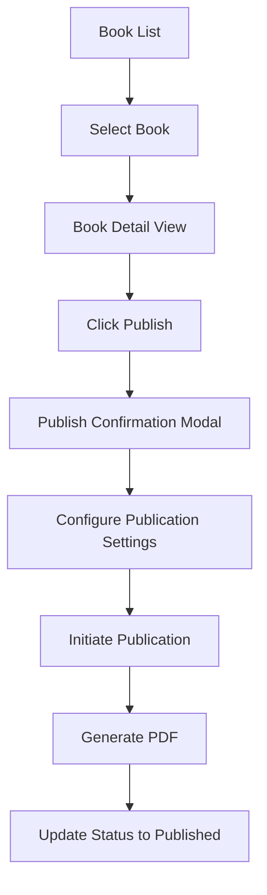
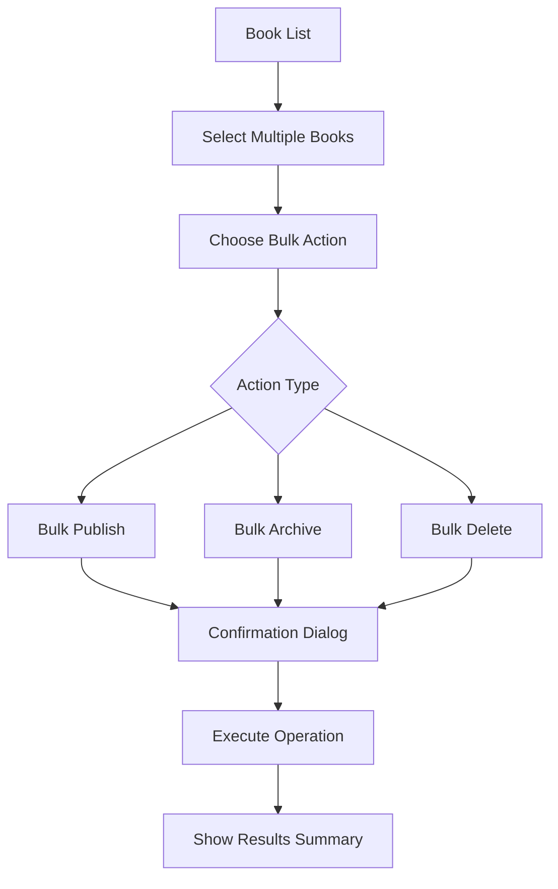

# VoucherBook Frontend Implementation Plan

## Executive Summary

This document provides a comprehensive implementation plan for the VoucherBook frontend section in the dashboard, based on analysis of the business requirements, existing API schemas, and current frontend architecture patterns.

## Table of Contents

- [Architecture Overview](#architecture-overview)
- [Feature Breakdown](#feature-breakdown)
- [Implementation Strategy](#implementation-strategy)
- [Component Design](#component-design)
- [State Management](#state-management)
- [API Integration](#api-integration)
- [User Experience Flow](#user-experience-flow)
- [Implementation Timeline](#implementation-timeline)
- [Technical Specifications](#technical-specifications)

## Architecture Overview

### Current Frontend Stack Analysis

**Framework & Architecture:**
- Next.js 15 with App Router
- React 19 with TypeScript
- Ant Design components with custom theming
- Tailwind CSS for styling
- React Query for API state management
- Internationalization with next-intl

**Existing Patterns:**
- Server-side authentication with `requireAdmin()`
- Modular component architecture in `/components/features/`
- Centralized API integration with Orval code generation
- Responsive layout patterns
- Role-based sidebar navigation

### VoucherBook Integration Strategy

The VoucherBook section will integrate seamlessly into the existing admin dashboard following established patterns:

1. **Navigation Integration**: Add to admin sidebar navigation
2. **Page Structure**: Follow existing dashboard page layout patterns
3. **Component Architecture**: Use established feature component patterns
4. **API Integration**: Leverage existing Orval-generated schemas
5. **Styling**: Follow existing Ant Design + Tailwind patterns

## Feature Breakdown

### Core Features Analysis from Business Requirements

Based on the stakeholder overview, the VoucherBook system requires these key frontend capabilities:

#### 1. Book Management (CRUD Operations)
- Create new voucher books with metadata
- Edit book details (title, edition, type, year, month)
- Update book status (draft → ready → published → archived)
- Delete/archive books with confirmation

#### 2. Book Generation & Publishing
- PDF generation workflow with progress tracking
- Bulk PDF operations
- Publication scheduling
- Status management through book lifecycle

#### 3. Content Management
- Page layout management
- Ad placement coordination
- Preview functionality
- Content validation

#### 4. Distribution Management
- Print distribution tracking
- Partner coordination
- Geographic distribution planning

#### 5. Analytics & Reporting
- Book performance metrics
- Distribution analytics
- Revenue tracking per book
- User engagement statistics

## Implementation Strategy

### Phase 1: Foundation (Week 1-2)
**Core Infrastructure**

1. **Navigation & Routing**
   ```typescript
   // Add to adminSidebar.tsx
   {
     label: t('voucherBooks'),
     href: `/${locale}/admin/voucher-books`,
     icon: 'BookOpen',
   }
   ```

2. **Base Page Structure**
   - Main listing page: `/admin/voucher-books`
   - Detail/edit page: `/admin/voucher-books/[id]`
   - Create page: `/admin/voucher-books/create`

3. **API Integration Setup**
   - Implement hooks using existing Orval-generated schemas
   - Set up React Query queries and mutations

### Phase 2: Core CRUD (Week 3-4)
**Essential Management Features**

1. **Book Listing Page**
   - Paginated table with filtering
   - Status indicators
   - Bulk operations
   - Search functionality

2. **Book Creation Form**
   - Multi-step wizard
   - Validation using backend schemas
   - Image upload for covers
   - Metadata management

3. **Book Detail/Edit**
   - Comprehensive book information
   - Status management
   - Edit capabilities
   - Preview functionality

### Phase 3: Advanced Features (Week 5-6)
**Publishing & Distribution**

1. **PDF Generation Interface**
   - Progress tracking
   - Queue management
   - Download functionality
   - Generation history

2. **Publishing Workflow**
   - Status transitions
   - Scheduling functionality
   - Approval processes
   - Publication confirmation

### Phase 4: Analytics & Optimization (Week 7-8)
**Insights & Performance**

1. **Analytics Dashboard**
   - Book performance metrics
   - Distribution statistics
   - Revenue analytics
   - Engagement tracking

2. **Advanced Management**
   - Bulk operations
   - Advanced filtering
   - Export functionality
   - Reporting tools

## Component Design

### Component Architecture

Following the established pattern from existing features:

```
components/features/voucherBook/
├── VoucherBookList.tsx              # Main listing component
├── VoucherBookCard.tsx              # Individual book card
├── VoucherBookCreateForm.tsx        # Creation wizard
├── VoucherBookEditForm.tsx          # Edit functionality
├── VoucherBookDetail.tsx            # Detailed view
├── VoucherBookStatusBadge.tsx       # Status indicator
├── VoucherBookMetrics.tsx           # Performance metrics
├── VoucherBookPublishModal.tsx      # Publication modal
├── VoucherBookPreview.tsx           # Book preview
└── VoucherBookBulkActions.tsx       # Bulk operation tools
```

### Key Components Specification

#### 1. VoucherBookList Component

```typescript
interface VoucherBookListProps {
  locale: Locale
  initialFilters?: VoucherBookFilters
}

export function VoucherBookList({ locale, initialFilters }: VoucherBookListProps) {
  // Features:
  // - Paginated data table
  // - Advanced filtering (status, type, year, month)
  // - Bulk selection and operations
  // - Quick actions (publish, archive, duplicate)
  // - Search functionality
  // - Export capabilities
}
```

#### 2. VoucherBookCreateForm Component

```typescript
interface VoucherBookCreateFormProps {
  locale: Locale
  onSuccess: (book: VoucherBook) => void
  onCancel: () => void
}

export function VoucherBookCreateForm({ locale, onSuccess, onCancel }: VoucherBookCreateFormProps) {
  // Features:
  // - Multi-step wizard (Basic Info → Cover Images → Settings → Review)
  // - Real-time validation using backend schemas
  // - Image upload with preview
  // - Template selection
  // - Draft saving capability
}
```

#### 3. VoucherBookDetail Component

```typescript
interface VoucherBookDetailProps {
  bookId: string
  locale: Locale
  readOnly?: boolean
}

export function VoucherBookDetail({ bookId, locale, readOnly }: VoucherBookDetailProps) {
  // Features:
  // - Comprehensive book information display
  // - Status management interface
  // - PDF generation controls
  // - Preview functionality
  // - Edit mode toggle
  // - Activity history
  // - Distribution tracking
}
```

## State Management

### React Query Integration

Following the existing pattern with custom hooks:

```typescript
// hooks/api/voucherBook/index.ts
export const useVoucherBooks = (params: VoucherBookQueryParams) => {
  return useApiQuery({
    endpoint: 'getAdminVoucherBookList',
    params,
    select: (data) => ({
      books: data.data,
      pagination: data.pagination,
    }),
  })
}

export const useVoucherBook = (id: string) => {
  return useApiQuery({
    endpoint: 'getAdminVoucherBookById',
    params: { id },
    enabled: !!id,
  })
}

export const useCreateVoucherBook = () => {
  return useApiMutation({
    endpoint: 'createAdminVoucherBook',
    onSuccess: (data) => {
      // Invalidate related queries
      queryClient.invalidateQueries(['voucherBooks'])
    },
  })
}

export const useUpdateVoucherBook = () => {
  return useApiMutation({
    endpoint: 'updateAdminVoucherBook',
    onSuccess: (data) => {
      // Update cache and invalidate related queries
    },
  })
}

export const usePublishVoucherBook = () => {
  return useApiMutation({
    endpoint: 'publishVoucherBook',
    onSuccess: (data) => {
      // Handle publication success
    },
  })
}

export const useGeneratePDF = () => {
  return useApiMutation({
    endpoint: 'generateVoucherBookPDF',
    onSuccess: (data) => {
      // Handle PDF generation start
    },
  })
}
```

### Local State Management

For complex forms and UI state:

```typescript
// Store for multi-step form
interface VoucherBookFormStore {
  currentStep: number
  formData: Partial<CreateVoucherBookRequest>
  validatedSteps: Set<number>
  coverImage?: File
  backImage?: File
}

// Store for list filters and selection
interface VoucherBookListStore {
  filters: VoucherBookQueryParams
  selectedBooks: string[]
  bulkOperation?: BulkOperationType
  viewMode: 'table' | 'grid'
}
```

## API Integration

### Schema Utilization

Using the analyzed API schemas:

#### Public API Schemas
- `VoucherBookResponse`: For public book data
- `VoucherBookQueryParams`: For filtering and search
- `VoucherBookListResponse`: For paginated results

#### Admin API Schemas
- `AdminVoucherBookResponse`: For full admin data
- `AdminCreateVoucherBookRequest`: For book creation
- `AdminUpdateVoucherBookRequest`: For book updates
- `AdminPublishVoucherBookRequest`: For publishing
- `AdminGeneratePdfRequest`: For PDF generation
- `AdminBulkVoucherBookOperationRequest`: For bulk operations

#### Internal API Schemas
- `InternalVoucherBookResponse`: For service communication
- `InternalGeneratePdfJobRequest`: For PDF jobs
- `InternalBookWithRelationsResponse`: For complete book data

### API Endpoints Integration

```typescript
// API Hooks implementation
const api = {
  // Book CRUD
  getBooks: (params: AdminVoucherBookQueryParams) => 
    GET('/admin/voucher-books', { params }),
  
  getBook: (id: string) => 
    GET('/admin/voucher-books/{id}', { params: { id } }),
  
  createBook: (data: AdminCreateVoucherBookRequest) => 
    POST('/admin/voucher-books', { data }),
  
  updateBook: (id: string, data: AdminUpdateVoucherBookRequest) => 
    PUT('/admin/voucher-books/{id}', { params: { id }, data }),
  
  deleteBook: (id: string) => 
    DELETE('/admin/voucher-books/{id}', { params: { id } }),

  // Status Management
  publishBook: (id: string, data: AdminPublishVoucherBookRequest) => 
    POST('/admin/voucher-books/{id}/publish', { params: { id }, data }),
  
  archiveBook: (id: string, data: AdminArchiveVoucherBookRequest) => 
    POST('/admin/voucher-books/{id}/archive', { params: { id }, data }),

  // PDF Operations
  generatePDF: (id: string, data: AdminGeneratePdfRequest) => 
    POST('/admin/voucher-books/{id}/generate-pdf', { params: { id }, data }),
  
  getPDFStatus: (id: string, jobId: string) => 
    GET('/admin/voucher-books/{id}/pdf-status/{jobId}', { params: { id, jobId } }),

  // Bulk Operations
  bulkOperation: (data: AdminBulkVoucherBookOperationRequest) => 
    POST('/admin/voucher-books/bulk', { data }),

  // Statistics
  getStats: (params: VoucherBookStatsQueryParams) => 
    GET('/admin/voucher-books/stats', { params }),
}
```

## User Experience Flow

### Primary User Journeys

#### 1. Create New Voucher Book


#### 2. Publish Existing Book


#### 3. Bulk Operations


### Interface Design Patterns

#### Dashboard Integration
- **Metrics Cards**: Show key VoucherBook statistics on main dashboard
- **Recent Activity**: Include VoucherBook events in activity feed
- **Quick Actions**: Provide shortcuts for common operations

#### List View Features
- **Filterable Columns**: Status, Type, Year, Month, Created By
- **Sortable Headers**: All major columns
- **Search Bar**: Full-text search across title and edition
- **View Toggle**: Table view vs. Grid view
- **Bulk Selection**: Checkbox selection with bulk action bar

#### Form Design
- **Progressive Disclosure**: Multi-step forms for complex operations
- **Real-time Validation**: Immediate feedback using backend schemas
- **Auto-save**: Draft functionality for incomplete forms
- **Image Preview**: Live preview of cover and back images
- **Template Gallery**: Pre-designed book templates

## Implementation Timeline

### Week 1-2: Foundation & Setup
**Day 1-3: Infrastructure**
- [ ] Add VoucherBook navigation to admin sidebar
- [ ] Create base route structure
- [ ] Set up API integration hooks
- [ ] Create base components shell

**Day 4-7: Basic List View**
- [ ] Implement VoucherBookList component
- [ ] Add filtering and search functionality
- [ ] Implement pagination
- [ ] Add basic CRUD operations

**Day 8-14: Form Foundation**
- [ ] Create VoucherBookCreateForm scaffold
- [ ] Implement form validation using backend schemas
- [ ] Add image upload functionality
- [ ] Create form step navigation

### Week 3-4: Core CRUD Operations
**Day 15-21: Creation & Editing**
- [ ] Complete multi-step creation wizard
- [ ] Implement VoucherBookEditForm
- [ ] Add preview functionality
- [ ] Implement draft saving

**Day 22-28: Detail View & Management**
- [ ] Complete VoucherBookDetail component
- [ ] Add status management interface
- [ ] Implement delete/archive functionality
- [ ] Add activity history

### Week 5-6: Advanced Features
**Day 29-35: Publication Workflow**
- [ ] Implement publication modal
- [ ] Add PDF generation interface
- [ ] Create progress tracking
- [ ] Add scheduling functionality

**Day 36-42: Bulk Operations**
- [ ] Implement bulk selection
- [ ] Add bulk action bar
- [ ] Create bulk operation modals
- [ ] Add operation result feedback

### Week 7-8: Analytics & Polish
**Day 43-49: Analytics Dashboard**
- [ ] Create VoucherBookMetrics component
- [ ] Implement statistics visualization
- [ ] Add performance tracking
- [ ] Create export functionality

**Day 50-56: Final Polish**
- [ ] Responsive design optimization
- [ ] Accessibility improvements
- [ ] Performance optimization
- [ ] Testing and bug fixes

## Technical Specifications

### Performance Requirements

#### Loading Performance
- **Initial Page Load**: < 2 seconds
- **List Rendering**: < 500ms for 50 items
- **Form Validation**: < 100ms response time
- **Image Upload**: Progress indication, < 30s timeout
- **PDF Generation**: Real-time progress updates

#### Memory Usage
- **Component Memory**: Efficient cleanup on unmount
- **Image Caching**: Smart caching for cover images
- **Query Optimization**: Proper query invalidation
- **Bulk Operations**: Chunked processing for large datasets

### Accessibility Requirements

#### WCAG 2.1 AA Compliance
- **Keyboard Navigation**: Full keyboard accessibility
- **Screen Reader Support**: Proper ARIA labels
- **Color Contrast**: Minimum 4.5:1 ratio
- **Focus Management**: Logical focus order
- **Alternative Text**: All images properly labeled

#### International Support
- **Multi-language**: Spanish, English, Guaraní, Portuguese
- **RTL Support**: Right-to-left language support
- **Cultural Adaptation**: Date formats, number formatting
- **Currency Display**: Multiple currency support

### Security Considerations

#### Frontend Security
- **Input Sanitization**: All user inputs properly sanitized
- **File Upload Security**: File type and size validation
- **XSS Prevention**: Proper output encoding
- **CSRF Protection**: CSRF tokens for state-changing operations

#### Data Protection
- **Sensitive Data**: No sensitive data in client-side storage
- **Image Handling**: Secure image upload and processing
- **Session Management**: Proper session handling
- **Error Messages**: No sensitive information disclosure

### Browser Compatibility

#### Supported Browsers
- **Chrome**: Latest 2 versions
- **Firefox**: Latest 2 versions
- **Safari**: Latest 2 versions
- **Edge**: Latest 2 versions

#### Mobile Support
- **Responsive Design**: Full mobile optimization
- **Touch Interactions**: Touch-friendly interface
- **Mobile Performance**: Optimized for mobile networks
- **Progressive Enhancement**: Core functionality without JavaScript

### Testing Strategy

#### Unit Testing
- **Component Testing**: Each component with Jest/React Testing Library
- **Hook Testing**: Custom hooks with proper mocking
- **Utility Testing**: Helper functions and utilities
- **Integration Testing**: API integration endpoints

#### End-to-End Testing
- **User Journeys**: Complete user workflows
- **Cross-browser Testing**: All supported browsers
- **Mobile Testing**: Responsive design validation
- **Performance Testing**: Load testing for bulk operations

### Monitoring & Analytics

#### Performance Monitoring
- **Core Web Vitals**: LCP, FID, CLS tracking
- **Custom Metrics**: VoucherBook-specific metrics
- **Error Tracking**: Comprehensive error monitoring
- **User Analytics**: Usage patterns and behavior

#### Business Metrics
- **Feature Usage**: Track feature adoption
- **Conversion Rates**: Creation to publication rates
- **User Engagement**: Time spent in VoucherBook section
- **Error Rates**: Track and reduce error occurrences

## Integration Points

### Backend Integration
- **API Compatibility**: Full compatibility with existing API schemas
- **Real-time Updates**: WebSocket integration for live updates
- **File Handling**: Integration with file upload service
- **Authentication**: Seamless integration with existing auth system

### Third-party Services
- **Image Processing**: Integration with image optimization service
- **PDF Generation**: Connection to PDF generation service
- **Analytics**: Integration with analytics platform
- **Monitoring**: Connection to monitoring services

## Risk Mitigation

### Technical Risks
- **API Changes**: Maintain flexibility for schema evolution
- **Performance Issues**: Implement progressive loading
- **Browser Compatibility**: Comprehensive testing strategy
- **Third-party Failures**: Graceful degradation and fallbacks

### Business Risks
- **User Adoption**: Intuitive design and comprehensive onboarding
- **Feature Complexity**: Progressive feature rollout
- **Data Loss**: Comprehensive backup and recovery procedures
- **Security Vulnerabilities**: Regular security audits and updates

## Success Metrics

### Technical Success Metrics
- **Page Load Speed**: < 2 seconds consistently
- **Error Rate**: < 1% application errors
- **Test Coverage**: > 85% code coverage
- **Performance Score**: > 90 Lighthouse score

### Business Success Metrics
- **User Adoption**: 80% of admin users engage with VoucherBook feature
- **Task Completion**: 95% successful completion of core workflows
- **User Satisfaction**: > 4.5/5 rating in user surveys
- **Feature Usage**: Regular usage of advanced features like bulk operations

### Operational Success Metrics
- **System Uptime**: > 99.5% availability
- **Support Tickets**: < 5% VoucherBook-related issues
- **Performance Stability**: Consistent performance under load
- **Security Incidents**: Zero security incidents

## Conclusion

This implementation plan provides a comprehensive roadmap for developing the VoucherBook frontend section. The plan follows established architectural patterns, leverages existing API schemas, and ensures seamless integration with the current dashboard system.

Key success factors:
1. **Adherence to existing patterns** ensures consistency and maintainability
2. **Proper API integration** using established schemas prevents integration issues
3. **Progressive implementation** allows for iterative development and testing
4. **Comprehensive testing strategy** ensures reliability and quality
5. **Performance considerations** maintain system responsiveness
6. **User-centered design** ensures adoption and satisfaction

The phased approach allows for continuous validation and adjustment, while the detailed technical specifications ensure all requirements are met. This plan positions the VoucherBook feature to become a central, valuable component of the VoucherBook platform's success in the Latin American market.